# OPERATOR_AUTHORITY_CALLGRAPH

- **Dispatch ID**: `WE-A-ENGINE-GATE05-R16-OPERATOR-NATIVE-PREP-20261010-DIRECT-7972af00`
- **Work Package**: `WP_ENGINE_GATE05_R16_OPERATOR_NATIVE_PREPARATION`
- **Revision**: `GATE05-R16-OPERATOR-NATIVE-PREPARATION` (Envelope 19)
- **Status**: Pure Read-Only Static Analysis / Preparation Only (Candidate Modification, Build, Runtime Execution = 0)
- **Controlling Lineage**: R15 Selected Debug Candidate (`835E8121...`, MVID `4fb1a25f-72c8-426d-b93f-d6cba4f9af72`), 9 Fixed Current Engine Paths

---

## 1. Executive Summary & Architectural Scope

This document establishes the source-anchored callgraph and authority model for the operator-owned normal lifecycle of Gate05 semantic validation in WarEconomy. It maps the transition from simulation proposal execution to immutable result sealing, task issuance, process isolation, out-of-band result consumption, receipt internalization, and promotion gating.

Per Master Decisions MD125 through MD132, canonical Domain Authority resides exclusively with the Dedicated Server; the local RimWorld engine acts as a bounded simulation worker producing proposals. Within this boundary, validation of staged proposals must be strictly operator-owned and fresh-process isolated, preventing caller self-validation, parameter forgery, or unadmitted content promotion.

---

## 2. Source-Anchored Normal Lifecycle Callgraph

All line numbers are anchored directly to [WorkerBridge.cs](file:///C:/Users/user/Desktop/RimMulti/scratch/WorkerBridgeMod/Source/WorkerBridge.cs) (3,288 lines, SHA256 `BA28C2234B2F77C6E50558825B3C9FB9D54DA7B7853D06D8DF4740366A59C718`) and [EngineHostCensus.cs](file:///C:/Users/user/Desktop/RimMulti/scratch/WorkerBridgeMod/Source/EngineHostCensus.cs) (3,695 lines, SHA256 `391F9645A519CA86B69856B09A564F16B1DCEB5E9E6E92126827E18A069A2EB1`).

```mermaid
flowchart TD
    subgraph ControlPlane [1. Operator Control Plane]
        A1[REGISTER_AUTHORITY\nL1072-L1215] --> A2[REGISTER_GRANT\nL1222-L1310]
        A2 --> A3[SET_TARGET_MAP\nL793, L1470-L1510]
        A3 --> A4[START_SIMULATION / STEP_TICKS\nL796, L804, L1515-L1705]
    end

    subgraph WorkerSealing [2. Worker Execution & Proposal Sealing]
        A4 --> B1[SEAL_RESULT\nL816, L1708-L1823]
        B1 --> B2[STAGE_SAVE\nL822, L1833-L2013]
        B2 -->|ValidateStagedXml L1933\nCompute stagedSha L1944| B3[Generate ValidatorTask\n& Channel Secrets L1951-L2005]
    end

    subgraph ProcessIsolation [3. Operator Process Launch & Binding]
        B3 --> C1[LAUNCH_OPERATOR_VALIDATOR\nL828, L2059-L2210]
        C1 -->|Nonce check L2087\nAdmitted exe check L2128-L2142\nProcess.Start L2158| C2[Fresh Independent Process\nPID != Simulator PID L2166]
        C2 --> C3[BindOperatorLaunchedProcess\nL2214-L2265]
    end

    subgraph ValidatorExecution [4. Read-Only Fresh Validator Execution]
        C3 --> D1[EXECUTE_VALIDATOR_TASK\nL834, L2267-L2428]
        D1 -->|Staged SHA check L2314\nProgramState.Playing L2327\nValidateStagedXml L2343\nLive Census L2354| D2[Construct ValidatorResult\nL2387-L2414]
        D2 -->|Write to Protected Channel\nL2417-L2421| D3[ValidatorResult Channel File]
    end

    subgraph ResultConsumption [5. Result Consumption & Receipt Internalization]
        D3 --> E1[COMPLETE_STAGE_VALIDATION\nL837, L2430-L2735]
        E1 -->|Reject caller payload L2446-L2459\nRead channel L2470-L2480\nToken & Nonce check L2495-L2508\nPID & StartTime check L2512-L2526\nMD128 16 Dimensions L2550-L2661| E2[Atomic Channel Consume\nFile.Move .consumed L2671-L2674]
        E2 --> E3[Materialize StageValidationReceipt\nL2688-L2714\ncurrentStageValidationReceipt L2730\nState = STAGED_VALIDATED L2731]
    end

    subgraph PromotionBoundary [6. Promotion Boundary Gate]
        E3 --> F1[PROMOTE_STAGED\nL849, L2763-L2980]
        F1 -->|Receipt active L2770\nGen & Epoch match L2815-L2823\nSealedResultId match L2830\nSame-volume rename L2950-L2970| F2[ARTIFACT_APPROVED\nFinal Save Promoted L2972-L2974]
    end

    subgraph LifecycleReset [7. Invalidation & State Reset]
        G1[RESET_WORKER / RevokeReadiness\nL397-L420, L1315-L1440] -.->|Nullify receipt & task\nGen+1, Invalidate cache| ControlPlane
    end
```

---

## 3. Step-by-Step Operator Authority Callgraph Details

### Stage 1: Authority & Grant Registration (Operator Control Plane)
- **`HandleRegisterAuthority(string arg)`** ([WorkerBridge.cs:L1072-L1215](file:///C:/Users/user/Desktop/RimMulti/scratch/WorkerBridgeMod/Source/WorkerBridge.cs#L1072-L1215)):
  - Parses incoming JSON into `AuthorityBundle` ([EngineHostCensus.cs:L17-L30](file:///C:/Users/user/Desktop/RimMulti/scratch/WorkerBridgeMod/Source/EngineHostCensus.cs#L17-L30)).
  - Enforces `allowedOperationMode == "SIMULATION"` (lines 1102-1108).
  - Enforces fail-closed target map boundary (`targetMapId >= 0`, line 1118).
  - Verifies `expectedSourceArtifactHash` is non-empty 64-hex SHA256 (lines 1125-1135).
  - Enforces `workerGeneration` monotonicity against `currentGeneration` (lines 1140-1155).
  - Stores authority in `registeredAuthority` (line 1205).
- **`HandleRegisterGrant(string arg)`** ([WorkerBridge.cs:L1222-L1310](file:///C:/Users/user/Desktop/RimMulti/scratch/WorkerBridgeMod/Source/WorkerBridge.cs#L1222-L1310)):
  - Parses JSON into `SimulationGrant` ([EngineHostCensus.cs:L32-L42](file:///C:/Users/user/Desktop/RimMulti/scratch/WorkerBridgeMod/Source/EngineHostCensus.cs#L32-L42)).
  - Checks active authority exists (lines 1230-1236).
  - Enforces authority linkage: `grant.authorityId == registeredAuthority.authorityId` (lines 1240-1246).
  - Enforces `grant.workerGeneration == currentGeneration` (lines 1250-1256).
  - Enforces `grant.allowedMode == "SIMULATION"` (lines 1260-1266).
  - Stores grant in `activeGrant` (line 1290).

### Stage 2: Stepping & Result Sealing (Worker Simulation)
- **`HandleSealResult(string arg)`** ([WorkerBridge.cs:L1708-L1823](file:///C:/Users/user/Desktop/RimMulti/scratch/WorkerBridgeMod/Source/WorkerBridge.cs#L1708-L1823)):
  - Requires `semanticState == SemanticApprovalState.INPUT_VALIDATED` (lines 1715-1721).
  - Requires active game in playing state (`Current.Game != null`, `ProgramState.Playing`, lines 1725-1732).
  - Executes live census via `EngineHostCensus.GenerateCensus(map)` (line 1748).
  - Calculates `sealedManifestHash` (line 1750).
  - Generates immutable `sealedResultId = $"SR_{DateTime.UtcNow:yyyyMMdd_HHmmss}_{Guid.NewGuid():N}"` (line 1755).
  - Constructs `ResultManifest` ([EngineHostCensus.cs:L132-L149](file:///C:/Users/user/Desktop/RimMulti/scratch/WorkerBridgeMod/Source/EngineHostCensus.cs#L132-L149)) containing all 16 bound dimensions.
  - Stores immutable record in `sealedResult` (line 1785), nullifies any prior `currentStageValidationReceipt` (line 1786), and advances state to `RESULT_SEALED` (line 1817).

### Stage 3: Proposal Staging & Task Issuance (Worker -> Operator Task)
- **`HandleStageSave(string arg)`** ([WorkerBridge.cs:L1833-L2013](file:///C:/Users/user/Desktop/RimMulti/scratch/WorkerBridgeMod/Source/WorkerBridge.cs#L1833-L2013)):
  - Requires `sealedResult != null` and `semanticState == SemanticApprovalState.RESULT_SEALED` (lines 1840-1848).
  - Stages save to isolated file path under `SafeSaveDataFolderPath/Staging/` (lines 1875-1885).
  - Validates staged XML format and EOF via `EngineHostCensus.ValidateStagedXml` (lines 1933-1938).
  - Computes exact disk `stagedSha` (lines 1941-1945).
  - Generates cryptographically secure 32-byte nonces: `capabilityNonce` and `channelSecretToken` via `RandomNumberGenerator` (lines 1954-1963).
  - Materializes `ValidatorTask` ([EngineHostCensus.cs:L72-L101](file:///C:/Users/user/Desktop/RimMulti/scratch/WorkerBridgeMod/Source/EngineHostCensus.cs#L72-L101)) at `SafeSaveDataFolderPath/Tasks/{validatorTaskId}.task.json` (lines 1970-2001).
  - Configures dedicated out-of-band result channel: `{validatorTaskId}.protected_result.json` (line 1971).
  - Sets `currentValidatorTask = task`, advances state to `STAGED_PENDING_VALIDATION` (lines 2003-2008).

### Stage 4: Operator Process Launch & Binding (Process Isolation)
- **`HandleLaunchOperatorValidator(string arg)`** ([WorkerBridge.cs:L2059-L2210](file:///C:/Users/user/Desktop/RimMulti/scratch/WorkerBridgeMod/Source/WorkerBridge.cs#L2059-L2210)):
  - Verifies `currentValidatorTask != null` and `!currentValidatorTask.isConsumed` (lines 2063-2073).
  - Verifies provided capability nonce matches `currentValidatorTask.capabilityNonce` (lines 2087-2091).
  - **Rejection of Caller-Nominated Executable**: Enforces `AdmittedOperatorValidatorExecutable` (lines 2128-2142). If caller supplies a path differing from operator-admitted executable, execution is rejected with `RevokeReadiness` (lines 2138-2142).
  - Launches fresh child process via `Process.Start(psi)` (line 2158).
  - **Self-Validation Rejection**: Checks `proc.Id != myPid` (lines 2166-2170).
  - Records exact UTC start time `proc.StartTime.ToUniversalTime()` (lines 2172-2182).
- **`BindOperatorLaunchedProcess(WorkerBridgeComponent comp, Process proc, string capabilityNonce)`** ([WorkerBridge.cs:L2214-L2265](file:///C:/Users/user/Desktop/RimMulti/scratch/WorkerBridgeMod/Source/WorkerBridge.cs#L2214-L2265)):
  - Static operator helper binding launched process instance to component fields: `operatorLaunchedValidatorProcess`, `operatorLaunchedValidatorPid`, `operatorLaunchedValidatorStartTimeUtc`, `operatorLaunchedValidatorExecutable`.

### Stage 5: Fresh Validator Task Execution (Read-Only Isolated Process)
- **`HandleExecuteValidatorTask(string arg)`** ([WorkerBridge.cs:L2267-L2428](file:///C:/Users/user/Desktop/RimMulti/scratch/WorkerBridgeMod/Source/WorkerBridge.cs#L2267-L2428)):
  - Executed inside the fresh child validator process.
  - Verifies `task.capabilityNonce == capabilityNonce` (lines 2291-2294).
  - Verifies `task.contentProfileFingerprint == GetActualContentProfileFingerprint()` (lines 2296-2300).
  - Verifies disk `stagedSha == task.stagedSha` (lines 2307-2317).
  - Prohibits target clamping: `task.targetMapIndex < 0` rejected fail-closed (lines 2320-2323).
  - Verifies staged save is loaded in validator engine (`Current.Game != null`, `activeSaveName == stagingSaveName`, lines 2326-2330).
  - Validates staged XML format via `EngineHostCensus.ValidateStagedXml` (lines 2343-2346).
  - Generates independent live census from loaded map: `liveCensus = EngineHostCensus.GenerateCensus(map)` (lines 2352-2355).
  - Verifies `liveCensus.ComputeManifestHash() == task.sealedManifestHash` (lines 2357-2360).
  - Captures validator process PID, StartTime UTC, and executable path (lines 2362-2385).
  - Constructs `ValidatorResult` ([EngineHostCensus.cs:L103-L130](file:///C:/Users/user/Desktop/RimMulti/scratch/WorkerBridgeMod/Source/EngineHostCensus.cs#L103-L130)) with `validatorResult = "PASS"` (lines 2387-2414).
  - **Protected Channel Write**: Writes result exclusively to `task.resultChannelPath` (lines 2417-2420).

### Stage 6: Result Consumption & Receipt Internalization (Operator Channel Intake)
- **`HandleCompleteStageValidation(string arg)`** ([WorkerBridge.cs:L2430-L2735](file:///C:/Users/user/Desktop/RimMulti/scratch/WorkerBridgeMod/Source/WorkerBridge.cs#L2430-L2735)):
  - **Rejection of Caller-Supplied Payload**: Rejects any caller-provided JSON payload under MD-127 (lines 2446-2459). Result must come exclusively from operator channel.
  - Verifies registered child PID exists (lines 2462-2467).
  - Reads exclusively from `currentValidatorTask.resultChannelPath` (lines 2470-2486).
  - **1. Channel Secret Token check**: `res.channelSecretToken == currentValidatorTask.channelSecretToken` (lines 2495-2502).
  - **2. Capability Nonce check**: `res.capabilityNonce == currentValidatorTask.capabilityNonce` (lines 2505-2509).
  - **3. PID check**: `res.validatorProcessId == expectedPid` (lines 2512-2516).
  - **4. Process StartTime check**: `res.validatorProcessStartTimeUtc == expectedStartTime` (lines 2519-2526).
  - **5. Self-validation check**: `res.validatorProcessId != myPid` (lines 2529-2534).
  - **6. Verdict check**: `res.validatorResult == "PASS"` (lines 2537-2541).
  - **7. MD-128 16 Dimensions Closed-Context Check**: (lines 2550-2661). Complete equality check across all 16 authority dimensions.
  - **Atomic Consumption**: Marks `currentValidatorTask.isConsumed = true` (line 2664) and atomically moves result file: `File.Move(resultFile, resultFile + ".consumed")` (lines 2668-2685).
  - **Materializes StageValidationReceipt**: Constructs `StageValidationReceipt` ([EngineHostCensus.cs:L44-L70](file:///C:/Users/user/Desktop/RimMulti/scratch/WorkerBridgeMod/Source/EngineHostCensus.cs#L44-L70)) containing full provenance and verified metadata (lines 2688-2714).
  - Clears operator process tracking state for next cycle (lines 2717-2729).
  - Stores receipt internally in `currentStageValidationReceipt` (line 2730).
  - Advances state to `STAGED_VALIDATED` (line 2731).

### Stage 7: Promotion Boundary (Atomic Replacement & Approval)
- **`HandlePromoteStaged(string arg)`** ([WorkerBridge.cs:L2763-L2980](file:///C:/Users/user/Desktop/RimMulti/scratch/WorkerBridgeMod/Source/WorkerBridge.cs#L2763-L2980)):
  - Enforces `currentStageValidationReceipt != null` and `semanticState == SemanticApprovalState.STAGED_VALIDATED` (lines 2770-2774).
  - Validates active authority and grant match receipt (lines 2785-2810).
  - Validates `receipt.workerGeneration == currentGeneration` (lines 2815-2819).
  - Validates `receipt.resultEpoch == currentResultEpoch` (lines 2822-2826).
  - Validates `receipt.sealedResultId == sealedResult.sealedResultId` (lines 2829-2833).
  - Validates staged file still exists and matches `receipt.stagedSha` (lines 2836-2850).
  - Validates live census matches `receipt.sealedManifestHash` (lines 2855-2870).
  - Promotes staged save to final destination via same-volume atomic rename (lines 2950-2970).

---

## 4. Prohibition of Public Caller Nomination & Diagnostic Bounds

Per MD126 and MD127, the following caller nomination paths are strictly prohibited by source construction:

1. **Caller Cannot Nominate Expected Hash or Manifest**:
   - `HandleCompleteStageValidation` accepts only an optional `validatorTaskId` string argument. Any argument starting with `{` is rejected with `RevokeReadiness("Caller-supplied validation result payload is prohibited (MD-127)")` ([WorkerBridge.cs:L2446-L2453](file:///C:/Users/user/Desktop/RimMulti/scratch/WorkerBridgeMod/Source/WorkerBridge.cs#L2446-L2453)).
2. **Caller Cannot Nominate Arbitrary Validator Executable**:
   - `HandleLaunchOperatorValidator` validates the executable against `AdmittedOperatorValidatorExecutable`. If caller attempts to specify an arbitrary binary, execution is rejected ([WorkerBridge.cs:L2138-L2142](file:///C:/Users/user/Desktop/RimMulti/scratch/WorkerBridgeMod/Source/WorkerBridge.cs#L2138-L2142)).
3. **Caller Cannot Inject Arbitrary Validation Receipt**:
   - `HandleSubmitStageValidationReceipt` is restricted to simulator internal materialization. Public caller invocation cannot bypass operator task binding.
4. **PID Inequality is Diagnostic Only**:
   - While `proc.Id != myPid` and `res.validatorProcessId != myPid` are checked ([WorkerBridge.cs:L2166, L2530](file:///C:/Users/user/Desktop/RimMulti/scratch/WorkerBridgeMod/Source/WorkerBridge.cs#L2166)), PID difference alone does not prove process isolation. True isolation requires operator-owned execution, dedicated `UserData/` paths, independent loaded Def database, and verified StartTime UTC matching.

---

## 5. MD129 Role-Aware Failure & State Transition Analysis

Under MD129, failures across distinct architectural planes must have role-aware consequences without blanket revocation of unrelated query planes:

| Failure Plane | Specific Failure Mode | Source Anchor | State Consequence | Re-Admission Path |
|---|---|---|---|---|
| **Authority Plane** | Duplicate authority registration in same generation | `WorkerBridge.cs:L1196` | Registration rejected; current state unchanged | `RESET_WORKER` required to advance generation |
| **Authority Plane** | Mode mismatch (`allowedOperationMode != "SIMULATION"`) | `WorkerBridge.cs:L1104` | Registration rejected fail-closed | Caller must correct authority bundle mode |
| **Grant Plane** | Grant authorityId mismatch against registered authority | `WorkerBridge.cs:L1242` | Grant rejected; authority remains valid | Caller must supply grant bound to active authority |
| **Staging Plane** | Unity save exception or XML validation failure | `WorkerBridge.cs:L1928, L1936` | `RevokeReadiness`, file moved to quarantine | Re-execute simulation step and re-stage save |
| **Launch Plane** | CapabilityNonce mismatch on validator launch | `WorkerBridge.cs:L2089` | `RevokeReadiness("Operator capability nonce verification failed")` | Full task re-issuance under operator authority |
| **Launch Plane** | Process StartTime retrieval failure | `WorkerBridge.cs:L2180` | Child killed if alive; `RevokeReadiness` | Re-attempt operator launch with valid OS permissions |
| **Validation Plane** | Staged file SHA mismatch in child validator | `WorkerBridge.cs:L2316` | Child returns `VALIDATION_FAILED`; no channel write | Staging integrity failure investigation |
| **Validation Plane** | Live census manifest hash mismatch | `WorkerBridge.cs:L2359` | Child returns `VALIDATION_FAILED` | Simulation divergence investigation |
| **Channel Plane** | Channel file missing or forged token | `WorkerBridge.cs:L2473, L2499` | `RevokeReadiness("Forged or unauthorized result origin")` | Clean task reset and operator re-execution |
| **Channel Plane** | Replay of already consumed task | `WorkerBridge.cs:L2442` | `RevokeReadiness("Replay of consumed ValidatorTask detected")` | Replay attack rejected; new task required |
| **Promotion Plane** | Generation / Epoch / SealedResultId mismatch | `WorkerBridge.cs:L2815-L2831` | `RevokeReadiness`; promotion blocked fail-closed | Resync with latest approved receipt and epoch |
| **Query Plane** | Syntax error or invalid query argument on status calls | `WorkerBridge.cs:L750-L875` | Returns error string; authority/receipt NOT revoked | Self-contained query retry; control plane undisturbed |

---

## 6. MD132 V4 Supported Job and Reservation Semantics

Per Master Decision MD132 and `SupportedSemanticManifest_V4_Closed` ([EngineHostCensus.cs:L348](file:///C:/Users/user/Desktop/RimMulti/scratch/WorkerBridgeMod/Source/EngineHostCensus.cs#L348)):

1. **Active Job Record**:
   - Defined in `ActiveJobRecord` ([EngineHostCensus.cs:L184-L191](file:///C:/Users/user/Desktop/RimMulti/scratch/WorkerBridgeMod/Source/EngineHostCensus.cs#L184-L191)):
     - `jobDef`: string defName of `CurJob.def`
     - `loadID`: string representation of `CurJob.loadID`
     - `targetA`, `targetB`, `targetC`: string representations of `LocalTargetInfo`
   - Populated at [EngineHostCensus.cs:L535-L543](file:///C:/Users/user/Desktop/RimMulti/scratch/WorkerBridgeMod/Source/EngineHostCensus.cs#L535-L543).
   - Bounded scope: Captures active job identity and primary targets without attempting to capture arbitrary job driver internal state machines, queue histories, or unverified thought graphs.
2. **Reservation Record**:
   - Defined in `ReservationRecord` ([EngineHostCensus.cs:L283-L291](file:///C:/Users/user/Desktop/RimMulti/scratch/WorkerBridgeMod/Source/EngineHostCensus.cs#L283-L291)):
     - `claimant`: Pawn ThingID holding reservation
     - `job`: string defName of associated job
     - `jobLoadID`: loadID of reserving job
     - `target`: string representation of target
     - `maxPawns`: integer maximum permitted pawns
     - `stackCount`: integer reserved stack count
   - Populated from `map.reservationManager.ReservationsReadOnly` at [EngineHostCensus.cs:L775-L795](file:///C:/Users/user/Desktop/RimMulti/scratch/WorkerBridgeMod/Source/EngineHostCensus.cs#L775-L795).
   - Sorted deterministically by `claimant`, then by `target` (line 793).
   - Bounded scope: Captures exact reservation claims without altering reservation manager internals.
