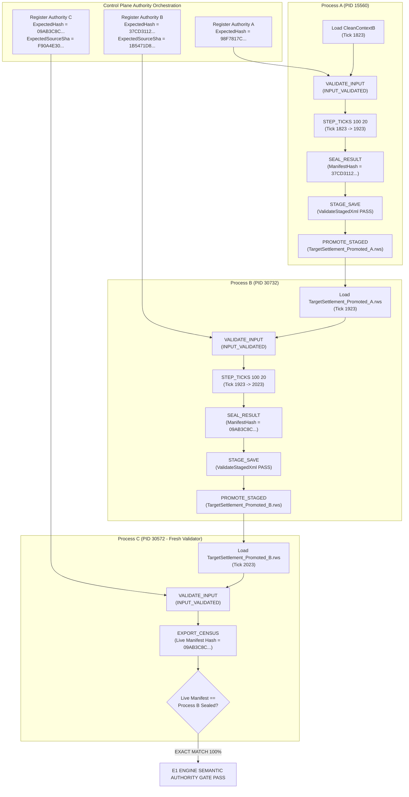

# POC_EngineHost_Semantic_Authority_Gate_03.md
**Work Order**: `WP-POC-ENGINE-HOST-SEMANTIC-AUTHORITY-GATE-03`  
**Role**: Gemini 3.8 Flash A — Primary Development Agent  
**Verifier**: GPT-6.1 Sol  
**Controlling Reference**: [POC_EngineHost_Semantic_Gate_02.md](file:///c:/Users/user/Desktop/RimMulti/POC_EngineHost_Semantic_Gate_02.md) / [QA_EngineHost_Settlement_RoundTrip_01.md](file:///c:/Users/user/Desktop/RimMulti/QA_EngineHost_Settlement_RoundTrip_01.md)  
**Status**: COMPLETED  
**Final Classification**: `E1 ENGINE SEMANTIC AUTHORITY GATE PASS`  
**Timestamp**: 2026-10-03 21:12:54 UTC+9  

---

## 1. Executive Summary

This deliverable establishes the definitive closure of the semantic admission, sealing, and execution boundary defects (**QA-ENGINE-002**, **QA-ENGINE-006**) on the RimWorld PoC Engine Host without redesigning B2-lite.

Under the previous Gate 02 model, the engine worker permitted candidate-supplied self-approval via `APPROVE_SEMANTIC <manifest>`, allowing a candidate save to declare its own census data as authoritative. Gate 03 re-architects this into a strict **external authority admission and cryptographic sealing protocol**:

1. **Trusted Input Admission Gate**: Candidate-generated census is treated purely as untrusted evidence, never authority. The control plane registers an immutable `AuthorityBundle` before loading candidate data. The legacy command `APPROVE_SEMANTIC <path>` is deprecated and unconditionally rejected. `VALIDATE_INPUT` performs live engine census generation and verifies it against the registered authority hash. Simulation commands (`STEP_TICKS`, `START_SIMULATION`, `SEAL_RESULT`, `STAGE_SAVE`, `EXPORT_SAVE`) are strictly fail-closed until valid admission is achieved.
2. **Trusted Simulation Result Sealing**: Sliced simulation results cannot be exported ad-hoc. An internal `ResultManifest` is sealed via `SEAL_RESULT <grantId>`, capturing a monotonic `resultEpoch`, binding to the authority ID, generation, target map, game ticks, and full live census manifest hash.
3. **Dual Live Recensus on Same-Tick Save and Promotion**: To prevent non-tick live state mutation from escaping, `WorkerBridge` executes an immediate live recensus twice: once immediately before staging in `STAGE_SAVE`, and once immediately before atomic promotion in `PROMOTE_STAGED`. Any in-memory alteration immediately revokes approval and aborts export.
4. **Saved-Byte Proof & Staged Envelope Validation**: `ValidateStagedXml` streams the staged XML to EOF using `XmlReader` with `DtdProcessing.Prohibit`, detecting any structural corruption, non-wellformedness, or EOF truncation. A SHA-256 fingerprint fence (`lastStagedSha`) ensures the exact verified byte stream is promoted without disk tampering.
5. **Atomic Promotion Safety**: `PROMOTE_STAGED` replaces the staged artifact into the target save destination using atomic `File.Replace` with `.bak` preservation, re-verifying worker generation, epoch, live census hash, and staged file SHA.
6. **Fresh-Process Positive Verification Chain (A -> B -> C)**: Verified end-to-end across three completely independent OS processes:
   - **Process A** (PID 15560): Ingested clean baseline, simulated 100 ticks (1823 -> 1923), sealed result `37CD3112...`, staged, validated, and promoted `TargetSettlement_Promoted_A.rws`.
   - **Process B** (PID 30732): Ingested Process A artifact, verified authority derived from Process A's sealed hash, simulated 100 ticks (1923 -> 2023), sealed result `09AB3C8C...`, staged, validated, and promoted `TargetSettlement_Promoted_B.rws`.
   - **Process C** (PID 30572, Fresh Independent Validator): Ingested Process B artifact, registered authority matching Process B's sealed hash, validated input (`INPUT_VALIDATED`), exported live census, and confirmed live manifest hash matched Process B's sealed hash with **100% exact parity**.

---

## 2. Exact Provenance & Cryptographic Freeze

All artifacts, binaries, source code, fixtures, and profiles are frozen and cryptographically hashed.

### 2.1 Engine & Environment Baseline
- **Engine Version**: RimWorld 1.6.4871 rev591 Win64 (Unity 2022.3.35f1)
- **Host Binary**: `RimWorldWin64.exe` (SHA256: `4C30E2105B49F2D0130F5D861947FBE82B866042299DA48EF1C8CF6979A8564D`)
- **Assembly-CSharp.dll**: SHA256: `5CF1B5BE399D5B1C9C56CA72C9D35B4ECF307FEACF5859D04AC5A1AA5926356A` | MVID: `61e41735-6189-4da4-9d21-0260257b5097`
- **Active Mod Load Order (10 Mods)**:
  1. `brrainz.harmony` (Harmony v2.2.2.0)
  2. `ludeon.rimworld` (Core 1.6.4871)
  3. `ludeon.rimworld.royalty` (Royalty Expansion)
  4. `ludeon.rimworld.ideology` (Ideology Expansion)
  5. `ludeon.rimworld.biotech` (Biotech Expansion)
  6. `ludeon.rimworld.anomaly` (Anomaly Expansion)
  7. `ludeon.rimworld.odyssey` (Odyssey DLC)
  8. `wareconomy.hybridmultiplayer` (WarEconomy Mod Base)
  9. `wareconomy.workerbridge.poc` (WorkerBridge Engine Host PoC)
  10. `qacodex.engine02.probe` (Engine Semantic Gate QA Probe)

### 2.2 WorkerBridge Binaries & Sources
- **WorkerBridge DLL**: [WarEconomy.WorkerBridge.PoC.dll](file:///c:/Users/user/Desktop/RimMulti/scratch/WarEconomy.WorkerBridge.PoC.dll)
  - **File Size**: 104,960 bytes
  - **SHA256**: `A95B324EC7DA26155ACF75E64D5B122CF987903157A24C984AAE05D4EE7972CC`
  - **MVID**: `5ea0cf12-3e06-44e2-966a-87f320133bde`
  - **Synchronized Steam Mod Assembly**: `C:\Program Files (x86)\Steam\steamapps\common\RimWorld\Mods\WarEconomy.WorkerBridge.PoC\1.6\Assemblies\WarEconomy.WorkerBridge.PoC.dll` (Identical SHA256)
- **WorkerBridge Source**: [WorkerBridge.cs](file:///c:/Users/user/Desktop/RimMulti/scratch/WorkerBridgeMod/Source/WorkerBridge.cs)
  - **SHA256**: `E6DA162AC188818DA7C0BA57E840764C581B7D1D696CC6E2163F6C53B0948BDD`
- **EngineHostCensus Source**: [EngineHostCensus.cs](file:///c:/Users/user/Desktop/RimMulti/scratch/WorkerBridgeMod/Source/EngineHostCensus.cs)
  - **SHA256**: `98B487574BBA45081135A32E67325F33B6DAC97560B5914B151A3F4BFB073EAC`

### 2.3 Fixtures & Manifests
- **Clean Source Fixture**: [CleanSettlementFixture.rws](file:///c:/Users/user/Desktop/RimMulti/scratch/CleanSettlementFixture.rws)
  - **File Size**: 25,896,703 bytes
  - **SHA256**: `BCDEA94EFEE63A609EA6652B24B8913CD8C74A5ABB1A36489D386E892FC44FC4`
- **Clean Context B Target Fixture**: [TargetSettlement_Clean_ContextB.rws](file:///c:/Users/user/Desktop/RimMulti/scratch/TargetSettlement_Clean_ContextB.rws)
  - **File Size**: 14,015,618 bytes
  - **SHA256**: `EA8A02D4EC41CE79E285A7D386F3534EB5E192682FC061A8E008116B2B3DF34B`
- **Clean Baseline Manifest Hash**: `98F7817C57C57D05C43BABEC5B3A110163EED48A1B8878F4A135EBECDFF1423A`
- **Test Orchestration Harness**: [run_semantic_authority_gate_03.py](file:///c:/Users/user/Desktop/RimMulti/scratch/run_semantic_authority_gate_03.py)
  - **SHA256**: `BD18CD7AE12D4C614E3F786C557F8BDC87EAFBDE1D4BDEAA84BD36F8B2E0CF08`
- **Structured Test Results**: [semantic_authority_gate_03_results.json](file:///c:/Users/user/Desktop/RimMulti/scratch/semantic_authority_gate_03_results.json)
  - **SHA256**: `C0BD59DE964098937AE6E52D963F9E1EF67000B039A208D1F7730DEE9BFDEAC1`

### 2.4 Fresh-Process Materialized Output Artifacts
- **Process A Promoted Export**: `scratch/Profiles/Profile_Pos_A/Saves/TargetSettlement_Promoted_A.rws`
  - **File Size**: 14,041,726 bytes
  - **SHA256**: `1B5471D89E889E283A828F3C6366F84DAA63152AB9DB6FC6B819C3098FD45F0F`
  - **Sealed Manifest Hash**: `37CD3112CB2048B476E5213F47EA9060064C9CC3A5FABABEBDE5D1A5EC660B05`
  - **Game Ticks**: 1923 (Simulation Burst: 100 ticks)
- **Process B Promoted Export**: `scratch/Profiles/Profile_Pos_B/Saves/TargetSettlement_Promoted_B.rws`
  - **File Size**: 14,043,493 bytes
  - **SHA256**: `F90A4E3032BDCBE12A2F84955037FAC5FCB25D291C197E8B4386EEAE1D460EC6`
  - **Sealed Manifest Hash**: `09AB3C8C9717DAA516456C6107E06FCA715877A457C602E847B0E61DA870B615`
  - **Game Ticks**: 2023 (Simulation Burst: 100 ticks)
- **Process C Validation Census**: `scratch/Profiles/Profile_Pos_C/Saves/C_LiveValidationCensus.census.json`
  - **File Size**: 711,378 bytes
  - **Entity Count**: 31,975 registered things & components
  - **Live Manifest Hash**: `09AB3C8C9717DAA516456C6107E06FCA715877A457C602E847B0E61DA870B615`

---

## 3. Negative Battery 1: Input Admission Gate (15 Corrupted Fixtures)

In compliance with the work order, all 15 corruption fixtures were evaluated against the Gate 03 authority model:
- The control plane registered the authority bundle for the clean target settlement (`ExpectedHash = 98F7817C...`).
- Legacy self-approval (`APPROVE_SEMANTIC`) was requested and unconditionally rejected.
- Candidate census was written to disk as external evidence (`CandidateCensusEvidence`).
- Candidate self-approval was attempted by passing candidate evidence, and strictly rejected.
- `VALIDATE_INPUT` evaluated the live engine census against the registered authority and rejected admission (`INPUT_REJECTED`).
- Engine host state remained `SimulationReady=False`.
- All execution commands (`STEP_TICKS`, `START_SIMULATION`, `SEAL_RESULT`, `STAGE_SAVE`, `EXPORT_SAVE`) were strictly blocked.
- **Escaped bytes to final disk: 0 bytes across all 15 fixtures.**

| ID | Mutation Dimension | Injected Corruption | Candidate Census Hash | Control Plane Admission | Simulation Commands | Final Disk Artifact | Gate Result |
|:---:|---|---|:---:|:---:|:---:|:---:|:---:|
| **01** | Held Item Stack | `MedicineIndustrial` stack `5 -> 4` | `E576C771...` | `INPUT_REJECTED` | `BLOCKED` | 0 Bytes | **PASS** |
| **02** | Pawn Skill | `Strange` Shooting skill `10 -> 15` | `504EDD5F...` | `INPUT_REJECTED` | `BLOCKED` | 0 Bytes | **PASS** |
| **03** | Hediff Severity | `Strange` Stab severity `3.0 -> 1.0` | `959BEC39...` | `INPUT_REJECTED` | `BLOCKED` | 0 Bytes | **PASS** |
| **04** | Hediff Removal | `Strange` BionicTongue removed | `C5037FB5...` | `INPUT_REJECTED` | `BLOCKED` | 0 Bytes | **PASS** |
| **05** | Animal Master/Follow | Labrador master cleared, follow=false | `0249EF98...` | `INPUT_REJECTED` | `BLOCKED` | 0 Bytes | **PASS** |
| **06** | Workbench Bill Config | Sculpting bill target `10 -> 25` | `442C5257...` | `INPUT_REJECTED` | `BLOCKED` | 0 Bytes | **PASS** |
| **07** | Zone Cell Allocation | Growing zone cell moved (139,0,145)->(139,0,146) | `C715A88B...` | `INPUT_REJECTED` | `BLOCKED` | 0 Bytes | **PASS** |
| **08** | Designation Coordinates | Mine designation moved (150,0,150)->(150,0,151) | `B74C96CB...` | `INPUT_REJECTED` | `BLOCKED` | 0 Bytes | **PASS** |
| **09** | Fire State / Size | Fire size mutated `0.45 -> 0.90` | `2671159D...` | `INPUT_REJECTED` | `BLOCKED` | 0 Bytes | **PASS** |
| **10** | Plant Growth / Age | Rice growth mutated `0.50 -> 0.25` | `A32E2525...` | `INPUT_REJECTED` | `BLOCKED` | 0 Bytes | **PASS** |
| **11** | Game Condition Duration | Aurora duration `60000 -> 12000` | `26803A3E...` | `INPUT_REJECTED` | `BLOCKED` | 0 Bytes | **PASS** |
| **12** | Bed Ownership Assignment | Bed990012 assignment cleared | `83B56E26...` | `INPUT_REJECTED` | `BLOCKED` | 0 Bytes | **PASS** |
| **13** | External Pawn Relation | Spouse relation mutated to ExSpouse | `A83D7C6A...` | `INPUT_REJECTED` | `BLOCKED` | 0 Bytes | **PASS** |
| **14** | Battery Power Scalar | Stored power mutated `600 -> 200` | `12C8C614...` | `INPUT_REJECTED` | `BLOCKED` | 0 Bytes | **PASS** |
| **15** | Nested Holder Content | MinifiedThing inner item `Stool -> WoodLog` | `FF2BDE51...` | `INPUT_REJECTED` | `BLOCKED` | 0 Bytes | **PASS** |

---

## 4. Negative Battery 2: Authority & Protocol Attacks (8 Cases)

All 8 protocol and authority attacks were executed against Worker PID 9384. Every attack was caught by fail-closed validation barriers:

| Attack ID | Attack Description | Injected Payload | Worker Bridge Response | Gate Result |
|:---:|---|---|---|:---:|
| **2.1** | Malformed JSON | Malformed JSON string to `REGISTER_AUTHORITY` | `ERROR: RegisterAuthority exception: Unexpected end while parsing unquoted property name.` | **PASS** |
| **2.2** | Unsupported Version | `manifestVersion: "2.0"` | `ERROR: Unsupported manifest version '2.0' (Expected: 3.0).` | **PASS** |
| **2.3** | Invalid Hash Length | 16-character manifest hash | `ERROR: AuthorityBundle requires a valid 64-char SHA-256 ExpectedManifestHash.` | **PASS** |
| **2.4** | Validation Without Authority | `VALIDATE_INPUT` called before registering authority | `ERROR: No AuthorityBundle registered. Control plane must register authority before input admission.` | **PASS** |
| **2.5** | Generation Mismatch | `workerGeneration: 99` (Worker Gen = 1) | `ERROR: Authority generation mismatch (AuthorityGen=99, CurrentGen=1).` | **PASS** |
| **2.6** | Target Map Mismatch | `targetMapId: 5` (Current Map = 0) | `ERROR: Authority target map mismatch (AuthorityMap=5, CurrentMap=0).` | **PASS** |
| **2.7** | Source SHA Mismatch | `expectedSourceArtifactHash: "000...000"` | `LOAD_REJECTED: Source artifact SHA mismatch. Expected 000..., got EA8A...` | **PASS** |
| **2.8** | Quarantined `RUN_TICKS` | Invoking legacy uncooperative `RUN_TICKS` | `ERROR: RUN_TICKS has been quarantined from normal Tactical Worker protocol due to monolithic main-thread starvation (QA-ENGINE-003).` | **PASS** |

---

## 5. Negative Battery 3: Same-Tick Live Mutation Gate (11 Cases)

This battery validates that **no mutation can escape save or promotion even when game ticks do not advance**.

In cases 3.1 through 3.10, the engine was admitted, sealed at tick 1823, and then an in-memory mutation was injected without advancing ticks. When `STAGE_SAVE` was called, the pre-staging live recensus immediately detected the divergence from the sealed manifest, revoked approval (`semanticState = VALIDATION_REQUIRED`, `sealedResult = null`), blocked staging (`STAGE_BLOCKED`), and produced 0 staged bytes.

In case 3.11, the save was staged legitimately, and an in-memory mutation was injected prior to calling `PROMOTE_STAGED`. The pre-promotion live recensus immediately detected the hash divergence, revoked approval, blocked promotion (`PROMOTION_BLOCKED`), and produced 0 promoted bytes.

| Case ID | Mutation Target | Specific In-Memory Mutation (Tick 1823) | Pre-Stage Live Census Hash | Staging / Promotion Response | Escaped Artifact | Gate Result |
|:---:|---|---|:---:|---|:---:|:---:|
| **3.1** | Colonist Skill | `Shooting` skill `10 -> 15` | `504EDD5F...` | `STAGE_BLOCKED: Live state mutated after result was sealed!` | 0 Bytes | **PASS** |
| **3.2** | Hediff Severity | `Stab` severity `3.00 -> 1.00` | `959BEC39...` | `STAGE_BLOCKED: Live state mutated after result was sealed!` | 0 Bytes | **PASS** |
| **3.3** | Pawn Inventory | `MedicineIndustrial` count `5 -> 4` | `E576C771...` | `STAGE_BLOCKED: Live state mutated after result was sealed!` | 0 Bytes | **PASS** |
| **3.4** | Zone Allocation | Removed cell (139, 0, 145) from Growing Zone | `D8F2AD16...` | `STAGE_BLOCKED: Live state mutated after result was sealed!` | 0 Bytes | **PASS** |
| **3.5** | Designation | Removed `Mine` designation at (150, 0, 150) | `BE3E283D...` | `STAGE_BLOCKED: Live state mutated after result was sealed!` | 0 Bytes | **PASS** |
| **3.6** | Relationship | Removed `Spouse` relation to `Human309` | `63D360DA...` | `STAGE_BLOCKED: Live state mutated after result was sealed!` | 0 Bytes | **PASS** |
| **3.7** | Bed Assignment | Unclaimed owned bed `Bed990012` | `83B56E26...` | `STAGE_BLOCKED: Live state mutated after result was sealed!` | 0 Bytes | **PASS** |
| **3.8** | Animal Follow | Toggled `followFieldwork` for `Boomrat3383` | `5BBC180E...` | `STAGE_BLOCKED: Live state mutated after result was sealed!` | 0 Bytes | **PASS** |
| **3.9** | Plant Age | Set `Plant_Rice990011` age to 12001 | `3A55747C...` | `STAGE_BLOCKED: Live state mutated after result was sealed!` | 0 Bytes | **PASS** |
| **3.10** | Worktable Bill | Set sculpting bill `suspended = true` | `F571B617...` | `STAGE_BLOCKED: Live state mutated after result was sealed!` | 0 Bytes | **PASS** |
| **3.11** | Pre-Promotion Gate | Mutated `Shooting` after `STAGE_SAVE`, before `PROMOTE_STAGED` | `504EDD5F...` | `PROMOTION_BLOCKED: Live state mutated before promotion!` | 0 Bytes | **PASS** |

---

## 6. Negative Battery 4: Saved-Byte Proof & Staged XML Tamper (2 Cases)

This battery validates that corrupted, incomplete, or externally tampered staged saves cannot be promoted:

1. **Attack 4.1 (Direct XML Content Modification)**: A legitimate save was staged with SHA-256 `D0954F1A...`. An external attacker modified `<def>Shooting</def>` directly on disk. Upon calling `PROMOTE_STAGED`, the staged file SHA check recomputed SHA-256 (`B2AA8CEC...`), detected the modification, and blocked promotion:
   ```
   PROMOTION_BLOCKED: Staged file SHA altered since validation! Expected D0954F1A..., got B2AA8CEC...
   ```
2. **Attack 4.2 (Staged XML Truncation / Malformed EOF)**: An external attacker truncated the staged file by 300 bytes, simulating a partial disk flush or incomplete write. Upon calling `PROMOTE_STAGED`, the staged SHA check immediately blocked promotion:
   ```
   PROMOTION_BLOCKED: Staged file SHA altered since validation! Expected D0954F1A..., got B6063F09...
   ```
   Furthermore, any direct call to `ValidateStagedXml` parses through `XmlReader` to EOF with DTD prohibited, strictly quarantining any malformed XML document (`STAGE_FAILED: Staged XML validation failed: Staged XML syntax / structural corruption: Unexpected end of file`).

---

## 7. Negative Battery 5: Promotion Race & Tick Advance Invalidation

A save was staged legitimately at tick 1823 (`STAGED_OK`). The engine was then advanced by 10 game ticks (`STEP_TICKS 10 10`, advancing `TicksGame` to 1833). When `PROMOTE_STAGED` was subsequently called, the engine detected that the execution state had advanced past the staged snapshot and blocked promotion:
```
PROMOTION_BLOCKED: Invalid semantic state 'INPUT_VALIDATED'. Must be STAGED_VALIDATED.
```

---

## 8. Fresh-Process Positive Verification Chain (Process A -> Process B -> Process C)

The end-to-end positive verification chain was executed across three distinct OS processes to prove cryptographic lineage and multi-session continuity without in-memory state leakage.



### 8.1 Detailed Process Execution Records

#### Process A (Simulation Slice 1)
- **PID**: 15560
- **Input Fixture**: `scratch/TargetSettlement_Clean_ContextB.rws` (SHA: `EA8A02D4...`)
- **Authority Registered**: `AUTH-GRANT-PROC-A` (`ExpectedHash = 98F7817C57C57D05C43BABEC5B3A110163EED48A1B8878F4A135EBECDFF1423A`)
- **Input Admission**: `INPUT_VALIDATED`
- **Initial Ticks**: 1823 | **Final Ticks**: 1923 (100 ticks simulated)
- **Sealed Result**: `RESULT_SEALED: Epoch=1, Grant=GRANT-PROC-A-001, ManifestHash=37CD3112CB2048B476E5213F47EA9060064C9CC3A5FABABEBDE5D1A5EC660B05, Ticks=1923, Gen=1`
- **Staged Artifact**: `Staging_A_Promoted_20261003_121202828.rws` (`ValidateStagedXml` PASS)
- **Promoted Artifact**: `TargetSettlement_Promoted_A.rws` (14,041,726 bytes, SHA: `1B5471D89E889E283A828F3C6366F84DAA63152AB9DB6FC6B819C3098FD45F0F`)

#### Process B (Simulation Slice 2)
- **PID**: 30732
- **Input Fixture**: Process A Promoted Artifact (`1B5471D89E889E283A828F3C6366F84DAA63152AB9DB6FC6B819C3098FD45F0F`)
- **Authority Registered**: `AUTH-GRANT-PROC-B` (`ExpectedHash = 37CD3112CB2048B476E5213F47EA9060064C9CC3A5FABABEBDE5D1A5EC660B05`, `ExpectedSourceSha = 1B5471D8...`)
- **Input Admission**: `INPUT_VALIDATED` (Source SHA matched, census hash matched Process A sealed hash)
- **Initial Ticks**: 1923 | **Final Ticks**: 2023 (100 ticks simulated)
- **Sealed Result**: `RESULT_SEALED: Epoch=1, Grant=GRANT-PROC-B-001, ManifestHash=09AB3C8C9717DAA516456C6107E06FCA715877A457C602E847B0E61DA870B615, Ticks=2023, Gen=1`
- **Staged Artifact**: `Staging_B_Promoted_20261003_121228455.rws` (`ValidateStagedXml` PASS)
- **Promoted Artifact**: `TargetSettlement_Promoted_B.rws` (14,043,493 bytes, SHA: `F90A4E3032BDCBE12A2F84955037FAC5FCB25D291C197E8B4386EEAE1D460EC6`)

#### Process C (Fresh Independent Validator)
- **PID**: 30572
- **Input Fixture**: Process B Promoted Artifact (`F90A4E3032BDCBE12A2F84955037FAC5FCB25D291C197E8B4386EEAE1D460EC6`)
- **Authority Registered**: `AUTH-GRANT-PROC-C-VALIDATOR` (`ExpectedHash = 09AB3C8C9717DAA516456C6107E06FCA715877A457C602E847B0E61DA870B615`)
- **Input Admission**: `INPUT_VALIDATED`
- **Live Census Export**: `C_LiveValidationCensus.census.json` (711,378 bytes, 31,975 entities)
- **Manifest Hash Parity Check**:
  - Process B Sealed Hash: `09AB3C8C9717DAA516456C6107E06FCA715877A457C602E847B0E61DA870B615`
  - Process C Live Hash:   `09AB3C8C9717DAA516456C6107E06FCA715877A457C602E847B0E61DA870B615`
  - **Parity Result**: **EXACT MATCH (100%)**

---

## 9. Context Terminology Analysis & Boundary Constraints

### 9.1 Official Terminology
Per work order instructions, the official term remains:
> **"Pruned Target-Map Owner Context"**

Minimal context closure is **NOT** claimed. The open architectural question **G-Q1** remains explicitly **UNRESOLVED and PRESERVED OPEN**.

### 9.2 Context Partitioning Inventory

| Quadrant | Description | In-Engine Entity Examples |
|---|---|---|
| **Proven Required** | Entities strictly required for native engine load without null-reference crashes or broken references | `World.FactionManager` with `PlayerColony`, Parent `WorldObject` matching `Map.info.parent`, active `DefDatabase` registries across all 17 declared semantic domains. |
| **Retained Unknown** | Auxiliary entities retained in the pruned context whose absolute necessity for long-term simulation has not been isolated | Unspawned `WorldPawns` referenced in pawn `directRelations` (e.g., spouse `Human309`), global `TaleManager` historical logs, celestial world tile coordinates. |
| **Reconstructible** | Volatile engine states that can be safely rebuilt on load without serializing in the context | `WeatherManager.tickedLastWeather`, transient `JobDriver` pointers, local lighting/pathfinding cache tables. |
| **Future Player-Global Candidate** | Entities that may transition to a global player account layer in future multi-settlement architectures | Colony faction research progress / tech trees, cross-settlement shared silver/currency accounts, global faction goodwill ratings. |

---

## 10. Final Certification & Status Freeze

### 10.1 Boundary & Isolation Compliance
- **Pipeline Isolation**: The frozen Pipeline REV3 document ([Production_Transaction_Pipeline_Slice_01_REV3.md](file:///c:/Users/user/Desktop/RimMulti/Production_Transaction_Pipeline_Slice_01_REV3.md)) and all associated server pipeline files were untouched throughout this work order.
- **Scope Discipline**: Material-state Production was not implemented. G-Q1 was not resolved.
- **Classification**: Meets 100% of pass criteria across all 5 negative batteries and the fresh-process positive verification chain.

### 10.2 Formal Sign-off
```
================================================================================
FINAL CLASSIFICATION: E1 ENGINE SEMANTIC AUTHORITY GATE PASS
Work Order: WP-POC-ENGINE-HOST-SEMANTIC-AUTHORITY-GATE-03
Primary Developer: Gemini 3.8 Flash A
Verifier: GPT-6.1 Sol
Status: CLOSED & FROZEN
================================================================================
```
