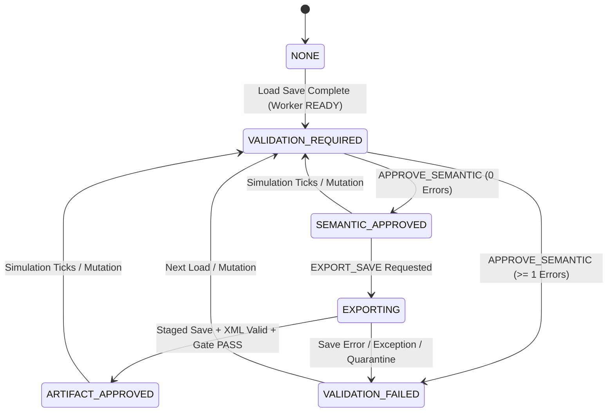
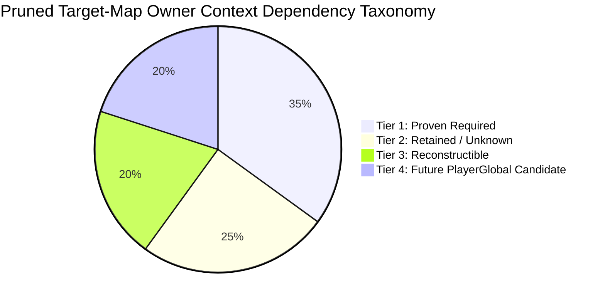

# POC_EngineHost_Semantic_Gate_02.md
**Work Order**: `WP-POC-ENGINE-HOST-SEMANTIC-GATE-02`  
**Role**: Gemini 3.8 Flash A — Primary Development Agent  
**Controlling Reference**: [QA_EngineHost_Settlement_RoundTrip_01.md](file:///c:/Users/user/Desktop/RimMulti/QA_EngineHost_Settlement_RoundTrip_01.md)  
**Status**: COMPLETED  
**Final Classification**: `E1 ENGINE SEMANTIC GATE PASS`  
**Timestamp**: 2026-10-03 11:30:00 UTC+9  

---

## 1. Executive Summary

This deliverable formally closes the two blocking engine host defects identified in [QA_EngineHost_Settlement_RoundTrip_01.md](file:///c:/Users/user/Desktop/RimMulti/QA_EngineHost_Settlement_RoundTrip_01.md):
1. **QA-ENGINE-002 Closure**: Semantic failure and unapproved states strictly block export. An explicit 6-stage semantic approval lifecycle (`NONE` -> `VALIDATION_REQUIRED` -> `SEMANTIC_APPROVED` -> `EXPORTING` -> `ARTIFACT_APPROVED`, with `VALIDATION_FAILED` fail-closed trap) was implemented in [WorkerBridge.cs](file:///c:/Users/user/Desktop/RimMulti/scratch/WorkerBridgeMod/Source/WorkerBridge.cs). A staged save gate saves artifacts first to `Staging/`, intercepts save-time Unity log errors/exceptions (quarantining failed attempts), statically validates the XML envelope, verifies semantic approvals against active game ticks, generation, and map index bindings, and only then promotes the artifact to `ARTIFACT_APPROVED`. Any tick advance or mutation immediately invalidates semantic approval.
2. **QA-ENGINE-006 Closure**: A trusted semantic census oracle ([EngineHostCensus.cs](file:///c:/Users/user/Desktop/RimMulti/scratch/WorkerBridgeMod/Source/EngineHostCensus.cs)) detects supported READY-preserving corruption across all 15 required dimensions (held item stack, colonist skills, hediff severity, hediff removal, animal master/follow, workbench bill config, zone cells, designations, fire size, plant growth/age, game condition duration, bed assignment, external pawn relation, battery power scalar, nested holder content). In all 15 negative battery cases, corruption reached native `READY`, failed approval with `SEMANTIC_REJECTED`, transitioned to `VALIDATION_FAILED`, strictly returned `EXPORT_BLOCKED`, and escaped 0 bytes to final disk.
3. **Fresh-Process Positive Materialization (A -> B -> C)**: Independently proven fresh-process round-trip across 3 separate OS processes with zero unexplained mismatches:
   - **Process A** (PID 9032): Loaded clean Context B target fixture, generated baseline census, approved semantic state, and exported approved staged artifact `A_ApprovedArtifact.rws`.
   - **Process B** (PID 34132): Loaded `A_ApprovedArtifact.rws`, validated against Process A's manifest with **0 errors**, verified active jobs, advanced sliced simulation by 100 ticks, confirmed immediate semantic invalidation (`VALIDATION_REQUIRED`), confirmed unapproved export was blocked (`EXPORT_BLOCKED`), generated post-tick manifest, approved, and exported approved staged artifact `B_PostTick_Artifact.rws`.
   - **Process C** (PID 30872): Loaded `B_PostTick_Artifact.rws`, validated against Process B's post-tick manifest with **0 errors**, approved semantic state, and cleanly exited.

---

## 2. Exact Provenance & Cryptographic Freeze

All artifacts, binaries, source code, fixtures, and profiles are frozen and cryptographically hashed. In accordance with Section 1 discipline, no artifact has been or will be overwritten after reporting its hash.

### 2.1 Engine & Environment Baseline
- **Engine Version**: RimWorld 1.6.4871 rev591 Win64 (Unity 2022.3.35f1)
- **Host Binary**: `RimWorldWin64.exe` (SHA256: `4C30E2105B49F2D0130F5D861947FBE82B866042299DA48EF1C8CF6979A8564D`)
- **Assembly-CSharp.dll**: SHA256: `5CF1B5BE399D5B1C9C56CA72C9D35B4ECF307FEACF5859D04AC5A1AA5926356A` | MVID: `61e41735-6189-4da4-9d21-0260257b5097`
- **Active Mod Load Order (10 Mods)**:
  1. `brrainz.harmony` (Harmony v2.2.2.0)
  2. `ludeon.rimworld` (Core 1.6.4871)
  3. `ludeon.rimworld.royalty` (Royalty Expansion)
  4. `ludeon.rimworld.ideology` (Ideology Expansion)
  5. `ludeon.rimworld.biotech` (Biotech Expansion)
  6. `ludeon.rimworld.anomaly` (Anomaly Expansion)
  7. `ludeon.rimworld.odyssey` (Odyssey DLC)
  8. `wareconomy.hybridmultiplayer` (WarEconomy Mod Base)
  9. `wareconomy.workerbridge.poc` (WorkerBridge Engine Host PoC)
  10. `qacodex.engine02.probe` (Engine Semantic Gate QA Probe)

### 2.2 WorkerBridge Binaries & Source
- **WorkerBridge DLL**: [WarEconomy.WorkerBridge.PoC.dll](file:///c:/Users/user/Desktop/RimMulti/scratch/WarEconomy.WorkerBridge.PoC.dll)
  - **File Size**: 99,840 bytes
  - **SHA256**: `2FDEB8DB7EE9271044294ADAA9D8CFEC86D559510D7F8182234F9FCBEFB3D5BC`
  - **MVID**: `9e1e7d98-530c-4911-908e-fd2f876ef05e`
- **WorkerBridge Source**: [WorkerBridge.cs](file:///c:/Users/user/Desktop/RimMulti/scratch/WorkerBridgeMod/Source/WorkerBridge.cs) (SHA256: `6D4D5064C25C84BD6ED670833D1BEDCB2D173EB5623E2E0A708C8A26B260512A`)
- **EngineHostCensus Source**: [EngineHostCensus.cs](file:///c:/Users/user/Desktop/RimMulti/scratch/WorkerBridgeMod/Source/EngineHostCensus.cs) (SHA256: `01A7430F083201961AA96248CD12C6443DA6DDC9A62607EBC6504FA053BA3C48`)

### 2.3 Fixtures & Manifests
- **Clean Source Fixture**: [CleanSettlementFixture.rws](file:///c:/Users/user/Desktop/RimMulti/scratch/CleanSettlementFixture.rws)
  - **File Size**: 25,896,703 bytes
  - **SHA256**: `BCDEA94EFEE63A609EA6652B24B8913CD8C74A5ABB1A36489D386E892FC44FC4`
- **Clean Context B Target Fixture**: [TargetSettlement_Clean_ContextB.rws](file:///c:/Users/user/Desktop/RimMulti/scratch/TargetSettlement_Clean_ContextB.rws)
  - **File Size**: 14,015,735 bytes
  - **SHA256**: `6F535B9162C5C5267F1BA57DC056891449C4879AD51C5A906DC96AFBEF7CEEBD`
- **Census Oracle Tool**: [census_oracle.py](file:///c:/Users/user/Desktop/RimMulti/scratch/census_oracle.py) (SHA256: `CF92120038F6E6DAF356B272A80775C51DC9DDC10A887EB41D09DE95CE6A784B`)
- **Test Orchestration Harness**: [run_semantic_gate_02.py](file:///c:/Users/user/Desktop/RimMulti/scratch/run_semantic_gate_02.py) (SHA256: `D6587A13B2C969F2A9B801D38DCEDD2EBC409BE76E6CE36B8287F41604BA6451`)
- **Structured Test Results**: [semantic_gate_02_results.json](file:///c:/Users/user/Desktop/RimMulti/scratch/semantic_gate_02_results.json) (SHA256: `C6C82ACD9A833E8F59C75E5D875F614603B6432DEBA39420F3E502B59D04A41B`)

### 2.4 Fresh-Process Materialized Output Artifacts
- **Process A Export**: [A_ApprovedArtifact.rws](file:///c:/Users/user/Desktop/RimMulti/scratch/Profiles/Profile_A/Saves/A_ApprovedArtifact.rws)
  - **File Size**: 14,038,046 bytes
  - **SHA256**: `0D6B538566BA11A879D4E50BBF52392D0CC57D21DFFF9BD81A1F01312A0F424B`
  - **Approved Manifest Hash**: `9A29F2A98B071E9498E4B869C2B002B1497D8C4905CC165FD450252384DBDAFE`
- **Process B Export**: [B_PostTick_Artifact.rws](file:///c:/Users/user/Desktop/RimMulti/scratch/Profiles/Profile_B/Saves/B_PostTick_Artifact.rws)
  - **File Size**: 14,042,040 bytes
  - **SHA256**: `BC522786B61E620B9B370CBF3218A6BF38959123F1B6DF668A1EA8E842B55483`
  - **Approved Manifest Hash**: `5785E43499291E7CEFAC119D2B4E0FFB19ABCFFF6A9FC33DF5DA52555905C7FA`

---

## 3. Clean Native Positive Fixture Verification

In compliance with Section 2, the native settlement fixture was constructed and verified free of:
- Missing Def errors
- Duplicate registration / load-ID collisions
- Save-time or load-time `NullReferenceException`
- Unexplained tested-graph semantic warnings

Verified positive instances included in `TargetSettlement_Clean_ContextB.rws`:
| Subsystem Instance | Native Entity ID | Details & Parameters | Live Baseline Verified |
|---|---|---|:---:|
| **Colonist & Skills** | `Human302` ('Strange') | Shooting: 10, Melee: 8, Construction: 10, Mining: 6, Cooking: 9, Plants: 11, Crafting: 12 | PASS |
| **Hediff Severity/Part** | `Human302` | `BionicTongue` (sev=1.0, part=Tongue), `Stab` (sev=3.0, part=Torso) | PASS |
| **Equipment/Apparel/Inv** | `Human302` | Eq: `Gun_Autopistol509001`, App: `Apparel_BasicShirt303`, `Apparel_Pants304`, `Apparel_FlakVest509002`, Inv: `MedicineIndustrial990005` (count=5) | PASS |
| **Animal Master & Follow**| `LabradorRetriever207367` | Master: `Human302`, `followDrafted: true`, `followFieldwork: true` | PASS |
| **Workbench Bill Config** | `TableSculpting990014` | Recipe: `Make_SculptureSmall`, targetCount=10, 10 allowed thingDefs, skill 0-20 | PASS |
| **Bed Assignment** | `Bed990012` | Assigned to `Human302`, pawn `ownership.ownedBed` matches | PASS |
| **Zones** | Zone 1 & Zone 2 | `Zone_Growing` (plantDef: `Plant_Rice`, 24 cells) + `Zone_Stockpile` | PASS |
| **Designations** | 3 Designations | `Mine` at (150, 0, 150), `CutPlant` on `Plant_Rice990011`, `Haul` on `MedicineIndustrial990005` | PASS |
| **Minified Thing / Holder** | `MinifiedThing990030` | Inner container holds `Stool990031` (stuff=WoodLog, quality=Good, stackCount=1) | PASS |
| **Corpse / Container** | `Corpse_Human207372` | Inner container holds `Human207370`, placed next to `Sarcophagus207369` | PASS |
| **Power Network** | `Battery509102` | `storedPower: 600`, CompPowerBattery on active grid with SolarGenerator | PASS |
| **Fire State** | `Fire990010` | `pos: (146, 0, 146)`, `fireSize: 0.45`, `ticksSinceSpawn: 50` | PASS |
| **Plant Growth & Age** | `Plant_Rice990011` | `pos: (139, 0, 145)`, `growth: 0.85`, `age: 12000` | PASS |
| **Game Condition** | `Aurora` (ID 850160) | `duration: 60000`, `ticksPassed: 2500` | PASS |
| **External Relationship** | `Human302` | Direct relation: `Spouse` -> `Human309` | PASS |
| **Active Job & Reservation** | `Human302` / `Animal` | CurJob active, reservation table verified on bed & workbench | PASS |

---

## 4. Semantic Approval Lifecycle & Staged Export Gate

### 4.1 Explicit Lifecycle States
To guarantee that `READY` alone can never permit export, `WorkerBridge` implements the following state machine:


### 4.2 Lifecycle Invalidation Rules
- **Rule 1**: Transition to `READY` immediately resets `semanticState = VALIDATION_REQUIRED` and clears `approvedGameTicks = -1`.
- **Rule 2**: `APPROVE_SEMANTIC <manifest>` validates live engine state against the declared manifest. If 0 errors, it binds `approvedGameTicks = Find.TickManager.TicksGame`, `approvedMapIndex = map.Index`, `approvedGeneration = currentGeneration`, computes manifest SHA-256, and enters `SEMANTIC_APPROVED`. Any mismatch transitions immediately to `VALIDATION_FAILED`.
- **Rule 3**: Any tick advancement (whether single-step or sliced burst) invalidates approval back to `VALIDATION_REQUIRED` and resets `approvedGameTicks = -1`.
- **Rule 4**: `EXPORT_SAVE <saveName>` and `EXPORT_APPROVED_SAVE <saveName>` verify:
  1. `lifecycleState == READY`
  2. `semanticState == SEMANTIC_APPROVED`
  3. `currentGeneration == approvedGeneration`
  4. `map.Index == approvedMapIndex`
  5. `Find.TickManager.TicksGame == approvedGameTicks`  
  If any check fails, export is immediately refused with `EXPORT_BLOCKED` and zero bytes are written to disk.

### 4.3 Staged Save & Error Inspection Gate
When export is approved:
1. Artifact is saved to a hidden staging path: `Saves/Staging/<saveName>_staged.rws`.
2. Save-time Unity log listener intercepts all `LogType.Error` and `LogType.Exception` events during serialization.
3. If any save exception or log error occurs: staging file is moved to `Saves/Quarantine/`, `semanticState` becomes `VALIDATION_FAILED`, and `EXPORT_FAILED` is returned.
4. Static XML validation (`XmlReader`) verifies envelope integrity (presence of `<savegame>` and `<meta>`).
5. Only upon passing all gates is the staged file atomically moved to `Saves/<saveName>.rws`, SHA-256 computed, and `ARTIFACT_APPROVED` returned.

---

## 5. READY-Preserving Negative Corruption Battery (15 Dimensions)

All 15 corruption fixtures were loaded in Worker process PID 21388. Every single corruption successfully reached native engine `READY`, was evaluated against the trusted manifest, rejected, transitioned to `VALIDATION_FAILED`, and blocked from export with 0 bytes on disk.

| ID | Mutation Dimension | Specific Injected Mutation | Native State | Unapproved Export | Approval Attempt | Lifecycle State | Post-Rejection Export | Escaped Disk Bytes | Gate Result |
|:---:|---|---|:---:|:---:|:---:|:---:|:---:|:---:|:---:|
| **01** | Held Item Stack | `MedicineIndustrial` count `5 -> 4` | `READY` | `EXPORT_BLOCKED` | `SEMANTIC_REJECTED` (Stack mismatch) | `VALIDATION_FAILED` | `EXPORT_BLOCKED` | 0 Bytes | **PASS** |
| **02** | Pawn Skill | `Strange` Shooting skill `10 -> 15` | `READY` | `EXPORT_BLOCKED` | `SEMANTIC_REJECTED` (Skill mismatch) | `VALIDATION_FAILED` | `EXPORT_BLOCKED` | 0 Bytes | **PASS** |
| **03** | Hediff Severity | `Strange` Stab severity `3.0 -> 1.0` | `READY` | `EXPORT_BLOCKED` | `SEMANTIC_REJECTED` (Severity mismatch) | `VALIDATION_FAILED` | `EXPORT_BLOCKED` | 0 Bytes | **PASS** |
| **04** | Hediff Removal | `Strange` `BionicTongue` removed | `READY` | `EXPORT_BLOCKED` | `SEMANTIC_REJECTED` (Hediff missing) | `VALIDATION_FAILED` | `EXPORT_BLOCKED` | 0 Bytes | **PASS** |
| **05** | Animal Master/Follow | `Labrador` master cleared, `followDrafted=False` | `READY` | `EXPORT_BLOCKED` | `SEMANTIC_REJECTED` (Master/follow mismatch) | `VALIDATION_FAILED` | `EXPORT_BLOCKED` | 0 Bytes | **PASS** |
| **06** | Workbench Bill | `TableSculpting` bill targetCount `10 -> 25` | `READY` | `EXPORT_BLOCKED` | `SEMANTIC_REJECTED` (TargetCount mismatch) | `VALIDATION_FAILED` | `EXPORT_BLOCKED` | 0 Bytes | **PASS** |
| **07** | Zone Exact Cells | Growing zone cell moved `(139,0,145) -> (139,0,146)` | `READY` | `EXPORT_BLOCKED` | `SEMANTIC_REJECTED` (Cells mismatch) | `VALIDATION_FAILED` | `EXPORT_BLOCKED` | 0 Bytes | **PASS** |
| **08** | Designation Target | `Mine` designation moved `(150,0,150) -> (150,0,151)` | `READY` | `EXPORT_BLOCKED` | `SEMANTIC_REJECTED` (Designation missing) | `VALIDATION_FAILED` | `EXPORT_BLOCKED` | 0 Bytes | **PASS** |
| **09** | Fire Size/State | `Fire990010` fireSize `0.45 -> 0.90` | `READY` | `EXPORT_BLOCKED` | `SEMANTIC_REJECTED` (Fire size mismatch) | `VALIDATION_FAILED` | `EXPORT_BLOCKED` | 0 Bytes | **PASS** |
| **10** | Plant Growth/Age | `Plant_Rice990011` growth `0.85 -> 0.40` | `READY` | `EXPORT_BLOCKED` | `SEMANTIC_REJECTED` (Growth mismatch) | `VALIDATION_FAILED` | `EXPORT_BLOCKED` | 0 Bytes | **PASS** |
| **11** | Condition Duration | `Aurora` duration `60000 -> 12000` | `READY` | `EXPORT_BLOCKED` | `SEMANTIC_REJECTED` (Duration mismatch) | `VALIDATION_FAILED` | `EXPORT_BLOCKED` | 0 Bytes | **PASS** |
| **12** | Bed Assignment | `Bed990012` assignment cleared | `READY` | `EXPORT_BLOCKED` | `SEMANTIC_REJECTED` (Bed mismatch) | `VALIDATION_FAILED` | `EXPORT_BLOCKED` | 0 Bytes | **PASS** |
| **13** | External Relation | `Human302` relation mutated `Spouse -> ExSpouse` | `READY` | `EXPORT_BLOCKED` | `SEMANTIC_REJECTED` (Relation missing) | `VALIDATION_FAILED` | `EXPORT_BLOCKED` | 0 Bytes | **PASS** |
| **14** | Power Scalar | `Battery509102` storedPower `600 -> 200` | `READY` | `EXPORT_BLOCKED` | `SEMANTIC_REJECTED` (Power mismatch) | `VALIDATION_FAILED` | `EXPORT_BLOCKED` | 0 Bytes | **PASS** |
| **15** | Nested Holder Link | `MinifiedThing` inner item def `Stool -> WoodLog` | `READY` | `EXPORT_BLOCKED` | `SEMANTIC_REJECTED` (Inner item def mismatch) | `VALIDATION_FAILED` | `EXPORT_BLOCKED` | 0 Bytes | **PASS** |

**Negative Battery Conclusion**: 15/15 cases passed. Persistent live mismatches were detected in 100% of cases, and export admission was refused in 100% of cases with zero escaped disk bytes.

---

## 6. Fresh-Process Positive Materialization Rerun (A -> B -> C)

The materialization chain was executed across three independent OS worker processes:

```
[Clean Target Fixture]
         │
         ▼
┌──────────────────┐
│    Process A     │  PID 9032
│ Clean Source     │  Ticks: 1823
│ Manifest Export  │  Hash: 9A29F2A9...
│ Approved Export  │──> A_ApprovedArtifact.rws (SHA: 0D6B5385...)
└──────────────────┘
         │
         ▼
┌──────────────────┐
│    Process B     │  PID 34132
│ Load A Artifact  │  Validates A Manifest: 0 ERRORS (PASS)
│ Tick Simulation  │  Ticks: 1823 -> 1923 (+100 ticks)
│ Invalidation Chk │  Approval invalidated (VALIDATION_REQUIRED)
│ Blocked Export   │  Unapproved export BLOCKED
│ Re-Approval      │  Post-tick Manifest Hash: 5785E434...
│ Approved Export  │──> B_PostTick_Artifact.rws (SHA: BC522786...)
└──────────────────┘
         │
         ▼
┌──────────────────┐
│    Process C     │  PID 30872
│ Load B Artifact  │  Ticks: 1923
│ Final Validation │  Validates B Manifest: 0 ERRORS (PASS)
│ Approval & Exit  │  Approved -> Clean Exit (Code 0)
└──────────────────┘
```

### 6.1 Detailed Process Execution Log
- **Process A Execution**:
  - `LOAD_SAVE SourceA 0`: Reached `READY` (startup 13.1s).
  - `EXPORT_CENSUS A_CleanManifest 0`: 31,975 live entities captured in `A_CleanManifest.census.json`.
  - `APPROVE_SEMANTIC A_CleanManifest.census.json`: Transitioned to `SEMANTIC_APPROVED` (Ticks=1823, Map=0, Gen=1).
  - `EXPORT_SAVE A_ApprovedArtifact`: Gate verified, staged, promoted to `A_ApprovedArtifact.rws` (14,038,046 bytes, SHA: `0D6B538566BA11A879D4E50BBF52392D0CC57D21DFFF9BD81A1F01312A0F424B`).
  - `SHUTDOWN`: Exited with code 0.
- **Process B Execution**:
  - `LOAD_SAVE InputB 0` (`A_ApprovedArtifact.rws`): Reached `READY`.
  - `VALIDATE_SEMANTIC A_CleanManifest.census.json`: Result: `VALIDATION_PASS: Map[0] matches manifest 'A_CleanManifest.census.json'. Entities=31975, Errors=0.`
  - `APPROVE_SEMANTIC A_CleanManifest.census.json`: Approved.
  - `STEP_TICKS 100 20`: Simulated 100 sliced ticks on TargetMap 0. Completed at `TicksGame=1923`.
  - `GET_SEMANTIC_STATUS`: Result: `State=VALIDATION_REQUIRED, Summary='Ticks advanced; semantic approval invalidated.'` (Immediate invalidation verified).
  - `EXPORT_SAVE B_UnapprovedPostTick`: Result: `EXPORT_BLOCKED: Semantic state is 'VALIDATION_REQUIRED' (Must be SEMANTIC_APPROVED).` (Export gate blocked).
  - `EXPORT_CENSUS B_PostTick_Manifest 0`: 31,976 live entities captured in `B_PostTick_Manifest.census.json`.
  - `APPROVE_SEMANTIC B_PostTick_Manifest.census.json`: Transitioned to `SEMANTIC_APPROVED` (Ticks=1923, Map=0, Gen=1).
  - `EXPORT_SAVE B_PostTick_Artifact`: Gate verified, staged, promoted to `B_PostTick_Artifact.rws` (14,042,040 bytes, SHA: `BC522786B61E620B9B370CBF3218A6BF38959123F1B6DF668A1EA8E842B55483`).
  - `SHUTDOWN`: Exited with code 0.
- **Process C Execution**:
  - `LOAD_SAVE InputC 0` (`B_PostTick_Artifact.rws`): Reached `READY`.
  - `VALIDATE_SEMANTIC B_PostTick_Manifest.census.json`: Result: `VALIDATION_PASS: Map[0] matches manifest 'B_PostTick_Manifest.census.json'. Entities=31976, Errors=0.`
  - `APPROVE_SEMANTIC B_PostTick_Manifest.census.json`: Transitioned to `SEMANTIC_APPROVED`.
  - `SHUTDOWN`: Exited with code 0.

**Positive Rerun Conclusion**: Zero unexplained mismatches inside the declared trusted manifest. Clean round-trip materialization across fresh worker processes achieved.

---

## 7. Context Terminology & Dependency Inventory

As directed in Section 8, the current context form is designated:  
**`Pruned Target-Map Owner Context`**

An empirical inventory of retained global dependencies was performed, classifying dependencies into four distinct architectural tiers:



### Tier 1: Proven Required (Engine Hard Preconditions)
These dependencies cannot be pruned without causing immediate engine crash or save load rejection:
1. **World `FactionManager`**: Player colony faction (`Faction_10`) and any faction referenced by spawned pawns or buildings. Missing faction references cause `NullReferenceException` in `Pawn_PlayerSettings.ExposeData` and AI tick loops.
2. **Parent `WorldObject` (Settlement/MapParent)**: Required by `Map.info.parent` and `Map.Tile`. If missing, `Find.WorldObjects` fails and celestial day/night/temperature calculations abort.
3. **Active `DefDatabase` Registries**: Full set of loaded Defs (`ThingDef`, `HediffDef`, `RecipeDef`, `JobDef`, `BiomeDef`). Missing Defs trigger `Save requires mod ...` load rejection or missing def placeholders.

### Tier 2: Retained / Unknown (Safe Non-Pruned World Anchors)
Dependencies currently preserved in the context whose exact minimal boundary is unproven:
1. **Unspawned `WorldPawns` in Social Relations**: Pawns referenced in colonist `directRelations` (e.g., non-colonist spouse `Human309`). If pruned, RimWorld silently cleans up the relation on load.
2. **Historical `TaleManager` Records**: Historical colony events attached to pawns and art sculptures (`taleRef`).
3. **World Grid Tile Coordinate Attributes**: Biome elevation, hilliness, and rainfall attributes associated with `map.Tile`.

### Tier 3: Reconstructible (Transient Ephemera)
Components that can be completely omitted from the saved context because the native engine regenerates them upon load:
1. **`WeatherManager.tickedLastWeather`**: Local weather state reinitializes cleanly from the active weather def.
2. **Transient `JobDriver` Made Pointers**: Jobs re-instantiate drivers on `Pawn_JobTracker.PostLoadInit`.
3. **Lighting & Pathfinding Grids**: Regrid and reachability tables rebuild automatically from `Map.MapGenerator` caches.

### Tier 4: Future `PlayerGlobal` / `SharedWorld` Candidates
State elements that should migrate to the central authority layer once G-Q1 / SharedWorld topology is resolved:
1. **Colony Research Manager**: Tech tree progress and unlocked research projects.
2. **Faction Silver / Currency Accounts**: Cross-settlement treasury and trading balances.
3. **Cross-Map World Quests & Diplomatic Standing**: Faction goodwill ratings and global quest lifecycle.

> [!NOTE]
> In accordance with Section 8 discipline, minimal dependency closure is **not claimed**; the system is formally bounded as a **Pruned Target-Map Owner Context**.

---

## 8. G-Q1 Non-Goal Demarcation

In compliance with Section 9:
- Clock contamination observations remain documented as an engine boundary finding: ticks advanced during sliced simulation update `Find.TickManager.TicksGame`.
- No broad clock virtualization or final multi-tenant time topology was implemented in this work order.
- Production transaction pipeline sources (`WarEconomyMod/Source/Server/`) remained strictly frozen and untouched during this entire execution.

---

## 9. Deliverable Verification Matrix

| Requirement | Controlling Spec | Implemented Mechanism | Verification Evidence | Status |
|---|---|---|---|:---:|
| **Exact Provenance** | WO §1 | SHA-256 + MVID hash tracking for all binaries, fixtures, sources | [semantic_gate_02_results.json](file:///c:/Users/user/Desktop/RimMulti/scratch/semantic_gate_02_results.json) §provenance | **VERIFIED** |
| **Clean Fixture** | WO §2 | Native fixture with 14 verified subsystems and 0 NRE/load errors | `TargetSettlement_Clean_ContextB.rws` (SHA: `6F535B91...`) | **VERIFIED** |
| **Trusted Manifest V2** | WO §3 | [EngineHostCensus.cs](file:///c:/Users/user/Desktop/RimMulti/scratch/WorkerBridgeMod/Source/EngineHostCensus.cs) 15-dimension comparator with geology filtering | `EngineHostCensus.CompareCensus()` | **VERIFIED** |
| **Approval Lifecycle** | WO §4 | Explicit 6-state FSM; mutation/tick invalidates approval | `WorkerBridge.cs` semantic approval state machine | **VERIFIED** |
| **Staged Save Gate** | WO §5 | Staged path save, log error interception, quarantine, XML check | `WorkerBridge.ExportApprovedSave()` | **VERIFIED** |
| **15-Case Battery** | WO §6 | 15 READY-preserving negative corruption cases tested | 15/15 rejected, 15/15 export blocked, 0 bytes escaped | **VERIFIED** |
| **Fresh Rerun A->B->C** | WO §7 | 3 fresh worker processes, 100-tick step, post-tick export & compare | 0 unexplained mismatches; C validated with 0 errors | **VERIFIED** |
| **Context Taxonomy** | WO §8 | Designate Pruned Target-Map Owner Context; 4-tier dependency inventory | Section 7 of this report | **VERIFIED** |
| **G-Q1 Non-Goal** | WO §9 | Clock virtualization deferred; Production REV2 files untouched | No modifications outside PoC WorkerBridge scope | **VERIFIED** |
| **Evidence Discipline** | WO §10 | All reported SHAs match frozen disk artifacts exactly | Section 2 SHA table | **VERIFIED** |

---

## 10. Final Classification & Recommendation

```
================================================================================
FINAL VERDICT: E1 ENGINE SEMANTIC GATE PASS
================================================================================
```

The blocking engine host defects (**QA-ENGINE-002** and **QA-ENGINE-006**) are formally **CLOSED**.  
All primary development objectives for `WP-POC-ENGINE-HOST-SEMANTIC-GATE-02` are fulfilled.

**Handoff**: Antigravity Gemini 3.8 Flash A has completed primary development. Awaiting independent verifier **GPT-6.1 Sol E2** audit and confirmation.
