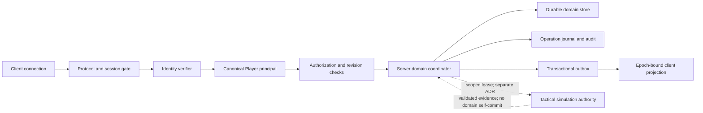
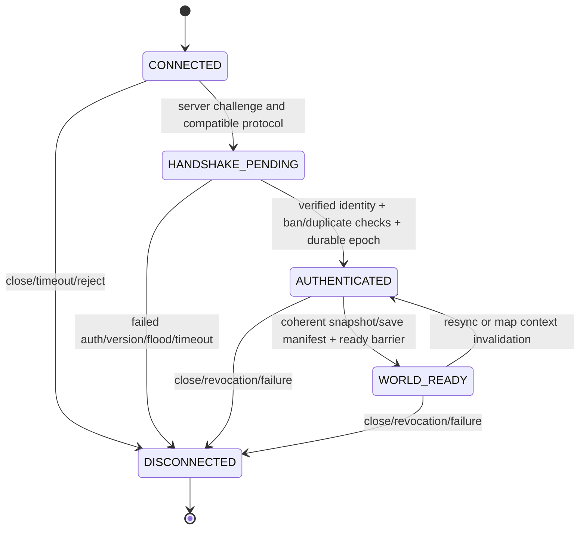
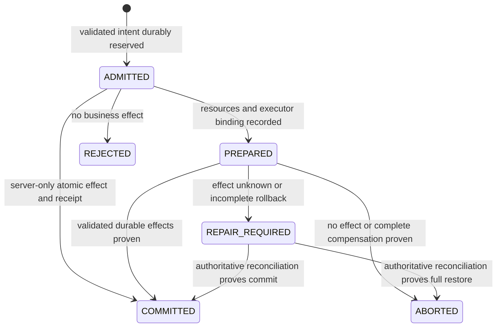

# ADR-001 — Authenticated Identity, Central Authority & Persistent State Boundary

- Work Package: **WP-ADR-AUTH-STATE-01**
- Status: **ACCEPTED** — Master Work Order WP-ADR-TACTICAL-OFFLINE-01
- Reviewer / author: QA / Architecture Reviewer
- Decision owner: Master (GPT-5.6 Sol), Gemini feasibility evidence를 함께 검토
- Date: 2026-10-01 (Asia/Seoul)
- Supersedes: 없음. **Official Gap Baseline v1 ADOPTED**를 설계 입력으로 사용
- Architecture Gate: **BLOCKED BY ARCHITECTURE 유지**
- Implementation: **NONE — Production 코드·배포·프로세스 변경 없음**
- QA-001~QA-014: **OPEN 유지**. 설계안 제출은 결함 해결 증거가 아니다.

Master가 본 문서의 identity/authority/persistence 계약을 ACCEPTED로 확정했다. 현재 코드에 구현됐다는 뜻은 아니다. 구체 Steam verifier와 DB provider는 PoC 대기이며, Tactical lease/engine save 설계는 ADR-002 및 후속 검증에 연결한다.

## 1. Context

[최상위 SRS](<C:/Users/user/Desktop/RimMulti/요구사항_명세서.md>)와 [공식 채택된 Gap Baseline v1 산출물](<C:/Users/user/Desktop/RimMulti/Official_Gap_Reconciliation_Candidate_v1.md>)을 기준으로 한다. 하위 문서의 같은 숫자를 Canonical ID로 사용하지 않는다.

현재 서버는 net8.0 별도 프로세스, Common은 netstandard2.0, Client는 실제 RimWorld 1.6 엔진을 참조하는 net472다. 서버는 메모리 기반 정치/경제 상태를 관리하고 클라이언트는 로컬 엔진 객체를 변경한다. TCP 연결 성공과 nickname 등록이 인증으로 취급되고 있으며, 영구 identity·버전 거부·durable state·application replay recovery가 없다.

ADR-001은 **누가 명령할 수 있는지, 누가 최종 도메인 상태를 확정하는지, 어떤 상태를 재시작 이후 보존할지**를 결정할 설계안이다. Offline Combat host 방식, remote map replication, complete inventory graph 및 분산 ownership 원자 프로토콜 자체는 후속 ADR의 책임이다. 다만 후속 설계가 따라야 할 identity, fencing, journal, revision 경계는 여기서 제안한다.

조사 증거:

| Evidence | Source / finding |
|---|---|
| AUTH-E01 | [PacketHeader](<C:/Users/user/Desktop/RimMulti/WarEconomyMod/Source/Common/Packets/PacketHeader.cs:6>): enum **30개(None 포함)**. 현재 client/server handler와 DTO를 각각 대조 |
| AUTH-E02 | [TcpNetworkServer.HandlePacket](<C:/Users/user/Desktop/RimMulti/WarEconomyMod/Source/Server/Network/TcpNetworkServer.cs:115>): auth state gate 없음; line125 caller ID binding, line288 임의 faction war |
| AUTH-E03 | [NetworkClient](<C:/Users/user/Desktop/RimMulti/WarEconomyMod/Source/Client/Networking/NetworkClient.cs:39>): parser lifetime 고정, line80 persona/nickname identity, line167 epoch 없는 queued callback |
| AUTH-E04 | [MainThreadQueue](<C:/Users/user/Desktop/RimMulti/WarEconomyMod/Source/Client/Threading/MainThreadQueue.cs:19>): raw Action queue; world/save/epoch context 없음 |
| AUTH-E05 | [FeudalManager](<C:/Users/user/Desktop/RimMulti/WarEconomyMod/Source/Server/Managers/FeudalManager.cs:39>): in-memory pending; line198 ID overwrite; line262 pending 제거 후 commit |
| AUTH-E06 | [Program](<C:/Users/user/Desktop/RimMulti/WarEconomyMod/Source/Server/Program.cs:20>): memory managers/start clock0, config/save/recovery/audit writer 없음 |
| AUTH-E07 | [Serializer](<C:/Users/user/Desktop/RimMulti/WarEconomyMod/Source/Common/Packets/PacketSerializer.cs:9>): TypeNameHandling.Auto; [Receiver](<C:/Users/user/Desktop/RimMulti/WarEconomyMod/Source/Common/Packets/PacketReceiver.cs:50>) body10MB 제한만, auth별 quota 없음 |
| AUTH-E08 | [ServerClientSession](<C:/Users/user/Desktop/RimMulti/WarEconomyMod/Source/Server/Network/ServerClientSession.cs:19>): caller mutable PlayerId, runtime short SessionId; durable epoch/auth state 없음 |
| AUTH-E09 | [기존 독립 테스트 로그](<C:/Users/user/Desktop/RimMulti/QA-Baseline/reconciliation-baseline-rerun.log>): BASE-04 pre-auth war, BASE-05 version/identity spoof, BASE-07 old partial frame 반례. 이번 ADR 작성에서 새 runtime test로 재실행한 것은 아님 |

이번 조사 시작 시 기준 입력55개와 해시를 대조했으며 변경이 없었다. 시작/종료 검증 기록은 QA-Baseline의 adr001-input-manifest.json / adr001-validation.json에 보존한다. 문서 검증과 설계 review만 수행했으며 새로운 authentication/database 구현 테스트의 PASS를 주장하지 않는다.

## 2. Requirements

| Canonical requirement | ADR decision obligation | Acceptance references |
|---|---|---|
| SRS-FR-004 | provider와 별개인 영구 PlayerId, 삭제/변경 없는 identity mapping | AC-AUTH-01, AC-PERSIST-01 |
| SRS-FR-005 | Steam identity 우선 검증; 실현 불가 확인 시 ID/Password fallback | AC-AUTH-01/02, POC-ID |
| SRS-FR-006 | protocol/mod version 및 지원 schema 대조 | AC-AUTH-03 |
| SRS-FR-007 | 비호환 client는 authentication/world exposure 전에 거절 | AC-AUTH-03 |
| SRS-BR-002 | 한 Player의 정식 Faction membership 한 개 | AC-DOMAIN-01 |
| SRS-BR-003 | 한 Player의 현재 Title 한 개, tree와 일치 | AC-DOMAIN-01 |
| SRS-BR-011 | 해당 Faction 최고 작위 보유자만 formal war 명령 | AC-AUTH-04 |
| SRS-NFR-004 | entity final states 및 revisions/operation receipts 일관 | AC-DOMAIN-01, AC-OP-01~04 |
| SRS-NFR-006 | 명시한 domain/time/cooldown/ban 상태와 operation outcome durable | AC-PERSIST-01~04 |
| SRS-NFR-007 | server만 중앙 domain final state 확정 | AC-AUTH-04, AC-EPOCH-01/02 |
| SRS-NFR-008 | 한 client의 종료/flood가 서버 전체를 중단시키지 않음 | AC-AUTH-05, AC-FAIL-01 |
| SRS-NFR-012 | 인증 actor 및 정치/ownership 효과를 운영자가 추적 | AC-AUDIT-01 |

추가 경계 연결: SRS-NFR-005의 multi-aggregate transaction, SRS-NFR-003의 config 검증, SRS-CON-010의 Offline Combat authority, SRS-FR-166의 완전 ownership 범위는 후속 ADR에서도 유지한다. ADR-001로 해당 기능을 완료 판정하지 않는다.

## 3. Existing Problems

| OPEN defect | Current cause / evidence | Proposed decision addressing it |
|---|---|---|
| **QA-001** | AUTH-E02/E03/E08. self-claimed identity와 faction, pre-auth mutation, version 거부 없음 | authenticated immutable principal; protocol state gate; commit-time domain authorization; verified provider mapping |
| **QA-002** | AUTH-E05/E06. domain/time/ban/pending memory only | durable aggregate + journal + transactional audit/outbox; bootstrap recovery barrier |
| **QA-011** | AUTH-E03/E04/E09. parser 재사용·queued action에 epoch 없음 | per-connection parser; authenticated epoch fence; world/save apply context; late response와 operation query 분리 |

QA-003/005/012도 operation uniqueness/receipt/repair state와 관련되지만 complete distributed engine transaction은 본 ADR 범위를 넘는다. 구조를 제안했다는 이유로 어느 결함도 close하지 않는다.

## 4. Decision Drivers

1. 영구 identity와 표시 이름을 분리하고 actor를 서버가 검증한다.
2. 모든 정치·경제·ownership 명령의 인가를 중앙에서 검사하고 commit 시점까지 유효하게 만든다.
3. session transport lifetime과 durable business operation lifetime을 분리한다.
4. restart/ACK loss 이후 operation 결과를 기억하며 새로운 session이 old engine result를 채택하지 않는다.
5. player membership/title, diplomacy, tax, market, ownership/time의 final state를 한 권한 경계로 둔다.
6. 새로운 엔진/DB/Steam 지원을 있다고 가정하지 않고 독립 PoC로 검증한다.
7. 인증/flood/저장 I/O의 실패를 세션과 world mutation 경계에 격리한다.
8. 이후 Offline/Tactical/Inventory ADR을 가능한 구조로 남기고 요구를 축소하지 않는다.

## 5. Candidate Architectures

### 5.1 Identity / authority alternatives

| Candidate | Identity / authority | Assessment |
|---|---|---|
| A — verified provider + server canonical principal | Steam verifier 우선, 조건부 password verifier; server PlayerId mapping, durable domain command coordinator | **권장**. provider feasibility와 분산 simulation 검증은 별도 |
| B — nickname/claimed Steam ID 직접 사용 | 클라이언트 문자열을 actor/ownership key로 삼음 | **배제**. 이름 변경/사칭·duplicate login·권한 붕괴; QA-001 유지 |
| C — provider ID를 domain primary key로 직접 사용 | 검증 후 Steam subject를 모든 영지/작위 FK로 사용 | 영구 식별은 가능하지만 fallback/link/migration 때 domain key 변경 위험. canonical internal PlayerId보다 부적합 |
| D — authenticated client가 domain 결과도 확정 | 로그인만 검증하고 war/tax/map result를 client 주장대로 commit | **배제**. authentication은 simulation outcome/target ownership proof가 아니다 |

### 5.2 Persistence technology alternatives — 선택 보류

아래는 공개 공식 문서의 기능 비교와 **설계 추론**이다. 프로젝트의 package restore, Windows publish, engine/save 연결, write throughput은 Gemini feasibility/PoC로 별도 입증해야 한다.

| Criterion | Atomic JSON snapshot + journal | SQLite | Embedded document DB (예: LiteDB) |
|---|---|---|---|
| Transaction | 직접 multi-aggregate journal/commit marker/checkpoint atomicity 구현 | 같은 DB의 domain/operation/outbox/audit를 한 transaction으로 묶는 후보 | document/collection간 transaction 보장 범위를 실제 provider에서 확인 필요 |
| Crash recovery | fsync/flush, torn-tail, checksums, rename 및 checkpoint rotation을 직접 증명 | rollback/WAL recovery 제공; durable settings/스토리지 조건은 확인 필요 | 복구/불완전 write/flush 보장 공식 증거와 실험 필요 |
| Schema migration | record/version migrator와 snapshot+journal 호환을 직접 유지 | application schema migrations + revision/constraint migration | document schema와 index migration을 application이 관리 |
| 운영 복잡도 | 파일 보기 쉬우나 recovery/compaction 코드는 복잡 | 로컬 DB/backup/WAL/checkpoint 관리; 상대적으로 적은 custom recovery | embedding 간편 후보; 유지보수/diagnostics 경로 검토 |
| .NET8 server | 내장 file/JSON API 사용 가능. crash 안전성은 자동 제공되지 않음 | .NET provider 후보 존재; net8 호환 package/RID는 **미검증** | .NET embedded 제품이지만 현재 선택 version의 net8 호환 **미검증** |
| 배포 의존성 | 별도 DB engine 없음, 단독 서버에 파일 logic 포함 | provider 및 native dependency 포함 방식 검증 필요 | managed/native dependency·version pin·publish 검증 필요 |
| 테스트 | failure points를 노출하기 쉬우나 모든 storage correctness 책임을 직접 부담 | process-kill + real DB/constraints tests에 적합 | fault injection과 cross-document atomicity oracle 필요 |
| 서버 단독 배포 | 가능 후보; client에 journal/save authority 배포 안 함 | server에만 DB/provider 포함 | server에만 store/provider 포함 |

SQLite는 atomic commit과 WAL recovery를 문서화하고 있다. WAL은 같은 host 파일 시스템과 단일 writer 경계를 전제로 하므로 여러 DB 파일/engine save까지 자동으로 원자화하지 않는다. [SQLite atomic commit](https://www.sqlite.org/atomiccommit.html), [WAL](https://www.sqlite.org/wal.html)

Microsoft.Data.Sqlite는 독립 사용 가능한 provider이고 transaction을 지원한다. 다만 async ADO.NET 호출이 실제 asynchronous I/O를 제공하지 않으므로 180 TPS loop에서 await만 붙여 blocking이 없어졌다고 판정하면 안 된다. [Provider](https://learn.microsoft.com/en-us/dotnet/standard/data/sqlite/), [Transactions](https://learn.microsoft.com/en-us/dotnet/standard/data/sqlite/transactions), [Async limitations](https://learn.microsoft.com/en-us/dotnet/standard/data/sqlite/async)

SQLite PoC에서는 WAL+FULL 등을 durability 후보로 검증하고 query로 실제 설정을 확인한다. NORMAL/OFF의 throughput만으로 성공을 선언하지 않는다. 설정별 power-loss 보장은 차이가 있다. [SQLite synchronous](https://www.sqlite.org/pragma.html#pragma_synchronous)

LiteDB는 비교를 위한 .NET embedded document store 후보일 뿐이다. 이번 확인에서는 상세 transaction 문서 접근이 되지 않았으므로 ACID/crash/현재 version 호환을 완료 사실로 주장하지 않는다. [제품 공식 개요](https://www.litedb.org/docs/)

**권장 우선순위:** SQLite를 첫 storage PoC 후보로 평가한다. JSON+journal은 작은 reference/fault model 및 차선 후보, embedded document DB는 동일 acceptance criteria를 만족할 때 비교한다. **DB 제품·provider version·journal/WAL mode는 확정하지 않는다.** 어느 DB를 택해도 RimWorld map save와 DB 사이 원자성은 후속 transaction ADR이 필요하다.

## 6. Recommended Architecture

**검증된 identity provider → immutable session principal → state/epoch gate → server-owned command coordinator → durable domain transaction + operation receipt + audit + outbox → client projection**을 권장한다.

설계상 단일 **DomainCommitCoordinator** 책임을 두고, 모든 domain mutation은 해당 경로를 통과한다. 이것은 클래스 이름/스레드 구현 확정이 아니다. network reader는 parser와 bounded admission을 담당하고 manager를 직접 변경하지 않는다. DB writer/commit serialization과 game clock scheduling을 분리하되, 공개 결과는 durable commit의 순서만 따른다.

최소 commit unit은 **변경된 aggregate + expected revisions + operation transition/result + audit event + outbox event + 관련 clock/config 버전**이다. 메모리 cache는 commit 후 새 immutable view로 교체한다. 실패한 write 뒤 cache만 success 상태로 남아서는 안 된다.

Simulation Authority는 이후 ADR에서 지정한다. 서버가 누군가에게 engine execution lease를 줬다는 사실은 해당 host가 membership/war/tax/ownership final metadata를 마음대로 확정할 수 있다는 뜻이 아니다.

## 7. Identity Model

### 7.1 Permanent identity

| Field | Proposed meaning / rule |
|---|---|
| PlayerId | 서버가 최초 검증 로그인 후 발급하는 opaque UUID128. 계정의 immutable primary key; nickname·Steam persona와 독립. 현재 short GUID/닉네임 재사용 금지 |
| ProviderIdentity | (Provider, VerifiedSubject) unique mapping → PlayerId. Steam은 verifier가 확인한 canonical Steam subject를 문자열로 보존; client가 보낸 숫자/문자열은 증명이 아님 |
| DisplayName | 변경 가능한 표시 속성. 중복 가능 여부/금지 문자는 UX 정책. 변경 시 PlayerRevision만 증가; ownership keys/operation actor 변경 없음 |
| AccountStatus | active/disabled/blocked 등 서버 기록. Ban과 함께 로그인·명령 인가 검사 |
| CredentialRecord | fallback일 때 unique login subject, password KDF/salt/parameter version 등. plain password 저장 금지 |
| IdentityLink | 검증된 provider 추가 연결 기록. 양측 identity proof 없이는 계정 병합/ownership migration 금지 |

초기 운영은 단일 world/server authority lineage를 전제로 한다. PlayerId는 그 계정 저장소에서 영구적이고 WorldId는 별도로 모든 world entity를 scope한다. 다중 서버 공유 계정/여러 world 동시 정식 소속은 SRS가 정한 기능이 아니며 별도 결정 대상이다. 그 지원을 가정해 SRS-BR-002/003을 완화하지 않는다.

### 7.2 Steam 우선 / fallback boundary

- **Steam 선택 조건:** client 환경에서 subject를 얻는 것뿐 아니라 server가 해당 claim의 소유·현재 유효성·서비스 대상·재사용 방지를 검증할 수 있어야 한다. 어떤 실제 Steam 함수/ticket/backend API가 가능한지는 **Gemini feasibility 대기**다.
- **Verifier contract(설계):** server challenge/connection binding에 대한 identity proof 입력 → verified provider subject 또는 명확한 실패. trusted validation 경로, audience/app binding 가능 여부, expiry/revocation, challenge replay 및 restart nonce 처리를 증명해야 한다. 이는 존재가 확인된 API 목록이 아니다.
- **Fallback 활성화:** SRS-FR-005의 “Steam 방식이 현실적으로 불가능”이라는 근거와 Master 승인 후 server policy로 ID/Password provider를 활성화한다. 일시적인 Steam 인증 실패, 사용자가 보낸 `steamUnavailable=true`만으로 자동 downgrade/account 생성하지 않는다.
- Steam 가능 환경에서는 Steam 우선 경로를 유지한다. 비Steam 지원 범위/Steam 장애 중 로그인 거절 또는 제한 운영은 Master 결정 대상이다.
- Password credential은 인증된 암호화 transport 위에서만 제출한다. 검증된 password KDF와 versioned cost/salt, 로그인 rate limit, credential 변경 시 session revocation이 필요하다. algorithm/SDK/인증서 배포는 PoC 이후 결정한다.
- fallback 계정에 나중에 Steam을 연결해도 **PlayerId는 유지**한다. 동일 Steam subject를 둘 이상의 PlayerId에 연결할 수 없다. 닉네임이 같다고 기존 계정을 찾아 붙이지 않는다.
- 최초 identity mapping/account 생성은 storage unique constraint/CAS로 직렬화한다. 동시에 같은 provider 로그인해도 Player record가 하나만 생겨야 한다.

### 7.3 Connection / epoch / world / save relations

| Field | Lifetime / issuer | Relationship |
|---|---|---|
| ConnectionId | socket 수락마다 서버 발급한 충분한 entropy의 opaque ID. reuse 없음 | 아직 PlayerId 없을 수 있다. transport/cancellation/parser/queue의 정확한 연결 식별 |
| SessionEpoch | (WorldId, PlayerId)별 서버 durable monotonic counter | 인증/duplicate 정책을 통과한 binding 때 원자 증가하고 저장 **후** AuthAccepted. client가 epoch를 선택할 수 없음 |
| PlayerId | 영구 계정 | owner/member/actor key. connection 종료나 display 변경으로 바뀌지 않음 |
| WorldId | durable UUID. 새 world/recovery lineage 식별 | entity/operation/save scope. 다른 world의 same target string/operation을 혼동하지 않음 |
| SaveRevision | SettlementId에 연결된 **서버가 인정한** engine snapshot/manifest revision | client local save counter와 다름. metadata/inventory revisions, checksum, operation 및 WorldId에 연결 |
| BootId | 매 server process 시작의 transport generation, volatile | live connection/challenge/lease invalidation을 돕는다. PlayerId/WorldId나 durable operation key를 대체하지 않음 |
| ClientApplyGeneration | client map load/unload마다 바뀌는 local context token, volatile | 같은 connection/epoch라도 unload된 Map callback이 새 Map에 적용되지 않도록 함. SaveRevision만으로 대신하지 않음 |

연결 binding 예: `ConnectionId ↔ (WorldId, PlayerId, SessionEpoch)`. client apply context는 여기에 target/layer, ClientApplyGeneration, base/result revision을 더한다. engine artifact는 `(WorldId, SettlementId, SaveRevision, InventoryRevision, manifestHash)`로 확인한다.

SessionEpoch 값은 persisted counter로 재시작에도 재사용하지 않는다. offline socket 종료는 runtime binding을 즉시 revoke하고 admission/commit fence를 닫는다. 신규 인증 때 counter CAS를 완료한다. backup rollback으로 counter가 되돌아갈 가능성은 section14의 새 WorldId recovery lineage로 차단한다.

## 8. Session State Machine

새 socket은 새 state machine이다. DISCONNECTED object를 reset해서 새 연결로 재사용하지 않는다.

| State | Allowed inbound categories | Outbound / restrictions |
|---|---|---|
| CONNECTED | 제한된 version/ClientHello, close control | 최소 server protocol info/challenge만. Player/world state 공개 및 mutation 없음 |
| HANDSHAKE_PENDING | challenge에 바인딩된 auth proof, 필요한 version negotiation, close | auth 결과/실패만. gameplay command는 parse 후 보류하지 않고 거부; 인증 완료 후 재실행 금지 |
| AUTHENTICATED | 자신의 operation status query, world snapshot/resync/ready control, close | 자신의 권한 범위 coherent domain snapshot/receipt. map mutation·정치/경제 새 명령 불가 |
| WORLD_READY | 해당 actor에게 허용된 command/query, scoped simulation report/result, close | 변경 명령은 section9/12 인가 및 durable commit. readiness가 모든 target map lease를 뜻하지 않음 |
| DISCONNECTED | 없음 | callback/result/ACK 적용 없음; 버퍼·parser·대기 작업 취소/해제 |

**Transition rules**

1. ClientHello로 protocol/mod compatibility를 확인한다. 현재 `ClientVersion` 한 필드 대신 protocol schema version과 mod compatibility policy를 구분하는 제안을 한다. 지원 범위 불일치는 SRS-FR-006/007에 따라 거절한다.
2. proof 검증 중 socket이 닫히면 verifier 완료 callback은 connection generation/state를 재검사한다. 죽은 연결에 principal/lease/ownership을 바인딩하지 않는다.
3. verified subject→PlayerId 조회/생성, Ban, duplicate session 정책 확인 후 epoch 증가를 durable하게 기록한다. 인증 실패 상태에 actor를 임시 세팅하지 않는다.
4. AuthAccepted를 받았다고 WORLD_READY가 아니다. coherent snapshot에는 WorldId, snapshot WorldRevision, 필요한 entity revisions 및 save manifest가 있고, delta catch-up/barrier 완료를 서버가 확인한다.
5. client ReadyAck는 일치하는 epoch/barrier를 확인하는 **일시적인 제어 응답**이다. 그것으로 ownership/domain state를 변경하지 않는다.
6. reconnect 중 default map/save를 먼저 등록해서 server catalogue를 덮어쓰지 않는다. accepted canonical snapshot/manifest와 reconciliation이 먼저다.
7. auth deadline/frame/byte/queue/CPU quota는 preauth용으로 별도 둔다. 수치는 PoC로 정하며 quota 없이 비동기화만 하는 것은 대책이 아니다.
8. 현재 Handshake=1에 새 auth 단계가 구현됐다고 가정하지 않는다. AuthAccepted/Challenge/Ready 등 **신규 control schema/헤더 번호는 Protocol PoC에서 배정**한다.

### 8.1 Epoch/fencing enforcement

- server receive: 연결 객체의 immutable ConnectionId로 principal을 찾고 현재 binding/SessionEpoch와 state를 확인한다. payload PlayerId/epoch는 binding을 교체하지 못한다.
- parser는 **connection당 새 인스턴스**. Disconnect 때 partial buffer를 버린다. 새 socket bytes와 old frame이 섞일 수 없다.
- enqueue된 client 작업은 raw Action 대신 apply context를 함께 전달하는 설계가 필요하다. 실행 직전 ConnectionId/SessionEpoch/WorldId/ClientApplyGeneration/target/base revision을 검사하고 불일치는 discard/resync한다.
- asynchronous provider 결과, exception cleanup, registration, timer, ACK, dialog callback도 같은 generation을 보존한다. old Disconnect callback이 current session을 지우지 못하도록 compare-and-remove한다.
- server commit은 명령의 현재 authenticated binding과 required domain revisions를 직렬화된 경계 안에서 다시 확인한다. 인가→commit 사이 privilege/owner 변화가 있으면 stale command를 거절한다.
- **이미 durable ADMITTED된 operation**은 origin socket과 독립된 서버 소유 작업이다. 새 epoch가 old worker/client result를 허용하는 근거가 되지는 않는다. 뒤늦은 result는 current executor lease/epoch/operation phase를 통과해야 한다. 기존 accepted evidence를 서버가 복구·commit하는 것은 old packet 실행과 구분한다.
- old session의 terminal result를 새 session이 얻으려면 **새 인증된 OperationStatusQuery**로 조회한다. 새 envelope의 결과도 operation/version을 검사하며 오래된 result를 current map에 그대로 materialize하지 않는다.

### 8.2 Duplicate login recommendation

| Policy | Transaction impact | Tactical impact | Recommendation |
|---|---|---|---|
| 기존 종료 후 신규 허용 | 새 epoch 발급 전 old binding revoke/commit barrier 필요. pending outcome 불명 상태를 단순 취소하면 asset 손상 가능 | old host authority 상실 후 새 host bootstrap/lease 전환 필요 | 단순 last-login-wins **비권장** |
| 신규 거절 | active binding이 살아 있으면 새 세션에 principal gameplay 권한을 주지 않는다. 기존 transaction 유지 | 기존 authoritative session 지속 | **초기 기본 정책 권장**. stale connection deadline/lease 상태 조회 필요 |
| explicit takeover | verified same identity, takeover consent/challenge, old session fence, durable operation barrier, epoch CAS 후 신규 허용 | coordinator handoff/recovery 필요; engine outcome 불명 시 lease/quarantine 상태 유지 | **장기 권장 후보**, 후속 Tactical/transaction PoC 통과 전 활성화 금지 |

동시 auth 두 개는 binding/epoch unique CAS로 winner 한 개만 만든다. 단순 dictionary FirstOrDefault routing 금지. 두번째 authenticated identity 확인 과정 자체는 domain gameplay 권한과 구분한다.

끊어진 옛 socket이 탐지됐다고 장기 operation을 삭제하지 않는다. durable journal로 old executor outcome을 reconcile한다. reconnect authentication은 허용할 수 있어도 관련 target의 WORLD_READY command/engine lease는 recovery barrier가 해제될 때까지 거절한다. 비관련 domain/world 기능은 안전하게 격리 가능한 범위에서 계속 운영한다.

## 9. Authority Boundary

### 9.1 Domain Authority

아래 state의 최종 writer/validator는 **서버 도메인 coordinator**다. Client는 intent/request 또는 lease 범위의 evidence를 제출하고 server projection을 표시한다. 같은 domain에 두 final writer를 두지 않는다.

| Domain | Server final authority / key invariant | Client / simulation boundary |
|---|---|---|
| Player | identity mapping/status, membership, current Title, authorized operation actor | DisplayName 요청만 허용; provider claim은 검증 전 신뢰하지 않음 |
| Faction | members/ruler/tier/name/color/lifecycle | client FactionId는 선택 대상/일치 검사값 |
| Title | Player별 현재 Title 최대1, eligibility/변경 인가 | enum 선택이 permission이 아님 |
| Feudal Tree | branch/parent/subordinate relations; cycle 없음 | client tree는 projection |
| Settlement ownership metadata | canonical SettlementId/layer/tile/owner/Faction, limits와 operation relation | local map load ID/SetFaction 성공만으로 metadata commit 불가 |
| Diplomacy / War / Alliance | 관계, primary/allied participants, timers/cooldown, 권한과 상태 전이 | UI/engine 관계 반영은 server state projection |
| Betrayer | authority intent evidence에 따른 faction 책임, duration/해제/반복 연장 | damage 또는 claimed report 단독으로 확정 불가 |
| Tax Policy / Delinquency | direct Superior/Vassal, 실제 collection outcome, Player별 부족 Value | client IsPaid boolean이 final evidence 아님 |
| World Time | committed tick/calendar, domain timer의 기준 | local interpolated time은 canonical authority 아님 |
| NPC Market | settlement/item별 가격 상태/config 및 승인 거래의 효과 | client trade report는 검증 대상, price projection 읽기만 |
| Server Configuration | validated effective settings + schema/revision + 적용 시점 | client 설정 claim으로 server rules 변경 불가 |
| Ban | permanent PlayerId/provider mapping 기반 집행 | nickname 변경/새 connection으로 우회 불가 |
| Audit | authenticated actor/operation/state transitions의 durable 기록 | player가 log 내용/actor를 덮어쓰지 못함 |

Simulation Authority는 **하나의 Map tick, AI, Pawn command 적용 및 결과 생성**을 맡는다. Map owner/attacker/trusted worker 중 무엇을 사용할지는 미정이다. Server-issued scoped lease가 없는 client는 자신의 map이라고 주장해도 중앙 domain 결과를 제출할 수 없다.

lease에는 WorldId, target/layer, executor principal, lease generation, accepted base Save/InventoryRevision, operation/session scope, expiry가 필요하다. 이것은 후속 ADR의 contract requirement이며 현재 구현되지 않았다. 정상 provider 로그인은 hostile host의 engine outcome 신뢰성을 해결하지 않는다.

### 9.2 Generic command authorization

기본 처리 순서:

**Authenticated Player → Faction membership → Role/Title permission → Target ownership/capability → Expected revisions → Current domain state → replay/duplicate reservation → transaction execute/commit.**

구체 규칙:

1. 방향/길이/schema/state/epoch 검사와 canonical decode를 먼저 한다. unknown header/unsupported command를 manager로 전달하지 않는다.
2. actor는 session principal이다. payload의 PlayerId/SenderFactionId/CurrentLord는 authority proof가 아니라 주장/대상이다. actor와 모순되면 reject, server-resolved actor로 정규화한다.
3. membership와 Title은 durable server aggregate에서 읽는다. Faction membership 최대1, current Title 최대1을 storage invariant와 coordinator가 함께 강제한다.
4. permission은 command별이다. War는 **해당 Faction 최고 Title 보유자** 여부를 검사하며 단순 `title >= King`으로 대체하지 않는다. 대상 ownership 검사는 Visit에서 caller의 소유권이 아니라 **실제 target owner를 찾아 응답 actor를 제한하는 검사**다. 모든 명령에 “자기 물건만”을 일률 적용하지 않는다.
5. target의 존재/WorldId/layer/owner/membership/tree relation과 command 허용 상태를 검사한다. TargetId는 server catalogue에서 resolve한다.
6. 인가에 사용한 membership/title/owner/relationship versions와 effect read-set을 commit 경계에 함께 포함한다. concurrent 권한 변경이 중간에 끼어드는 TOCTOU를 차단한다.
7. 새 operation은 권한/expected revision을 검사한 뒤 journal에 reserve한다. **기존 동일 operation의 terminal receipt 조회**는 재실행이 아니므로 현재 owner가 바뀌었다고 결과를 삭제/재적용하지 않는다. caller가 원 actor인지와 조회 범위는 재검증한다.
8. active long-running operation은 phase마다 필요한 permission/state/revision/lease를 재검증한다. 무효화된 phase는 새 효과를 내지 않고 abort/repair로 처리한다. 이미 commit된 효과를 connection 종료만으로 역전시키지 않는다.
9. operator/system command도 별도 trusted principal과 audit를 사용한다. Player가 system role이나 clock event를 packet에서 선택할 수 없다.

## 10. Persistent State Boundary

**Durable=yes**는 정상 restart 후 committed state가 논리적으로 동일하다는 약속이다. 각 store가 다른 파일에 있다는 이유로 transaction 관계를 생략할 수 없다. 연결 객체/partial bytes/UI window는 저장하지 않는다.

| State | Authority Owner | Durable | Revision Needed | Transaction Relationship | Recovery Requirement |
|---|---|---|---|---|---|
| Player / provider mapping / credentials | Server identity+domain | Yes | PlayerRevision; identity mapping unique key; durable EpochCounter | account mapping/auth epoch; membership/title 변경은 Faction/Tree와 공동 commit | 동일 subject→동일 PlayerId; credentials/ban 확인; live session은 복원하지 않음 |
| Faction | Server domain | Yes | FactionRevision | membership/title/ruler/tier/name/color/creation/dissolution | members와 Player membership 불일치·ruler 부재 상태 reject/quarantine |
| Title | Server domain | Yes | PlayerRevision + FactionRevision/TreeRevision에 포함 | appointment/promotion/demotion/expulsion + 관련 settlement changes | 개인별 최대1; 올바른 branch/ruler 재구성 |
| Feudal Tree | Server domain | Yes | Faction aggregate의 TreeRevision; 별도 node revision 최소화 | title/membership/direct tax/branch split | cycle, orphan, wrong faction parent 검출; 임의 tree 재생성 금지 |
| Settlement Metadata | Server domain | Yes | SettlementRevision | owner/faction/title limits/territory + operation + save association | 같은 SettlementId/WorldId/layer/owner, active operation/repair 연결 복원 |
| Territory | Server domain | Yes 또는 동일 입력으로 정확히 재구성한 canonical projection | Faction/Settlement revision + territory algorithm/config version | settlement/tier/priority mutation과 동일 commit | priority 생성 순서·topology·config가 없어질 수 없음. derived라면 결과 hash 동일 확인 |
| World Time | Server clock/domain | Yes | committed WorldTick; WorldRevision checkpoint | time advances + 만료 domain events + receipts/outbox | tick0 재시작 금지; 공개/commit된 tick보다 뒤로 가지 않음 |
| War / diplomatic relations / cooldown | Server domain | Yes | relation/war aggregate revision | ruler auth, declaration/prep/peace/participants/timer | 같은 parties/state/durations; expiry effect 중복 적용 없음 |
| Alliance | Server domain | Yes | relation revision | request/accept/break, cooldown, one-Hop participants | symmetric relation, direct edge와 active war 참가 상태 복원 |
| Betrayer | Server domain | Yes | relation/faction political revision | authenticated intent evidence + duration/extension + audit | timer/피해자/attack rights 그대로; restart로 낙인 해제 금지 |
| Tax Policy / collection attempts | Server domain | Yes | policy/collection revision | direct tree relation + actual caravan arrival + inventory/operation | 다음 cycle은 실제 collection 기준; pending collection 결과 재조회 |
| Delinquency | Server domain | Yes | Player tax aggregate revision | collection residual Value/추가 징수와 atomic | Player별 부족 Value 복구; deadline만으로 체납 재생성 금지 |
| NPC Market | Server domain | Yes | MarketRevision: tuple(SettlementId, ItemDef) | 승인 거래 effect + decay tick/config + operation | tuple 독립/가격·기준 tick 동일; 보고 replay로 이중 충격 없음 |
| Inventory manifest / save association | Server canonical asset coordinator; engine authority는 후속 ADR | Yes | InventoryRevision, SaveRevision | buyer/seller/Caravan/tax/ownership 및 engine-save operation | stale local save 덮어쓰기 금지; actual entity graph와 journal reconciliation |
| Operation Journal / idempotency tombstones | Server coordinator | Yes | OperationRevision | admission, domain effect, terminal result, audit/outbox | unfinished phase 분류; completed 동일 receipt; collision payload 기억 |
| Ban | Server operator authority | Yes | account/ban revision | identity mapping + session revocation + audit | player identity 기준 집행; restart 전후 동일 |
| Configuration Schema Version / effective config | Server operator+validated config | Yes | SchemaVersion + ConfigRevision/hash | 변경 적용 tick + domain timers/formula provenance | 해당 state를 만든 설정 보존; incompatible schema는 startup 실패 |
| Audit / transactional outbox | Server domain/operator | Yes | monotonically ordered EventId/WorldRevision | 중요 commit과 audit/outbox append 원자화 | pending delivery 재전송; 이미 전달한 effect replay 없음; 분쟁 추적 |

Tax/NPC Market의 실제 inventory write 여부는 후속 ADR에 의존한다. 미정이라고 durable asset state를 memory-only로 취급하지 않는다. map save bytes는 저장된 manifest와 강하게 연결하되 DB transaction만으로 engine 파일 commit까지 해결됐다고 주장하지 않는다.

### 10.1 World clock durability

제안은 **committed clock watermark**와 일시적인 scheduling estimate를 구분한다. canonical WorldTick을 publish하거나 그 tick에 domain 결과를 ACK하기 전에 해당 tick과 연관된 domain events를 durable하게 확정해야 한다. batching은 가능하지만 공개 state/ACK가 durable watermark를 앞서서는 안 된다. client interpolation은 estimate이며 canonical commit이 아니다.

0명 접속 때도 clock commit을 계속한다. 부하 때문에 미확정 scheduling ticks를 줄이거나 미룰 수는 있으나 committed time/timer를 조용히 유실해서는 안 된다. commit cadence·180TPS 지속 성능·지연 catch-up 및 server downtime 동안 time을 진행할지는 clock PoC/후속 ADR에서 결정한다. **허용 rollback window를 임의로 도입하지 않는다.**

### 10.2 Startup / shutdown recovery barrier

startup은 schema/version/checksum·identity mapping·membership/title/tree·domain references·journal/outbox·clock을 검증한 후 network world admission을 연다. live sessions와 simulation leases는 기본 폐기/재인가한다. unfinished engine operation은 recovery/quarantine 대상이며 client READY로 먼저 넘어가지 않는다.

정상 shutdown은 admission 종료→commit/drain→durable checkpoint/outbox→close 순서다. 정상 종료가 없었다고 completed journal을 지우거나 seed150/220으로 state를 덮어쓰지 않는다.

## 11. Revision Model

모든 Pawn/Tile에 global version을 붙이는 방식을 채택하지 않는다. **변경 충돌/인가/재구성 경계의 aggregate에 최소 revision**을 둔다.

| Candidate | Minimum proposal / purpose | Mandatory in ADR-001? |
|---|---|---|
| WorldRevision | 성공한 canonical domain commit의 monotonic ordering/barrier. world snapshot+outbox 기준 | Yes. 모든 명령의 expected global revision으로 쓰지 않음 |
| PlayerRevision | membership/currentTitle/account/display 관련 Player aggregate 변경 | Yes. display-only 수정이 unrelated transaction을 막지 않도록 command read-set 분리 가능 |
| FactionRevision | membership/ruler/title rank/tree/tier 변경을 인가/영역 평가에 사용 | Yes. 별도 TreeRevision은 큰 tree/구독 효율 필요 시 추가; 기본 faction aggregate에 포함 |
| SettlementRevision | owner/faction/tile/layer/metadata 변경과 pending ownership fence | Yes |
| InventoryRevision | 서로 거래하는 asset graph/owner scopes의 materialized 최신 state | **경계 필수**, 실제 graph 단위/증가 정책은 Inventory ADR/PoC 결정 |
| SaveRevision | 서버가 인정한 engine save manifest; Inventory/Settlement revision과 association | **경계 필수**, 파일 format/atomic publication은 Save/Transaction ADR 결정 |
| OperationRevision | operation phase/result의 CAS 및 duplicate worker result 처리 | Yes |
| Relation/Tax/Market revision | war/alliance 관계, tax/collection, settlement-item price 등 별도 변경 aggregate | 필요한 최소 entity별 CAS; per-packet game-wide CAS 금지 |
| ConfigRevision / SchemaVersion | effective balance/validator와 durable schema migration | Yes; transport protocol version과 구분 |

Revision은 해당 key에서 server-issued monotonic uint64/int64 범위 counter로 다룬다. overflow는 reset이 아니라 controlled stop/migration 대상이다. `ExpectedRevision`은 하나의 숫자 대신 command가 읽는 **{aggregate key → revision}** 집합을 담을 수 있어야 한다. caller가 revision을 보내도 server lookup/인가를 건너뛰지 않는다.

Multi-aggregate commit은 read-set/CAS를 하나의 durable transaction으로 검증한다. 단일 coordinator를 쓰더라도 persistence constraint가 방어한다. owner/title 변경마다 인가에 사용되는 faction/tree/settlement revision을 함께 bump한다. 시간이 흘러 매 tick 모든 Player/Market revision을 늘릴 필요는 없다.

World snapshot은 한 WorldRevision의 consistent read와 필요한 entity revisions를 가진다. engine apply의 base revision이 다르면 무조건 오래된 save를 적용하지 않고 authoritative resync/recovery를 요청한다. event 순서 gap은 outbox/query를 통해 보충한다.

## 12. Operation / Idempotency Model

### 12.1 Proposed common record

| Field | Adopt / purpose |
|---|---|
| WorldId | 필수. operation/entity 범위와 recovery lineage |
| OperationId | 필수. client intent 생성 시 UUID128, retry에도 유지. durable `(WorldId, OperationId)` unique; sender마다 같은 ID 덮어쓰기 금지 |
| ActorPlayerId / ActorKind | 필수. immutable authenticated actor; client payload로 지정 불가. system/operator 별도 identity |
| OriginSessionEpoch / ConnectionId | admission audit/fencing에 보존. **idempotency key나 retry payload hash에는 넣지 않음** |
| CommandType / PayloadSchemaVersion | 필수. canonical command semantics 및 hash version |
| TargetRefs | 필수. server-resolved target keys/WorldId; compound 대상 지원 |
| ExpectedRevisions | mutation 필수. effect/authorization read-set, long phase 시 server 검증 read-set 추가 |
| PayloadHash | 필수. actor/world/type/target/expected revisions/semantic payload를 deterministic canonical encoding으로 server 계산 |
| CanonicalPayload / typed intent | admitted 재시작 복구에 필수인 최소 intent만 보존. credentials/auth proof/token 제외 |
| State | 필수. 아래 phase machine |
| OperationRevision | 필수. atomic phase transitions |
| CreatedAt / CompletedAt | CreatedAt은 server UTC + admitted WorldTick. completed timestamp/commit tick 기록; client wall clock을 권한/만료 기준으로 사용하지 않음 |
| TerminalReceipt | 필수. stable result/code, affected revision(s), commit WorldRevision, effect summary/hash. 완료 후 조회 가능 |
| ExecutionBinding | engine involved일 때 필수. executor lease/generation, base Save/InventoryRevision, expected step, evidence hash |
| Audit/outbox references | 필수. business commit과 동일 transaction에 append; 재전송으로 UI effect 중복 방지 |

Canonical hash는 순서/encoding/numeric/optional field/default 정책을 고정한다. socket challenge, new ConnectionId, retry epoch와 기타 transport metadata는 의미 payload가 아니므로 hash에서 제외한다. semantic target/value 또는 expected revision을 바꾸면 **새 OperationId**를 사용한다. peer가 보낸 hash만 비교하지 않는다.

### 12.2 Operation phases

COMMITTED/REJECTED/ABORTED는 terminal이고 동일 receipt를 반환한다. 불확실한 상태는 REJECTED 또는 정상 rollback으로 거짓 확정하지 않는다. `REPAIR_REQUIRED`는 잠금/격리 및 operator 추적을 유지하며 자동 타임아웃으로 삭제하지 않는다.

Server-only 단기 command는 하나의 transaction에서 admission+effect+receipt를 함께 commit할 수 있다. 장기 engine command는 ADMITTED/PREPARED가 durable이고 해당 state를 재시작 후 recovery한다. 분산 commit 방식은 아직 승인하지 않는다.

### 12.3 Retry / receipt query semantics

1. 현재 세션 인증/state/epoch 검사 후 typed command와 server hash를 만든다.
2. journal에 같은 key가 없으면 permission/revisions/current state 검증 후 atomic reserve. concurrent duplicate는 unique conflict에서 기존 record를 다시 읽는다.
3. 같은 key, 같은 actor/type/target/expected revisions/payload hash:
   - terminal이면 **기존 receipt 재조회**. gameplay effect·audit business event·market 충격 재실행 없음;
   - active이면 현재 status/OperationRevision 반환, 두번째 executor 시작 금지.
4. 같은 key인데 actor/world scope 안의 다른 actor 또는 semantic payload가 다르면 `OPERATION_ID_CONFLICT`, 효과0. 기존 payload/receipt를 상대 actor에게 공개하지 않으며 security audit/rate limit.
5. timeout/ACK loss 시 client가 새 인증 후 `OperationStatusQuery`를 보낸다. 이는 **신규 proposed control/query schema**이며 현재 PacketHeader에 없다. domain final state를 바꾸지 않는다.
6. 완료 result가 old epoch에서 도착하면 버리고 새 envelope로 조회한다. receipt가 과거 commit revision이라면 그것으로 최신 map/state를 되돌리지 않는다. event ID와 current authoritative revision을 비교해 이미 적용됐으면 UI만 확인하거나 resync한다.
7. session이 바뀌어도 OperationId/hash/actor는 유지한다. completed operation을 replay하면서 old expected revision을 현재 revision으로 바꾸지 않는다.
8. 완료 command의 full intent를 archive하더라도 **unique key, actor, payload hash, terminal status/receipt 조회 경로**를 해당 World lifetime 동안 유지하는 것을 초기 권장한다. 짧은 TTL 뒤 key 재실행 허용 금지. 저장 비용/개인정보 및 export/archive 정책은 별도 결정한다.
9. outbox delivery/ACK는 at-least-once일 수 있다. 소비자는 EventId/operation/revision으로 중복을 제거한다. TCP Reliable을 application “exactly once delivery”로 부르지 않는다. 목표는 **business effect at most once + durable result recovery**다.

### 12.4 ACK / executor result split

DeliveryAck는 “이 envelope/event를 받았다”는 transport/projection 정보다. 소유권/save/세금 최종 commit 권한을 갖지 않는다. old ACK는 현재 epoch의 delivery cursor를 전진시키지 않는다. 재전송은 안전한 duplicate projection이 될 수 있다.

FiefTransferResult 같은 executor report는 authenticated principal 외에 **current lease generation + target + operation phase/revision + base/result save evidence**를 검증한다. 바뀐 session의 동일 PlayerId만으로 old executor result를 받아들이지 않는다. 이미 journal에 accepted evidence가 있으면 coordinator가 새 packet 없이 복구할 수 있다. replay acceptance와 current engine permission은 다른 검사다.

## 13. Packet Authorization Matrix

이 표는 **전체 현재 enum 30개**에 대한 권장 정책이다. Current의 D=실제 해당 Header를 반환하는 DTO, S=server switch handler, C=client switch handler이며 1/0으로 표시한다. enum-only는 D/S/C=0/0/0이다. DTO/handler 존재는 완성/안전 판정이 아니다. `No C→S; S→C only`는 client가 같은 header를 보내면 무조건 reject한다는 뜻이다. authenticated server-origin projection도 session/world/apply fencing을 통과해야 한다.

기본 gameplay는 WORLD_READY에서만 허용한다. missing handler의 규칙은 **future contract**, 현재 사용할 수 있는 기능이 아니다. Operator/system writer는 client Principal과 별도이며 mutation 모두 section12 journal/commit을 따른다.

| Packet/Command [value; Current D/S/C] | Unauthenticated Allowed? | Authoritative Actor Source | Required Permission | Target Resolution | Expected Revision | Replay Policy | Persistence Effect |
|---|---|---|---|---|---|---|---|
| None [0; 0/0/0; enum-only] | No | 없음 | invalid sentinel 거부 | 없음 | 없음 | reject/close policy | 없음 |
| Handshake [1; 1/1/0] | Yes: preauth control만 | Connection-bound verifier; payload actor 미신뢰 | version/challenge/proof; ban/duplicate policy | verified subject→PlayerId | account/epoch CAS | challenge1회; repeated phase reject | verified 후 account/epoch/security audit만; unauth world mutation0 |
| Disconnect [2; 0/0/0; enum-only] | Yes: close만 | 현재 ConnectionId | 연결 자신의 close | binding만; 다른 PlayerId 금지 | epoch compare-remove | idempotent close | live binding revoke; admitted ops 삭제 금지 |
| WorldTickSync [10; 1/0/1] | No C→S; S→C only | server clock | server-origin projection; 수신 epoch 검증 | WorldId | committed tick/WorldRevision | old tick ignore/gap resync | 송신은 없음; source clock 이미 durable |
| SettlementListSync [11; 1/0/1] | No C→S; S→C only | server domain | public catalogue projection; epoch/barrier | server canonical settlements/layers | snapshot WorldRevision/Settlement revisions | snapshot monotonic/event dedup | 없음; commit된 catalogue projection |
| SettlementRegister [12; 1/1/0] | No | session PlayerId | authorized create/import/update capability; owner; limits/territory | canonical ID; new allocation server 승인 | Settlement/Faction/Save read-set | durable operation; same-ID payload conflict | validated metadata + audit/outbox; client owner/Faction overwrite 금지 |
| WarDeclarationRequest [20; 1/1/0] | No | session→server membership | SRS-BR-011 최고 Title; war/cooldown rules | server actor Faction; target Faction lookup | actor Player/Faction, relation/config | durable op/terminal receipt | War/participants/timer + audit/outbox |
| WarStateUpdate [21; 1/0/1] | No C→S; S→C only | server diplomacy | 정당한 recipient projection | canonical WarId/parties | War revision/WorldRevision | event dedup/monotonic | 없음; source War durable |
| AllianceRequest [22; 1/0/0] | No | session→membership | Faction ruler; valid target/request state | server Faction pair | Faction/relation/config | durable op; action schema 분리 | request/political state/cooldown + audit |
| AllianceResponse [23; 0/0/0; enum-only] | No | session target ruler | 자기 Faction 대상 pending request; request/current party match | server stored request/pair | request/relation/Faction | atomic accept/deny winner + receipt | Alliance 관계/request terminal + audit/outbox |
| AllianceBreak [24; 0/0/0; enum-only] | No | session own ruler | 직접 alliance 및 파기 권한 | canonical direct edge | relation/Faction/config | durable op | relation/cooldown/관련 war 참가 규칙 + audit |
| BetrayalNotification [25; 1/0/0] | No C→S; S→C only | server political domain | authority-validated intent 결과 projection | server recorded incident/Factions | political/relation revision | event dedup | 없음; source Betrayer state/audit durable |
| VisitRequest [30; 1/1/1] | No | session visitor | own Caravan/arrival 검증, target owner online/admission; 일반 visit rules | server catalogue로 owner/host resolve; unknown!=NPC | Settlement/Caravan/request phase | unique RequestId + op; duplicate does not replace | request receipt/lifecycle; restart pending은 안전 terminal 처리, 입장은 별도 lease |
| VisitCancel [31; 1/1/1] | No | session original visitor | stored requester; Pending인 경우에만 취소 | stored RequestId; payload owner 미신뢰 | request OperationRevision/epoch binding | atomic terminal winner; retry receipt | cancel terminal/outbox; accepted admission을 늦은 취소로 역전 금지 |
| VisitResponse [32; 1/1/1] | No | session actual owner; forwarded leg는 server | canonical target owner의 current binding; Pending만 | stored request/settlement/visitor | request/Settlement/owner binding | atomic accept/deny winner; payload substitution reject | terminal receipt/entry permit; 실제 map 입장 승인 별도 Tactical ADR |
| TaxCaravanDispatch [40; 1/0/0] | No | session Direct Superior/delegate | direct tree relation; own authorized collection Caravan | server policy/vassal/settlement | tree/Player/policy/Caravan | durable dispatch operation | collection attempt/route relation; arrival 전 징수/체납 불가 |
| TaxDemandNotice [41; 0/0/0; enum-only] | No C→S; S→C only | server tax domain | 관련 collector/vassal recipient | stored policy/collection | policy/collection revision | event dedup | 없음; source demand durable |
| TaxPaymentSubmit [42; 1/1/0] | No | authorized collector/executor principal | current collection lease + actual arrival/asset evidence; IsPaid trust 금지 | stored collection/vassal/actual inventory | policy/Player/Inventory/collection lease | op+step dedup; old epoch result reject | validated debit/credit/delinquency/cycle + audit; 현재 boolean DTO REPLACE |
| TaxDelinquencyBroadcast [43; 1/0/1] | No C→S; S→C only | server tax domain | authorized recipient projection | Player tax aggregate | tax/World revision | event dedup | 없음; committed tax state projection |
| FiefTransferOffer [44; 1/1/0] | No | session canonical actor | server-resolved ownership/role and transfer-context policy | canonical settlement/recipient player/Faction | Player/Faction/tree/Settlement/Inventory/Save | durable op globally unique within WorldId | pending durable journal; final transfer is later validated transaction |
| FiefTransferExecute [45; 1/0/1] | No C→S; S→C leased directive | server coordinator | scoped executor grant; current lease/target/map match | canonical SettlementId + layer + base manifest | Operation/Settlement/Inventory/Save/lease | per-step duplicate receipt; never execute twice | directive/evidence association journal; engine save outcome separate |
| FiefTransferResult [46; 1/1/0] | No | authenticated leased executor (not payload lord) | exact OperationId/phase/lease; durable save/effect evidence | stored target + executor binding | Operation/base-result Save/Inventory; epoch | step id/hash CAS; terminal query ≠ new execute | accepted evidence + commit/abort/REPAIR_REQUIRED; no raw Success commit |
| FogOfWarSync [50; 1/0/1] | No C→S; S→C only | server strategic vision | recipient Faction/alliance vision; public settlements always public | WorldId/layers + server vision | vision basis/WorldRevision | revisioned replacement, stale ignore | projection only; legacy blanket fog policy REPLACE |
| DynamicMarketSync [60; 1/0/1] | No C→S; S→C only | server market domain | authorized price projection | tuple settlement/item | MarketRevision/config/WorldRevision | snapshot/event dedup; joining snapshot | 없음; committed price state projection |
| NPCTradeReport [61; 1/1/0] | No | session trader + scoped trade evidence | own Caravan/authorized NPC trade; valid quantity/direction/execution proof | canonical NPC+Item tuple and transaction | Market/Inventory/Caravan/config | durable trade op/evidence id; replay effect0 | validated trade price effect + audit; arbitrary report not execution proof |
| P2PTradeOffer [62; 0/0/0; enum-only] | No | session buyer/seller resolved from request | own assets/Caravan; server shop orders, actual presence/effective inventory | canonical shop/order/counterparty | Order/Inventory/Settlement/Caravan | durable op; same request receipt | buyer/seller inventories atomic + order outcome + audit/outbox; protocol미구현 |
| TacticalInstanceCreate [70; 0/0/0; enum-only] | No | session authorized visitor/attacker | server-issued approval or legal attack rights; offline attack 지원 | canonical target/participants/base map manifest | Settlement/Save/domain attack rights/lease | durable session admission op | session/lease/operation association; map simulation not implemented |
| TacticalInstanceJoin [71; 0/0/0; enum-only] | No | session own PlayerId | participant eligibility + own Pawn capability | stored session/participant roster | session/lease/participant revision | join op or request dedup | roster/lease where durable recovery needed; transient rendering not stored |
| TacticalInstanceLeave [72; 0/0/0; enum-only] | No | session participant | own participant; retreat/dropout rules | stored session/participant | session/lease/Operation revision | leave dedup | validated retreat/Caravan outcome when effect exists; disconnect!=instant asset deletion |
| TacticalLockstepCommand [73; 0/0/0; enum-only] | No | session participant | only own Pawns, valid ordered input/session mode | server roster + pawn capability + simulation lease | lease/input sequence; domain CAS only for effects | (lease,input sequence) dedup/reorder; no per-move full domain op | input evidence as required; consequential outcomes durable; sync algorithm미결정 |

**현재 구조의 주의점**

- `PKT_AllianceAction`은 Accept/Deny/Break action까지 **AllianceRequest** 헤더를 반환한다. AllianceResponse/Break 전용 DTO/handler가 있다는 뜻이 아니다. 새 typed schema에서 각 action의 actor/target/state policy를 검사하거나 별도 메시지로 분리해야 한다.
- Disconnect는 enum만 있다. 실제 current teardown은 socket/cancellation event 경로이며 위 wire close policy는 설계 제안이다.
- BetrayalNotification은 DTO와 server event producer가 있지만 **client handler는 없다**. FogOfWarSync는 client apply만 있고 실제 authoritative server vision producer는 없다.
- TaxCaravanDispatch는 DTO/manager method가 있으나 server packet switch가 없다. TaxDemandNotice는 enum-only다.
- Tactical four headers/P2PTradeOffer는 enum-only다. Lockstep 명칭만으로 최종 replication 방식을 승인하지 않는다.
- 양방향 Visit의 client 수신은 server가 canonical request/response를 라우팅한 것만 허용한다. sender가 바꾼 Host/Visitor/Settlement를 전달해서 target permit을 만들지 않는다.
- 현행 FiefTransferResult/TaxPaymentSubmit/NPCTradeReport는 설계 수준의 execution proof/save/revision/lease fields가 부족하다. authentication 추가만으로 그대로 허용할 수 없다.

### 13.1 Proposed missing control / operator categories

아래는 **현재 enum에 없는 설계 메시지/명령**이다. 번호·DTO·실제 API를 배정/구현하지 않는다.

| Category | Allowed session / actor | Permission/target/revision/replay | Persistence effect |
|---|---|---|---|
| ClientHello / AuthChallenge / AuthProof / AuthAccepted / AuthRejected | section8 preauth control; verified provider/connection | phase+challenge+version binding; finite auth replay cache; proof secret는 journal 금지 | authenticated mapping/epoch/security audit; preauth domain write0 |
| WorldSnapshotRequest / Resync / ReadyAck | AUTHENTICATED 또는 READY current epoch | own authorized view; matching WorldId/barrier; snapshot+delta gap checked | ReadyAck는 volatile readiness, ownership/write commit 없음 |
| OperationStatusQuery / OperationReceipt | AUTHENTICATED/READY canonical original actor, trusted system/operator 별도 | (WorldId,OperationId)+actor, stable OperationRevision/receipt; private payload 보호 | read-only, old receipt로 map rollback 금지 |
| DeliveryAck | current authenticated epoch | 해당 event/delivery sequence만; old epoch cursor reject | business effect 없음; cursor는 재전송 편의 값 |
| ExplicitTakeover | verified same identity control plane | 기존 binding revoke+operation/Tactical barrier 필요 | feature 비활성 기본; accepted일 때 epoch/lease/audit |
| ConfigChange / Ban / Unban / Kick / AuditQuery | trusted local operator principal, 일반 player packet 금지 | config schema/revision, permanent player identity, operation audit | config/ban durable; kick binding revoke; audit query read-only |
| Timer / recovery system command | authenticated internal SystemPrincipal | committed clock/config/operation phase/read-set | expiry/recovery domain effects+operation/audit/outbox atomic |

Faction/title/tree/shop/Pawn command protocol의 새로운 개별 Header 설계는 domain/remote ADR에서 한다. 여기에 없는 command가 기본 허용되는 것이 아니라 **allowlist에 없으면 reject**한다.

## 14. Failure Handling

| Failure scenario | Expected behavior / durable outcome | Isolation / client result |
|---|---|---|
| Handshake 직후 socket 종료 | state/binding 재검사; proof completion으로 죽은 socket을 AUTHENTICATED/WORLD_READY로 만들지 않음. account mapping이 이미 commit됐다면 계정은 유지, live presence0 | epoch gap은 허용, gameplay effect0. reconnect에서 동일 PlayerId 조회 |
| Authentication 중 packet flood | preauth category/size/rate/deadline/queue/concurrency quota. 정치/경제 packet은 저장해두었다가 auth 후 실행하지 않음 | 해당 connection throttle/close; 정상 client/clock 계속. audit는 제한 집계해 logging DoS 방지 |
| 같은 Player 동시 로그인 | duplicate-login binding CAS winner1; 기본 newcomer reject. rejected login은 기존 binding/epoch revoke 안 함 | 기존 transaction/Tactical 유지; takeover는 별도 승인 전 금지 |
| Old session late packet/callback/result | ConnectionId/epoch/world/apply context mismatch reject. old cleanup는 새 session compare-remove 실패해야 함 | domain/cache/map effect0. status는 새 session query로 복구 |
| Server crash before commit | journal ADMITTED/PREPARED는 recovery 대상. write transaction 미확정이면 success ACK 없음 | server-only command는 effect0 또는 proven terminal 상태; engine effect 불명은 REPAIR_REQUIRED |
| Server crash after commit before ACK | domain+receipt+audit/outbox 함께 복구 | 같은 operation retry에 stable receipt, effect 추가0; pending projection 재전송 |
| Client 동일 operation 재전송 | semantic hash/actor 동일이면 status/terminal receipt 조회 | concurrent 요청도 business effect 최대1 |
| Payload만 바꿔 same OperationId | actor/type/target/expected-revision/hash mismatch reject | OPERATION_ID_CONFLICT; 기존 record immutable; 다른 actor에게 receipt 유출 금지 |
| Persistence write failure | durable commit 미완료에 success 금지. staged changes/cache publication 취소; ambiguous commit은 journal/store 조회로 분류 | 해당 world mutation admission을 DEGRADED_READ_ONLY로 닫고 정상 read/status 가능 범위 유지. 새로운 “성공”을 memory-only로 확정하지 않음 |
| Corrupted persistence record | checksum/schema/invariant 검증 실패를 숨기지 않음. world READY admission 닫고 정확한 operator fault | 빈 seed/default로 reset 금지. verified backup+journal 전체 복구 또는 명시적 maintenance; 모호한 state는 계속 차단 |
| Old session ACK | 해당 epoch의 delivery cursor만 갱신; current cursor에 적용 금지 | 새 epoch에서 committed event safe replay/query |
| Auth provider 느림/실패 | timeout/cancellation/circuit-breaker. unauth principal 생성 금지 | Steam 실패를 password 자동 fallback/account duplication으로 바꾸지 않음 |
| Resync 중 stale local save 제출 | SaveRevision/base manifest 비교, server latest보다 오래되거나 wrong world면 거절 | authoritative load/recovery; 새 engine 권한 부여 전 reconcile |
| Commit 중 membership/title/owner 변경 | coordinator read-set/revision/permission 재검증, conflict이면 새 효과 없음 | 새 intent에는 새 OperationId와 current revision 사용; 기존 terminal result는 보존 |
| Lease 만료 뒤 engine result | 현재 execution grant가 아니면 reject; 기존 operation을 success/abort로 추측하지 않음 | pending repair 상태 유지, 후속 authority ADR의 recovery 경로 |
| Server restart | live sessions/challenges/callbacks 폐기. schema/journal/domain/time 검증 후 admission | new ConnectionId/BootId와 더 큰 durable epoch; old client socket 재사용 불가 |

**Commit ambiguity:** write 실패가 보고됐지만 저장소에 commit됐을 수 있으면 두번째 effect를 실행하기 전에 authoritative operation record를 조회한다. storage 확인이 불가능하면 retryable/unknown status만 반환하고 acceptance success/normal rollback을 꾸며내지 않는다.

**Backup restore:** 같은 lineage에서 검증 가능한 최신 committed journal까지 복구할 때 기존 WorldId와 completed receipts를 유지한다. 더 오래된 backup으로 committed state를 잃는 rollback은 NFR-006 충족 복구가 아니다. 운영자 명시적 disaster recovery 결정/보고 없이 실행하지 않는다. 그런 예외 복구를 승인한다면 새 WorldId recovery lineage를 부여하고 old epoch/save/operation envelopes를 거절한다. 이것은 데이터 유실을 정상화하거나 defect를 PASS 처리하는 정책이 아니다. credentials/Ban이 손실됐으면 authentication/ban enforcement도 fail-closed로 복구해야 한다.

**Durability incident vs client failure:** storage corruption/write failure로 mutation을 멈추는 것은 client Disconnect가 서버 전체를 중단시키는 것과 구분한다. NFR-008을 이유로 훼손된 persistence 위에서 계속 write하지 않는다.

## 15. Security / Abuse Considerations

### 15.1 Required security boundaries

- authenticated encrypted transport/server identity proof 없이는 password, identity proof 및 world command를 보내지 않는다. 특정 TLS/인증서 API가 현재 연결에 있다고 가정하지 않는다. net472 client + net8 server 실제 환경의 transport PoC가 필요하다.
- packet header→고정 허용 DTO/schema mapping을 사용하고 deserializer의 arbitrary runtime type selection을 막는다. 현재 TypeNameHandling.Auto는 재설계 대상이다. 이것만 보고 실제 exploit 성공을 주장하지 않지만 untrusted input type 해석 경계를 그대로 승인하지 않는다.
- finite header/body limits, nesting depth, array/count/string bounds, outstanding commands, response backlog, preauth CPU budget를 stage별 제한한다. 오류 후 같은 connection의 damaged parser를 재사용하지 않는 정책을 검증한다.
- socket remote address/display name/claimed SteamId는 role proof가 아니다. authentication evidence의 verifier output만 provider subject mapping에 사용한다.
- connection/epoch/WorldId/expected revision/OperationId/nonce 어느 하나도 **secret capability를 대신하지 않는다**. 외부에서 알아낼 수 있는 operation ID만으로 receipt/target에 접근할 수 없다.
- operator commands는 player packet routing과 분리한다. console principal도 actor/command/result를 audit하고 Ban/config 변경과 session revocation을 commit한다.
- Ban 및 identity verification은 로그인과 privileged operation admission 양쪽에서 확인한다. Ban 중 reconnect/동일 display name/새 provider linking으로 우회하지 못해야 한다.
- domain authorization은 commit-time 검증을 포함한다. membership/title/owner 변경 중 stale caller의 권한을 유지하지 않는다.
- auth retry, account creation, password guessing, duplicate OperationId conflict, malformed frame, replay receipt query는 서로 quota를 둔다. event/audit log flooding도 격리한다.
- credential/Steam proof/raw password/session secret는 audit·operation payload에 저장하지 않는다. security audit에는 correlation, outcome, verified actor(있는 경우), reason code와 제한된 metadata만 남긴다.

### 15.2 Architecture invariants

| Invariant | Proposed assertion |
|---|---|
| **INV-AUTH-001** | DisplayName은 Player Identity가 아니다. 이름 변경은 domain owner keys를 바꾸지 않는다 |
| **INV-AUTH-002** | Unauthenticated session은 World State를 변경할 수 없다. preauth security telemetry/challenge만 예외이며 domain mutation 권한 아님 |
| **INV-AUTH-003** | Client 제출 PlayerId/FactionId는 authority proof가 아니다 |
| **INV-AUTH-004** | 이전 SessionEpoch의 callback은 현재 World에 적용될 수 없다 |
| INV-AUTH-005 | 하나의 Player/World에는 최대 하나의 active gameplay binding; authentication race에서도 동일 |
| INV-AUTH-006 | role/target/revision/current state 검증과 effect commit 사이의 concurrent change는 무효화 또는 동일 transaction 보호를 받는다 |
| INV-AUTH-007 | server-only projection/lease directive를 client-origin command로 해석하지 않는다 |
| **INV-PERSIST-001** | 정상 재시작 후 durable domain state가 논리적으로 동일해야 한다 |
| INV-PERSIST-002 | domain effect + terminal receipt + 중요 audit + outbox는 하나의 commit unit이며 success는 durability 이후 |
| INV-PERSIST-003 | corrupted/unverifiable state를 seed/default로 조용히 대체하지 않는다 |
| INV-PERSIST-004 | 공개/ACK된 canonical World Time 및 revision은 정상 재시작에서 되돌아가지 않는다 |
| **INV-OP-001** | 하나의 operation은 최대 한 번의 business effect만 발생시킨다 |
| INV-OP-002 | 같은 (WorldId, OperationId)는 같은 actor/type/target/semantic payload에만 대응한다 |
| INV-OP-003 | completed operation의 outcome은 session 변경/restart 이후에도 stable하며 조회 가능하다 |
| INV-OP-004 | 전달 ACK는 business commit 증거가 아니다. incomplete/unknown engine outcome은 durable repair state다 |
| INV-STATE-001 | 한 Player의 정식 Faction membership과 current Title은 각각 최대 하나이며 tree/ownership state와 일치한다 |
| INV-SIM-001 | simulation lease는 해당 map 실행 권한만 부여하며 domain final writer 권한을 양도하지 않는다 |

Invariant 식별자는 **ADR 내부 설계 식별자**이며 Canonical Requirement 번호를 대체하지 않는다.

### 15.3 Audit envelope

중요 event에는 EventId, WorldId, committed WorldRevision/WorldTick, authenticated ActorKind/PlayerId, origin epoch/connection correlation, OperationId/type, affected target keys 및 before/after revisions, result/reason, ConfigRevision을 기록한다. 민감 credential/proof는 제외한다. display name은 편의 snapshot일 수 있지만 primary actor key가 아니다.

중요 정치/ownership audit는 domain commit과 함께 저장한다. 운영자가 파일을 볼 필요는 export/console projection으로 충족할 수 있지만 console-only 휘발성 메시지를 durable audit로 간주하지 않는다. append-only 권한 분리/변조 탐지·보존/backup 방식은 storage PoC와 운영 정책에서 결정한다.

## 16. Migration Impact on Existing Code

설계 책임 매핑이다. **이번 작업에서 파일을 변경하지 않는다.**

| Current component | Required architectural migration | Blocked dependency |
|---|---|---|
| PKT_PlayerHandshake / PacketHeader | ClientHello/auth proof/accepted/rejected/world-ready/query schema와 방향 구분; version policy, typed envelopes | Steam+transport feasibility, protocol PoC |
| ServerClientSession | immutable ConnectionId/principal/state, durable epoch binding, bounded auth/admission resources | identity/store schema/duplicate policy |
| TcpNetworkServer.HandlePacket | state/category gate → actor resolver → typed authorization → coordinator. current managers direct mutation 금지 | auth + command/revision model |
| SendToPlayer / disconnect cleanup | exact current binding lookup; compare-and-remove by connection/epoch; caller nickname lookup 제거 | single binding registry |
| NetworkClient | DisplayName/PlayerId 분리, AuthAccepted 이전 gameplay 금지, new parser per connection, epoch-bounded async callbacks | new protocol and transport |
| MainThreadQueue | apply context 검증, world/map generation, base/result revision과 cancellation | session+save manifest contract |
| SettlementRegister | client-controlled catalogue overwrite 대신 validated import/create/update intent. current save reconciliation 우선 | canonical settlement IDs/ownership/import PoC |
| Diplomacy / Feudal / Market | server domain aggregates/read-set, idempotent command coordinator, durable clocks/revisions | domain policies + persistence |
| AtomicFiefTransferExecutor / result | current executor는 engine adapter/evidence 후보. raw Success로 domain commit 금지 | complete graph/save/lease/repair ADR |
| Program / WorldTickManager | startup recovery/config/schema/clock barrier, transactional timer effects, durable audit/outbox shutdown | storage/time PoC |
| PacketSerializer / Receiver | allowlisted DTO, versioned framing/context, finite resource caps | protocol compatibility/version migration |

**Legacy data migration:** nickname-based PlayerId를 display text만 보고 새 identity와 자동 연결하지 않는다. 지금 존재하는 memory/world save/catalogue는 snapshot/export를 보존하고, verified account proof와 operator 승인 mapping을 통해 ownership migration한다. 이름 중복/변경·불분명한 소유권은 quarantine + audit 대상이다.

새 world를 초기화하는 경로와 기존 world를 복구하는 경로를 분리한다. migration schema/version/hash와 원본 backup을 보존하고 reversible dry-run을 먼저 검증한다. 호환되지 않는 old client는 version policy에 따라 거절한다. “재등록”으로 과거 save가 새 canonical world를 덮어쓰는 경로를 유지하지 않는다.

## 17. Required PoCs

| PoC | Evidence required / dependencies | Not assumed complete |
|---|---|---|
| **POC-ID** Steam feasibility | 실제1.6 client/provider/server 배포 환경에서 verified immutable subject, proof validity/replay/revocation, 비Steam 경계, 두 계정/같은 닉네임. Gemini API/availability 보고서 | Steam SDK/API 존재·운영 credentials 미확인 |
| **POC-TRANSPORT** | net472↔net8 authenticated encrypted channel, server identity validation, downgrade/invalid-cert rejection, fragmentation/finite resources | 현재 TcpClient만으로 보안 channel을 가정하지 않음 |
| **POC-AUTH-EPOCH** | simulated two connections/state gate, delayed auth completion/disconnect, durable epoch restart, old parser/queue/ACK/result fencing | mock verifier 통과는 Steam feasibility 증거 아님 |
| **POC-STORE** | 실제 Windows net8 publish/독립 배포, 선택 provider version, transaction constraints, process kill/flush failure/torn/corrupt records, backup+migration | DB 제품/provider 선택 보류 |
| **POC-OP** | admitted/commit/ACK 각 단계 crash, concurrent identical ID, payload collision, result query after restart, outbox/audit atomicity | in-memory dictionary만으로 durable 성공 판정 금지 |
| **POC-READY-SAVE** | coherent domain snapshot→delta barrier, latest accepted manifest, stale local save/map-generation callback 차단 | complete inventory/engine graph는 후속 ADR |
| **POC-CLOCK** | zero-client durable clock cadence, published-time non-regression, timer exactly-once, store latency/backpressure와180TPS scheduling | loss allowance/downtime progression 임의 확정 금지 |
| **POC-TAKEOVER** | default duplicate rejection 먼저. explicit takeover는 host/operation phase outcome recovery 및 atomic revoke/new epoch | Tactical Authority ADR 전 takeover 활성화 금지 |

이 단계는 PoC 범위 제안이며 새 구현 착수 명령이 아니다. Master가 필요한 PoC를 승인하고 Gemini가 구현/feasibility 증거를 제출하면 QA는 독립 실패 주입으로 검증한다.

## 18. QA Acceptance Criteria

표의 ID는 테스트/ADR 내부 참조이며 Requirement는 Canonical SRS만 사용한다. 모든 outcome은 실제 storage/client/engine vs mock 범위를 로그에 명시한다.

| Criterion | Canonical requirement / defect | Objective pass oracle |
|---|---|---|
| AC-AUTH-01 | SRS-FR-004/005; QA-001 | 서로 다른 verified subjects가 동일 DisplayName이어도 다른 PlayerId; 이름 변경/재접속/restart 후 동일 계정의 PlayerId·ownership 그대로 |
| AC-AUTH-02 | SRS-FR-005; QA-001 | Steam-capable 경로 우선; unverified ID 또는 client unavailable flag로 fallback 계정 생성/기존 account 접근0; 승인된 fallback/link만 같은 PlayerId 유지 |
| AC-AUTH-03 | SRS-FR-006/007 | unsupported protocol/mod version은 AuthAccepted/WorldReady 이전 거절, world snapshot/command 실행0 |
| AC-AUTH-04 | SRS-BR-011/NFR-007; QA-001 | preauth 모든 mutation 효과0; forged Player/Faction/owner payload 효과0; non-highest Title war 거절. authorized control case는 정확히1회 |
| AC-AUTH-05 | SRS-NFR-008 | auth flood/malformed/slow verifier 한 세션만 제한; 다른 정상 세션/clock 진행. peak queue/memory/latency budget은 PoC에서 측정·Master 승인 |
| AC-EPOCH-01 | SRS-NFR-004/007; QA-011 | old partial frame 후 새 connection 정상 parse; old queued callbacks/dialog/update/save/result/ACK effect0; current control case만 적용 |
| AC-EPOCH-02 | SRS-NFR-006/007; QA-011 | restart/new auth가 prior epoch를 재사용하지 않음; old cleanup가 new binding을 지우지 못함; dead socket auth completion 권한0 |
| AC-DOMAIN-01 | SRS-BR-002/003/NFR-004 | concurrent join/title/ownership 관련 mutation 결과 한 membership·한 current Title; tree/Faction/owner 최종 state 불일치0 |
| AC-OP-01 | SRS-NFR-004/006/007 | 동일 operation retry/concurrent packet1000건의 business effect 최대1; finalized이면 안정적인 같은 receipt. ACK loss 후 재조회 성공 |
| AC-OP-02 | SRS-NFR-004/007 | same ID에 변경 target/payload/revision/actor는 collision reject; 기존 record/receipt/asset effect 변경0 |
| AC-OP-03 | SRS-NFR-006; QA-002 | after-commit-before-ACK process kill/restart 후 동일 receipt와 state; market/ownership/tax 효과 추가0 |
| AC-OP-04 | SRS-NFR-004/007 | long operation의 origin reconnect가 old executor lease를 활성화하지 않음; accepted evidence만 coordinator recovery 가능 |
| AC-PERSIST-01 | SRS-NFR-006; QA-002 | section10 모든 durable state fixture를 정상/비정상 restart 후 semantic 비교: identity/title/tree/settlement/territory/war/alliance/betrayer/tax/value/market/time/cooldown/ban/config/journal 동일 |
| AC-PERSIST-02 | SRS-NFR-004/006/012 | effect+receipt+audit+outbox 각 write 위치 kill/실패에서 all-committed 또는 no-effect/proven pending; 부분 성공 ACK0 |
| AC-PERSIST-03 | SRS-NFR-006/007 | corrupted/truncated/schema-incompatible records → READY/새 mutation 차단, clear operator error, silent seed reset0; verified recovery만 admission 복원 |
| AC-PERSIST-04 | SRS-NFR-006; QA-002 | published committed time/revision이 restart 후 감소0; timer effects 재실행0; save/Inventory revision보다 오래된 client save overwrite0 |
| AC-FAIL-01 | SRS-NFR-008 | handshake close/duplicate login/disconnect 중 정상 domain coordinator는 지속; 한 client crash로 process 전체 종료0 |
| AC-AUDIT-01 | SRS-NFR-012 | operator가 canonical actor/OperationId/targets/revisions/result로 정치·ownership 사건 reconstruct; nickname 변경 후에도 같은 actor; credentials/proof secret 포함0 |
| AC-DUP-01 | SRS-NFR-004/007/008 | 동시에 verified same player 두 connections → active gameplay binding 최대1, default existing session 유지; newcomer가 pending transaction/Tactical lease 바꾸지 못함 |
| AC-READY-01 | SRS-NFR-004/007; QA-011 | AUTHENTICATED sync 중 command 거부; valid snapshot+barrier 이후만 WORLD_READY. 같은 epoch라도 다른 map generation의 callback 효과0 |

**PASS 제한:** documentation completeness 또는 mock state machine 성공을 production authentication/persistence PASS로 바꾸지 않는다. Steam feasibility·real durable store fault test·engine/save boundary가 미검증인 동안 Architecture Gate를 그대로 유지한다. QA-001/002/011 close에는 해당 regression oracle의 실제 코드 연결 실행 로그와 Master 승인이 필요하다.

## 19. Open Questions

| Question / decision owner | Default proposal / decision boundary |
|---|---|
| Steam 실제 검증 API/subject/audience/revocation와 deployment 가능 여부 — Gemini→Master | 미확인. POC-ID 결과 전 특정 SDK/backend가 있다고 설계에 박아두지 않음 |
| Steam 불가능의 범위와 fallback account provisioning/link/recovery — Master/User | proof 기반 linking, 자동 downgrade/닉네임 병합 금지 |
| Highest Title 동순위 ruler가 있을 때 SRS-BR-011의 command entitlement — Master | highest 보유자 원칙 유지; 동순위 한 명만 권한이라는 규칙 임의 추가 금지 |
| Server identity/certificate trust/distribution — Master+Gemini | encrypted/authenticated channel 원칙; 실제 net472/OS feasibility 검증 |
| Duplicate login 기본 정책 / explicit takeover 필요 시점 — Master | 신규 거절 권장; takeover는 Tactical/operation recovery 전 미지원 |
| WorldId scope/계정 저장소 배포 및 다중 world support — Master | 초기 단일 world/server 계정 authority; cross-server sharing 요구 추가 안 함 |
| DB/provider/version/Windows RID/단독 server publish — Gemini→Master | SQLite 첫 PoC 후보일 뿐 확정 아님 |
| World clock commit cadence 및 shutdown/crash/downtime 진행 — Master, clock ADR | committed time regression 금지; rollback allowance 없이 performance PoC |
| Complete inventory/save authoritative representation / host 검증 — 후속 ADR | server final domain과 scope 계약 유지, 현재 engine result 단독 신뢰 금지 |
| Identity legacy migration / 불명 owner/manual adjudication — Master/User | verified ownership mapping; name matching 금지, ambiguous quarantine |
| Operation archive/receipt retention/audit export/storage budgets — Master | world lifetime dedup key/result path 유지 권장; TTL로 재실행 허용 금지 |
| auth/frame/queue/timeout budgets — Gemini PoC→Master | finite stage별 budgets 필수, 수치는 환경 측정 후 승인 |
| corrupt data disaster restore 및 audit/ban state verification — Master/operator | 정상 recover와 명시적 손실 복구 구분; silent world reset 금지 |

위 질문은 이미 정한 Requirement를 변경하려는 요청이 아니다. Steam 우선, offline attack 지원, 중앙 final state, durable state와 replay 불변 조건은 유지한다.

## 20. Decision Status

**ACCEPTED** — Master Work Order WP-ADR-TACTICAL-OFFLINE-01에 따른 문서 상태 갱신.

Master가 확정한 계약은 다음과 같다. DB provider/구체 Steam verifier/Tactical host 선택은 아직 확정되지 않았고 feasibility/후속 ADR을 기다린다.

채택된 계약:

1. canonical immutable PlayerId / verified provider mapping / DisplayName 분리.
2. preauth mutation 금지 및 WORLD_READY barrier.
3. durable SessionEpoch + per-connection parser + client world/map apply fencing.
4. 초기 duplicate newcomer reject; explicit takeover는 후속 PoC 이후.
5. server final Domain Authority와 별도 Simulation Authority.
6. 최소 aggregate revisions, durable operation uniqueness/receipt/audit/outbox, restart/corruption recovery boundary.
7. SQLite-first storage PoC 권장, technology choice는 feasibility 이후.

**Architecture Gate: BLOCKED BY ARCHITECTURE. QA-001~QA-014: OPEN. Production implementation: NONE.**

Master 결정에 따라 문서 상태만 ACCEPTED로 변경했다. Production 구현/결함 해결 승인이 아니며 Architecture Gate와 OPEN 결함은 유지한다. 다음 설계는 ADR-002로 진행한다.

