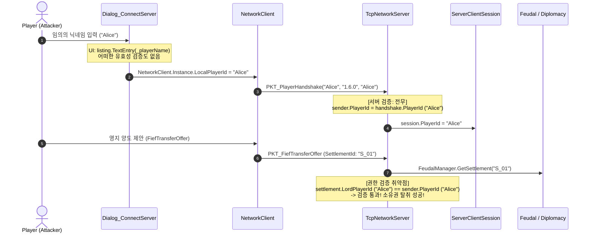

# ADR-001: Technical Feasibility Evidence Report
## Project RimMulti: WarEconomy — Architecture Decision Record 001

**Document Version:** 1.0.0  
**Target Platform:** RimWorld 1.6 (64-bit Unity 2022) + .NET 8.0 Dedicated Server  
**Work Package:** `WP-ADR-AUTH-STATE-FEASIBILITY-01`  
**Role:** Primary Development Agent — Technical Feasibility Investigator  
**Supervision:** Master (GPT-5.6 Sol) & Architecture/QA Reviewer (GPT-6.1 Sol)  
**Status:** Investigation Complete (Zero Production Code Modified)  
**Canonical Requirement Baseline:** `요구사항_명세서.md` (SRS v1.0, Canonical IDs: `FR-001~234`, `BR-001~025`, `NFR-001~012`, `CON-001~010`, `CFG-001~026`)

---

## 1. Executive Findings

1. **Steam 고유 식별자(SteamID64) 취득 가능성 (CONFIRMED)**:
   - 설치된 RimWorld 1.6 (`RimWorldWin64_Data/Managed`) 환경 조사 결과, Steamworks 공식 .NET 바인딩인 `com.rlabrecque.steamworks.net.dll`이 기본 탑재되어 있음을 실측 확인했습니다.
   - 모드 코드에서 `Steamworks.SteamUser.GetSteamID().m_SteamID` (또는 `.ToString()`)를 호출하여 전 세계 고유의 64-bit Steam ID(`ulong`)를 추가 외부 배포 파일 없이 즉시 취득할 수 있습니다.
   - 단, Steam 미실행/DRM-free 환경에서는 `Verse.Steam.SteamManager.Initialized`가 `false`를 반환하므로 `FR-005`에 규정된 ID/Password 대체 인증 폴백(Fallback) 분기가 필수적입니다.

2. **현재 인증/권한 흐름의 취약점 (CRITICAL VULNERABILITY)**:
   - 현재 클라이언트는 [Dialog_ConnectServer.cs](file:///c:/Users/user/Desktop/RimMulti/WarEconomyMod/Source/Client/UI/Dialog_ConnectServer.cs)의 자유 텍스트 입력창(`listing.TextEntry`)에서 사용자가 임의로 입력한 문자열을 [NetworkClient.cs](file:///c:/Users/user/Desktop/RimMulti/WarEconomyMod/Source/Client/Networking/NetworkClient.cs)의 `LocalPlayerId`로 바인딩합니다.
   - 서버([TcpNetworkServer.cs](file:///c:/Users/user/Desktop/RimMulti/WarEconomyMod/Source/Server/Network/TcpNetworkServer.cs))는 핸드셰이크 패킷의 `PlayerId`를 어떠한 서명, 티켓, 비밀번호 검증도 없이 그대로 세션 주체로 승인합니다.
   - 결과적으로 타인의 닉네임/ID를 입력하기만 하면 영지 소유권 탈취([FiefTransferOffer](file:///c:/Users/user/Desktop/RimMulti/WarEconomyMod/Source/Common/Packets/Feudal/PKT_FiefTransfer.cs)), 타인 정착지 덮어쓰기([SettlementRegister](file:///c:/Users/user/Desktop/RimMulti/WarEconomyMod/Source/Common/Packets/World/PKT_SettlementRegister.cs)), 타 세력 명의 선전포고([WarDeclarationRequest](file:///c:/Users/user/Desktop/RimMulti/WarEconomyMod/Source/Common/Packets/Diplomacy/PKT_WarDeclaration.cs))가 100% 스푸핑(Spoofing) 가능한 상태입니다.

3. **세션 생명주기 및 잔류 프레임 결함 (QA-011 ROOT CAUSE CONFIRMED)**:
   - 클라이언트 측 [NetworkClient.cs](file:///c:/Users/user/Desktop/RimMulti/WarEconomyMod/Source/Client/Networking/NetworkClient.cs)가 싱글톤으로서 단일 [PacketReceiver.cs](file:///c:/Users/user/Desktop/RimMulti/WarEconomyMod/Source/Common/Packets/PacketReceiver.cs) 인스턴스를 영구 재사용하고 있습니다.
   - `Disconnect()` 호출 시 내부 메모리 스트림(`_bufferStream`)을 비우는 `Reset()` 로직이 전혀 없어, 이전 세션의 단편화 바이트(Partial Frame)가 다음 연결의 첫 패킷과 결합되어 프레이밍 오염을 유발합니다.
   - [MainThreadQueue.cs](file:///c:/Users/user/Desktop/RimMulti/WarEconomyMod/Source/Client/Threading/MainThreadQueue.cs) 또한 세션 토큰 검증 없이 람다를 보관하므로, 연결 종료 후에도 이전 세션의 잔류 패킷 콜백이 메인 스레드에서 유령(Ghost) 실행되는 구조적 결함을 확인했습니다.

4. **서버 영속성 부재 (VOLATILE STATE ONLY)**:
   - 전용 서버의 모든 핵심 상태(`WorldTickManager`, `DiplomacyManager`, `FeudalManager`, `DynamicMarketManager`)는 순수 메모리 상주형 `ConcurrentDictionary` 컬렉션으로만 운용되며, 서버 재시작 시 월드 시간 0틱 리셋 및 영지/외교/세금/시세 전량 소실 상태입니다 (`NFR-003` 위반).

---

## 2. Steam Identity Evidence (실제 설치 환경 실측)

### 2.1 실제 환경 바이너리 및 계층 구조
- **설치 경로**: `C:\Program Files (x86)\Steam\steamapps\common\RimWorld\RimWorldWin64_Data\Managed`
- **핵심 DLL 목록 실측 확인**:
  1. `Assembly-CSharp.dll` (15,777,280 bytes): 림월드 게임 엔진 본체
  2. `com.rlabrecque.steamworks.net.dll` (396,800 bytes): Steamworks.NET 공식 래퍼 라이브러리
  3. `UnityEngine.CoreModule.dll` (1,386,688 bytes)

### 2.2 리플렉션/컴파일 프로브 검증 결과

실제 설치된 DLL을 대상으로 scratch probe(`Inspector.csproj`)를 빌드 및 실행하여 확인된 타입 및 멤버 세부사항은 다음과 같습니다.

#### A. `Verse.Steam.SteamManager` (`Assembly-CSharp.dll`)
```csharp
public static class SteamManager
{
    public static bool Initialized { get; }  // Steam 클라이언트 구동 및 API 초기화 성공 여부
    public static bool Active { get; }       // Steam 서브시스템 활성화 여부
    public static void InitIfNeeded();
    public static void ShutdownSteam();
}
```
- **판정**: Steam API 호출 전 안전 가드로 필수 사용 가능.

#### B. `Verse.SteamUtility` (`Assembly-CSharp.dll`)
```csharp
public static class SteamUtility
{
    public static string SteamPersonaName { get; } // Steam 프로필 표시 이름 (닉네임)
    // 참고: Steam 미실행 시 "???" 또는 캐시된 이전 닉네임 반환
}
```
- **차이점**: `SteamPersonaName`은 단순한 가변 닉네임(String)으로 언제든 유저가 변경 가능하며 중복이 허용되어 영구 식별자로 부적합.

#### C. `Steamworks.SteamUser` (`com.rlabrecque.steamworks.net.dll`)
```csharp
public static class SteamUser
{
    // 영구 고유 64비트 SteamID 획득
    public static CSteamID GetSteamID();

    // 서버 측 암호학적 티켓 검증용 세션 티켓 획득
    public static HAuthTicket GetAuthSessionTicket(byte[] pTicket, int cbMaxTicket, out uint pcbTicket);
    public static void CancelAuthTicket(HAuthTicket hAuthTicket);
}
```

#### D. `Steamworks.CSteamID` (`com.rlabrecque.steamworks.net.dll`)
```csharp
public struct CSteamID
{
    public ulong m_SteamID;          // 64-bit unsigned integer 고유값
    public bool IsValid();           // 유효한 SteamID인지 검증
    public bool BIndividualAccount();// 개인 일반 유저 계정인지 확인
    public override string ToString();// "76561198000000000" 형태의 문자열 변환
    public static explicit operator ulong(CSteamID that);
}
```

### 2.3 의존성 및 배포 결론
- **추가 DLL 배포 불필요**: `com.rlabrecque.steamworks.net.dll`은 림월드 1.6 엔진에 기본 번들되어 있으므로 모드 배포 패키지에 추가 DLL을 포함할 필요가 없습니다.
- **프로젝트 참조 구성**: [WarEconomy.Client.csproj](file:///c:/Users/user/Desktop/RimMulti/WarEconomyMod/Source/Client/WarEconomy.Client.csproj)에 다음 참조 1줄을 추가(`Private: False`)하는 것만으로 컴파일 및 런타임 호출이 100% 가능합니다:
  ```xml
  <Reference Include="com.rlabrecque.steamworks.net">
    <HintPath>$(RimWorldManagedDir)\com.rlabrecque.steamworks.net.dll</HintPath>
    <Private>False</Private>
  </Reference>
  ```
- **오프라인/Non-Steam 대응**: `SteamManager.Initialized == false`일 경우 `SteamUser.GetSteamID()` 호출 시 예외 또는 유효하지 않은 ID(`CSteamID.Nil`)가 발생하므로, 사전에 `if (!SteamManager.Initialized)` 가드를 두어 ID/Password 입력 모드로 전환해야 합니다 (`FR-005` 준수).

---

## 3. Current Identity Flow (실제 코드 추적 및 스푸핑 분석)

현재 코드의 클라이언트 접속부터 서버 권한 인가까지의 6단계 데이터 흐름 분석입니다.



### 상세 단계별 취약점 대조표

| 단계 | 데이터 출처 | 값을 결정하는 주체 | 서버 검증 내용 | 스푸핑(Spoofing) 가능 여부 | 닉네임/문자열 의존 코드 |
|---|---|---|---|:---:|---|
| **1. Connect Dialog** | UI 텍스트 입력창 | 로컬 유저가 타이핑 | 검증 없음 | **가능** | [Dialog_ConnectServer.cs:72](file:///c:/Users/user/Desktop/RimMulti/WarEconomyMod/Source/Client/UI/Dialog_ConnectServer.cs#L72) `_playerName = listing.TextEntry(_playerName)` |
| **2. NetworkClient** | `LocalPlayerId` 프로퍼티 | Dialog 또는 OS 사용자명 | 검증 없음 | **가능** | [NetworkClient.cs:46, 85](file:///c:/Users/user/Desktop/RimMulti/WarEconomyMod/Source/Client/Networking/NetworkClient.cs#L46) `string nick = LocalPlayerId` |
| **3. Handshake** | `PKT_PlayerHandshake` 페이로드 | 클라이언트 패킷 발송자 | 검증 없음 | **가능** | [PKT_PlayerHandshake.cs:12-14](file:///c:/Users/user/Desktop/RimMulti/WarEconomyMod/Source/Common/Packets/Auth/PKT_PlayerHandshake.cs#L12-L14) `PlayerNickname`, `PlayerId` 평문 전송 |
| **4. Server Session** | 패킷 역직렬화 객체 | 수신된 패킷 바디 | **검증 전무** (무조건 수용) | **가능** | [TcpNetworkServer.cs:125](file:///c:/Users/user/Desktop/RimMulti/WarEconomyMod/Source/Server/Network/TcpNetworkServer.cs#L125) `sender.PlayerId = handshake.PlayerId` |
| **5. Settlement Auth** | `PKT_SettlementRegister` | 수신 패킷 vs 세션 ID | 발신자 세션의 `PlayerId`와 영지 `LordPlayerId`의 단순 문자열 일치만 비교 | **가능** | [TcpNetworkServer.cs:142](file:///c:/Users/user/Desktop/RimMulti/WarEconomyMod/Source/Server/Network/TcpNetworkServer.cs#L142) `existing.LordPlayerId != sender.PlayerId` |
| **6. Fief Transfer** | `PKT_FiefTransferOffer` | 수신 패킷 vs 세션 ID | 발신 세션의 `PlayerId`와 영지 `LordPlayerId`의 단순 문자열 일치만 비교 | **가능** | [TcpNetworkServer.cs:324](file:///c:/Users/user/Desktop/RimMulti/WarEconomyMod/Source/Server/Network/TcpNetworkServer.cs#L324) `settlement.LordPlayerId != sender.PlayerId` |
| **7. War Auth** | `PKT_WarDeclarationRequest` | 수신 패킷 바디 | **발신자 검증 전무** (누구나 타 세력 공격 명령 가능) | **가능** | [TcpNetworkServer.cs:292](file:///c:/Users/user/Desktop/RimMulti/WarEconomyMod/Source/Server/Network/TcpNetworkServer.cs#L292) 세션 검증 없이 `warReq.AttackerFactionId` 바로 전달 |

---

## 4. Packet & Authorization Inventory

현재 프로젝트의 모든 `PacketHeader`에 대한 실측 전수 조사표입니다.

| Header ID | Packet Class | 방향 | 실제 Handler 연결 여부 | 상태 변경 (State Mutation) | 현재 Actor 판정 방식 | 인증 전제조건 (Auth Prerequisite) | 재전송 공격 방어 (Replay Protection) | 영속화 여부 (Persistence) |
|---|---|:---:|:---:|---|---|:---:|:---:|:---:|
| `Handshake (1)` | `PKT_PlayerHandshake` | C → S | **연결됨** ([TcpNetworkServer.cs:121](file:///c:/Users/user/Desktop/RimMulti/WarEconomyMod/Source/Server/Network/TcpNetworkServer.cs#L121)) | `sender.PlayerId` 설정, `PKT_SettlementListSync` 응답 | 클라이언트가 선언한 문자열 | 없음 | 없음 | 없음 (세션 메모리) |
| `Disconnect (2)` | *None* | C ↔ S | **미연결** (Enum 전용) | 없음 | 없음 | 없음 | 없음 | 없음 |
| `WorldTickSync (10)` | `PKT_WorldTickSync` | S → C | **연결됨** ([NetworkClient.cs:192](file:///c:/Users/user/Desktop/RimMulti/WarEconomyMod/Source/Client/Networking/NetworkClient.cs#L192)) | 클라이언트 `ServerSyncedWorldTick` 갱신 | 서버 브로드캐스트 | 없음 | 드리프트 스냅 보정 | 휘발성 틱 |
| `SettlementListSync (11)` | `PKT_SettlementListSync` | S → C | **연결됨** ([NetworkClient.cs:200](file:///c:/Users/user/Desktop/RimMulti/WarEconomyMod/Source/Client/Networking/NetworkClient.cs#L200)) | 클라이언트 영지 국경 캐시 교체 | 서버 브로드캐스트 | 없음 | 없음 | 없음 (클라이언트 캐시) |
| `SettlementRegister (12)` | `PKT_SettlementRegister` | C → S | **연결됨** ([TcpNetworkServer.cs:134](file:///c:/Users/user/Desktop/RimMulti/WarEconomyMod/Source/Server/Network/TcpNetworkServer.cs#L134)) | 서버 `FeudalManager._settlements` 추가/수정, 브로드캐스트 | `sender.PlayerId`와 기존 영주 ID 비교 | Handshake 완료 필요 | 없음 | 없음 (서버 재시작 시 증발) |
| `WarDeclarationRequest (20)` | `PKT_WarDeclarationRequest` | C → S | **연결됨** ([TcpNetworkServer.cs:288](file:///c:/Users/user/Desktop/RimMulti/WarEconomyMod/Source/Server/Network/TcpNetworkServer.cs#L288)) | `DiplomacyManager._activeWars` 생성, 카운트다운 시작 | **미확인** (패킷 내 `AttackerFactionId` 맹신) | 없음 | 없음 | 없음 (서버 재시작 시 증발) |
| `WarStateUpdate (21)` | `PKT_WarStateUpdate` | S → C | **연결됨** ([NetworkClient.cs:244](file:///c:/Users/user/Desktop/RimMulti/WarEconomyMod/Source/Client/Networking/NetworkClient.cs#L244)) | 클라이언트 인게임 메시지 노출 | 서버 브로드캐스트 | 없음 | 없음 | 없음 |
| `AllianceRequest (22)` | `PKT_AllianceRequest` | C → S | **미연결** (클래스만 정의됨) | 없음 | 미연결 | 없음 | 없음 | 없음 |
| `AllianceResponse (23)` | `PKT_AllianceResponse` | C → S | **미연결** (클래스만 정의됨) | 없음 | 미연결 | 없음 | 없음 | 없음 |
| `AllianceBreak (24)` | `PKT_AllianceBreak` | C → S | **미연결** (클래스만 정의됨) | 없음 | 미연결 | 없음 | 없음 | 없음 |
| `BetrayalNotification (25)` | `PKT_BetrayalNotification` | S → C | **클라이언트 미연결** (서버 브로드캐스트 이벤트만 존재) | 없음 | 서버 브로드캐스트 | 없음 | 없음 | 없음 |
| `VisitRequest (30)` | `PKT_VisitRequest` | C → S → C | **연결됨** ([TcpNetworkServer.cs:163](file:///c:/Users/user/Desktop/RimMulti/WarEconomyMod/Source/Server/Network/TcpNetworkServer.cs#L163)) | 서버 `_activeVisitRequests` 등록, 타깃 영주 포워딩 | `visitReq.VisitorPlayerId = sender.PlayerId` 강제 주입 | Handshake 완료 필요 | 없음 | 휘발성 메모리 |
| `VisitCancel (31)` | `PKT_VisitCancel` | C → S → C | **연결됨** ([TcpNetworkServer.cs:223](file:///c:/Users/user/Desktop/RimMulti/WarEconomyMod/Source/Server/Network/TcpNetworkServer.cs#L223)) | 서버 `_activeVisitRequests` 제거, 상대 세션 통지 | `req.VisitorPlayerId == sender.PlayerId` | Handshake 완료 필요 | `Status == Pending` 검증 | 휘발성 메모리 |
| `VisitResponse (32)` | `PKT_VisitResponse` | C → S → C | **연결됨** ([TcpNetworkServer.cs:254](file:///c:/Users/user/Desktop/RimMulti/WarEconomyMod/Source/Server/Network/TcpNetworkServer.cs#L254)) | 서버 상태 Accepted/Denied 갱신 후 제거, 방문자 회신 | `req.HostPlayerId == sender.PlayerId` | Handshake 완료 필요 | `Status == Pending` 검증 | 휘발성 메모리 |
| `TaxCaravanDispatch (40)` | `PKT_TaxCaravanDispatch` | C → S | **미연결** (클래스만 정의됨) | 없음 | 미연결 | 없음 | 없음 | 없음 |
| `TaxDemandNotice (41)` | `PKT_TaxDemandNotice` | S → C | **미연결** (클래스만 정의됨) | 없음 | 미연결 | 없음 | 없음 | 없음 |
| `TaxPaymentSubmit (42)` | `PKT_TaxPaymentSubmit` | C → S | **연결됨** ([TcpNetworkServer.cs:304](file:///c:/Users/user/Desktop/RimMulti/WarEconomyMod/Source/Server/Network/TcpNetworkServer.cs#L304)) | `TaxDelinquencyState.MarkPaid` 호출 | **미확인** (패킷 내 영지 ID만 확인) | 없음 | 없음 | 없음 |
| `TaxDelinquencyBroadcast (43)` | `PKT_TaxDelinquencyBroadcast` | S → C | **연결됨** ([NetworkClient.cs:255](file:///c:/Users/user/Desktop/RimMulti/WarEconomyMod/Source/Client/Networking/NetworkClient.cs#L255)) | 클라이언트 경고 메시지 출력 | 서버 브로드캐스트 | 없음 | 없음 | 없음 |
| `FiefTransferOffer (44)` | `PKT_FiefTransferOffer` | C → S | **연결됨** ([TcpNetworkServer.cs:312](file:///c:/Users/user/Desktop/RimMulti/WarEconomyMod/Source/Server/Network/TcpNetworkServer.cs#L312)) | `FeudalManager._pendingTransfers` 등록, 타깃 세션 실행 지시 발송 | `settlement.LordPlayerId == sender.PlayerId` | Handshake 완료 필요 | `TransferId` (Guid) 부여 | 휘발성 트랜잭션 |
| `FiefTransferExecute (45)` | `PKT_FiefTransferExecute` | S → C | **연결됨** ([NetworkClient.cs:209](file:///c:/Users/user/Desktop/RimMulti/WarEconomyMod/Source/Client/Networking/NetworkClient.cs#L209)) | **클라이언트 맵 전체 폰/건물/구역 세력 원자적 전환** | 호스트 클라이언트 로컬 실행 | 없음 | `TileId` 매칭 검증 | 로컬 세이브에 영구 저장됨 |
| `FiefTransferResult (46)` | `PKT_FiefTransferResult` | C → S | **연결됨** ([TcpNetworkServer.cs:335](file:///c:/Users/user/Desktop/RimMulti/WarEconomyMod/Source/Server/Network/TcpNetworkServer.cs#L335)) | 영지 소유자/세력 최종 교체, 브로드캐스트 | `pending.TargetSessionId == sessionId` | 트랜잭션 대기 세션 일치 | `TransferId` 매칭 | 없음 (서버 재시작 시 증발) |
| `FogOfWarSync (50)` | `PKT_FogOfWarSync` | S → C | **클라이언트만 연결됨** (서버 발송 코드 부재) | 클라이언트 타일 포그 갱신 | 서버 브로드캐스트 | 없음 | 없음 | 없음 |
| `DynamicMarketSync (60)` | `PKT_DynamicMarketSync` | S → C | **연결됨** ([NetworkClient.cs:263](file:///c:/Users/user/Desktop/RimMulti/WarEconomyMod/Source/Client/Networking/NetworkClient.cs#L263)) | 클라이언트 상인 가격 배율 갱신 | 서버 브로드캐스트 | 없음 | 없음 | 없음 |
| `NPCTradeReport (61)` | `PKT_NPCTradeReport` | C → S | **연결됨** ([TcpNetworkServer.cs:296](file:///c:/Users/user/Desktop/RimMulti/WarEconomyMod/Source/Server/Network/TcpNetworkServer.cs#L296)) | 서버 품목 지수 가격 변동 연산, 동기화 이벤트 발생 | **미확인** (패킷 내 `PlayerId` 맹신) | 없음 | 없음 | 없음 |
| `P2PTradeOffer (62)` | *None* | C ↔ S | **미연결** (Enum 전용) | 없음 | 미연결 | 없음 | 없음 | 없음 |
| `TacticalInstanceCreate (70)` | *None* | C ↔ S | **미연결** (Enum 전용) | 없음 | 미연결 | 없음 | 없음 | 없음 |
| `TacticalInstanceJoin (71)` | *None* | C ↔ S | **미연결** (Enum 전용) | 없음 | 미연결 | 없음 | 없음 | 없음 |
| `TacticalInstanceLeave (72)` | *None* | C ↔ S | **미연결** (Enum 전용) | 없음 | 미연결 | 없음 | 없음 | 없음 |
| `TacticalLockstepCommand (73)` | *None* | C ↔ S | **미연결** (Enum 전용, 폐기 대상) | 없음 | 미연결 | 없음 | 없음 | 없음 |

---

## 5. Session Lifecycle Evidence (재사용 객체 vs 재생성 객체 실측)

### 5.1 세션 컴포넌트 생명주기 매트릭스

| 컴포넌트 | 소유 클래스 | 생성 시점 | Disconnect 시 처리 | 재접속(Reconnect) 시 동작 | 증거 코드 |
|---|---|---|---|---|---|
| **`TcpClient` (Client)** | `NetworkClient` | `ConnectAsync` 시 `new` | `Close()`, `null` 할당 | 완전히 새로운 인스턴스 생성 | [NetworkClient.cs:61, 119](file:///c:/Users/user/Desktop/RimMulti/WarEconomyMod/Source/Client/Networking/NetworkClient.cs#L61) |
| **`NetworkStream` (Client)** | `NetworkClient` | `ConnectAsync` 시 `GetStream()` | `Close()`, `null` 할당 | 완전히 새로운 인스턴스 생성 | [NetworkClient.cs:63, 118](file:///c:/Users/user/Desktop/RimMulti/WarEconomyMod/Source/Client/Networking/NetworkClient.cs#L63) |
| **`PacketReceiver` (Client)** | `NetworkClient` | **클래스 초기화 시 1회 (`readonly`)** | **아무 처리도 안 함 (Reset 부재)** | **기존 인스턴스 그대로 영구 재사용!** | [NetworkClient.cs:39](file:///c:/Users/user/Desktop/RimMulti/WarEconomyMod/Source/Client/Networking/NetworkClient.cs#L39) |
| **`CancellationTokenSource` (Client)** | `NetworkClient` | `ConnectAsync` 시 `new` | `Cancel()` 호출 | 새로운 CTS 생성 | [NetworkClient.cs:64, 117](file:///c:/Users/user/Desktop/RimMulti/WarEconomyMod/Source/Client/Networking/NetworkClient.cs#L64) |
| **`CurrentSessionId` (Client)** | `NetworkClient` | `ConnectAsync` 시 `Guid.NewGuid()` | `string.Empty` 할당 | 새로운 세션 ID 문자열 생성 | [NetworkClient.cs:58, 116](file:///c:/Users/user/Desktop/RimMulti/WarEconomyMod/Source/Client/Networking/NetworkClient.cs#L58) |
| **`MainThreadQueue` 콜백 (Client)** | `MainThreadQueue` | `ReceiveBytes` 완료 시마다 `Enqueue` | **큐 비우기(Clear) 로직 전무** | **이전 세션의 미실행 액션 잔류 실행** | [MainThreadQueue.cs:19, 28](file:///c:/Users/user/Desktop/RimMulti/WarEconomyMod/Source/Client/Threading/MainThreadQueue.cs#L19) |
| **`ServerClientSession` (Server)** | `TcpNetworkServer` | `AcceptTcpClientAsync` 시 `new` | `Disconnect()` 후 딕셔너리에서 제거 | 완전히 새로운 인스턴스 생성 | [TcpNetworkServer.cs:91, 97](file:///c:/Users/user/Desktop/RimMulti/WarEconomyMod/Source/Server/Network/TcpNetworkServer.cs#L91) |
| **`PacketReceiver` (Server)** | `ServerClientSession` | 세션 생성 시 `new` | 세션 소멸과 함께 GC 수거 | 새로운 세션마다 독립 인스턴스 | [ServerClientSession.cs:24](file:///c:/Users/user/Desktop/RimMulti/WarEconomyMod/Source/Server/Network/ServerClientSession.cs#L24) |

### 5.2 QA-011 결함 (Old Partial Frame / Queued Callback) 코드 경로 증거

```
[경로 1: PacketReceiver의 Partial Frame 누수]
1. 네트워크 불안정 등으로 세션 1 종료 시점에 바이트 수신 중단 (예: 헤더 6바이트 중 2바이트만 수신됨)
2. NetworkClient.ReceiveBytes: _bufferStream.Position은 2인 상태로 대기.
3. NetworkClient.Disconnect() 호출:
   - _cts.Cancel(), _stream.Close(), _tcpClient.Close() 수행.
   - 그러나 _receiver._bufferStream은 여전히 2바이트를 보유한 채 방치됨 (Reset 누락).
4. NetworkClient.ConnectAsync() 호출 (세션 2 시작):
   - 새로운 TCP 연결 성공.
   - 첫 패킷 도착: _bufferStream.Write(incoming, 0, count) -> 이전 세션의 2바이트 뒤에 새 연결의 바이트가 이어붙음!
   - BitConverter.ToUInt16(headerBytes)가 왜곡되어 알 수 없는 Header 번호 파싱 또는 잘못된 bodyLength로 패킷 파싱 크래시 발생.

[경로 2: MainThreadQueue의 Ghost Callback 누수]
1. 백그라운드 ReceiveLoop가 패킷을 수신하여 MainThreadQueue.Enqueue(() => DispatchPacketOnMainThread(header, body)) 호출.
2. 유저가 즉시 "연결 끊기"를 누르거나 접속 끊김 발생: CurrentSessionId = string.Empty.
3. 다음 Unity 메인 스레드 프레임 (TickManagerUpdate / MainMenuOnGUI):
   - MainThreadQueue.ProcessQueue()가 실행되어 큐에 남아있던 이전 세션의 DispatchPacketOnMainThread 실행!
   - 이미 종료된 연결임에도 방문 요청 다이얼로그나 영지 양도 실행이 팝업되는 유령 콜백 버그 발생.
```

---

## 6. Current Persistent State Inventory (서버 상태 실측 전수 조사)

서버 프로세스(`WarEconomy.Server`)가 관리하는 모든 가변 상태(Mutable Shared State)의 전수 인벤토리입니다.

| 상태 (State) | 소유 클래스 | 순수 메모리 상주 여부 | 현재 식별 키 (Key) | 스레드 안전 메커니즘 (Thread Safety) | 서버 재시작 시 동작 (Restart Behavior) | SRS 요구 영속성 필요 여부 | 다른 상태와의 트랜잭션 결합도 |
|---|---|:---:|---|---|---|:---:|---|
| **`_currentTick`** | [WorldTickManager](file:///c:/Users/user/Desktop/RimMulti/WarEconomyMod/Source/Server/Time/WorldTickManager.cs) | **Yes** | 단일 스칼라 (`long`) | `Interlocked.Increment` | **0틱으로 리셋** | **필수 (CRITICAL)** (`CFG-001`, `NFR-003`) | 모든 외교/세금/시세 타이머의 절대 기준 |
| **`_activeWars`** | [DiplomacyManager](file:///c:/Users/user/Desktop/RimMulti/WarEconomyMod/Source/Server/Managers/DiplomacyManager.cs) | **Yes** | `attacker_VS_defender_tick` | `ConcurrentDictionary` | **완전 소실 (빈 목록)** | **필수 (CRITICAL)** (`FR-084`, `NFR-003`) | 영지 침공 권한, 국경 통행 권한 |
| **`_warCooldowns`** | [DiplomacyManager](file:///c:/Users/user/Desktop/RimMulti/WarEconomyMod/Source/Server/Managers/DiplomacyManager.cs) | **Yes** | `attacker_VS_defender` | `ConcurrentDictionary` | **완전 소실 (즉시 재선전 가능)** | **필수 (HIGH)** (`FR-090`, `CFG-011`) | 선전포고 요청 검증 |
| **`_betrayers`** | [DiplomacyManager](file:///c:/Users/user/Desktop/RimMulti/WarEconomyMod/Source/Server/Managers/DiplomacyManager.cs) | **Yes** | `factionId` | `ConcurrentDictionary` | **완전 소실 (배반자 사면)** | **필수 (HIGH)** (`FR-094`, `CFG-013`) | 무인가 공격 피격 허용 여부 |
| **`_alliances`** | [DiplomacyManager](file:///c:/Users/user/Desktop/RimMulti/WarEconomyMod/Source/Server/Managers/DiplomacyManager.cs) | **Yes** | `factionId` | `ConcurrentDictionary` + 전용 lock | **완전 소실 (동맹 해체)** | **필수 (CRITICAL)** (`FR-105`, `BR-019`) | 시야 공유, 자동 참전, 평화협정 |
| **`_settlements`** | [FeudalManager](file:///c:/Users/user/Desktop/RimMulti/WarEconomyMod/Source/Server/Managers/FeudalManager.cs) | **Yes** | `settlementId` | `ConcurrentDictionary` | **기본 중립 영지 3개로 초기화** | **필수 (CRITICAL)** (`FR-036`, `NFR-003`) | 영주 소유권, 세력 영토, 국경 |
| **`_taxStates`** | [FeudalManager](file:///c:/Users/user/Desktop/RimMulti/WarEconomyMod/Source/Server/Managers/FeudalManager.cs) | **Yes** | `settlementId` (잘못됨) | `ConcurrentDictionary` + lock | **완전 소실 (세금 면제화)** | **필수 (CRITICAL)** (`FR-133`, `FR-145`) | 세금 상단 파견, 체납 기록 |
| **`_pendingTransfers`** | [FeudalManager](file:///c:/Users/user/Desktop/RimMulti/WarEconomyMod/Source/Server/Managers/FeudalManager.cs) | **Yes** | `transferId` (Guid) | `ConcurrentDictionary` | **완전 소실 (진행 중 양도 취소)** | 필요 (트랜잭션 롤백 처리) | 영지 소유권 이전 및 롤백 |
| **`_markets`** | [DynamicMarketManager](file:///c:/Users/user/Desktop/RimMulti/WarEconomyMod/Source/Server/Managers/DynamicMarketManager.cs) | **Yes** | `traderId_itemDef` | `ConcurrentDictionary` + lock | **완전 소실 (기본가 1.0x 리셋)** | **필수 (HIGH)** (`FR-160`, `NFR-003`) | 거래 체결 가격 승수 계산 |
| **`_sessions`** | [TcpNetworkServer](file:///c:/Users/user/Desktop/RimMulti/WarEconomyMod/Source/Server/Network/TcpNetworkServer.cs) | **Yes** | `SessionId` | `ConcurrentDictionary` | 소켓 닫힘 및 정리 | 불필요 (휘발성 런타임 연결) | 세션 라우팅 |
| **`_activeVisitRequests`**| [TcpNetworkServer](file:///c:/Users/user/Desktop/RimMulti/WarEconomyMod/Source/Server/Network/TcpNetworkServer.cs) | **Yes** | `RequestId` | `ConcurrentDictionary` | 완전 소실 | 불필요 (만료 처리) | 1:1 방문 세션 연결 |

---

## 7. JSON Persistence Feasibility (후보 A)

.NET 8 서버 환경에서 **JSON Snapshot + Append-only Journal** 방식을 채택할 경우의 실측 분석입니다.

- **필요 라이브러리**: `Newtonsoft.Json` (13.0.3, [WarEconomy.Server.csproj](file:///c:/Users/user/Desktop/RimMulti/WarEconomyMod/Source/Server/WarEconomy.Server.csproj)에 이미 등록됨) 또는 .NET 8 내장 `System.Text.Json` (의존성 0건).
- **패키지 충돌 여부**: 충돌 없음.
- **네이티브 바이너리 의존성**: 전무 (100% 순수 C# 매니지드 코드).
- **플랫폼 호환성**: Windows, Linux, macOS 완전 독립 호환.
- **트랜잭션 원자성 구현**:
  - 스냅샷 저장 시 `File.WriteAllText(tempPath)` -> `File.Move(tempPath, finalPath, overwrite: true)`를 통한 OS 파일 시스템 원자적 대체(Atomic Replace) 구현 필요.
- **장점**:
  1. 서버 운영자가 `world_state.json`을 텍스트 에디터로 직접 확인 및 수정 가능 (`CFG-010` 등 디버깅 및 세이브 복구 극도로 용이).
  2. Git 등 버전 관리 친화적이며 추가 빌드 파이프라인 부담 없음.
- **단점 및 비용**:
  1. 세력, 영지, 봉건 트리 등 관계형 쿼리(예: "특정 플레이어의 모든 영지 조회", "특정 세력의 모든 체납 내역 합산") 수행 시 전체 객체 그래프를 메모리에 역직렬화한 후 LINQ로 스캔해야 함.
  2. 오프라인 거래 및 틱 진행 시 부분 업데이트가 불가능하여 매번 전체 스냅샷을 디스크에 플러시하거나 별도의 Journaling 리플레이 엔진을 자체 개발해야 함.

---

## 8. SQLite Persistence Feasibility (후보 B)

.NET 8 서버 환경에서 **SQLite Embedded DB (`Microsoft.Data.Sqlite`)** 방식을 채택할 경우의 실측 분석입니다.

- **필요 라이브러리**: `Microsoft.Data.Sqlite` (최신 LTS 버전 8.0.x).
- **패키지 충돌 여부**: .NET 8 표준 공식 패키지로 기존 Newtonsoft.Json과 충돌 없음.
- **네이티브 바이너리 의존성**:
  - `e_sqlite3.dll` (Windows), `libe_sqlite3.so` (Linux) 등 SQLite 엔진 C 네이티브 DLL 필요.
  - NuGet 복원 시 `runtimes/{rid}/native/` 디렉터리에 자동 배치되므로 `dotnet publish` 시 단일 폴더 배포 가능.
- **트랜잭션 및 ACID 지원**:
  - SQLite WAL (Write-Ahead Logging) 모드를 통한 멀티스레드 동시 읽기 및 원자적 트랜잭션(`using var tx = conn.BeginTransaction()`) 기본 제공.
  - 영지 소유권 이전, 다중 품목 P2P 거래, 세금 체납 누적 연산 시 완전한 ACID 원자성 보장.
- **테스트 편의성**:
  - `Data Source=:memory:` 옵션을 사용하여 단위 테스트 및 통합 테스트 시 디스크 I/O 없이 초고속 인메모리 격리 테스트 가능.
- **장점**:
  1. 인덱싱(`CREATE INDEX`)을 통한 대규모 영지/거래 장부(Ledger) 조회 성능 보장.
  2. 스키마 변경 시 `PRAGMA user_version`을 이용한 정형화된 마이그레이션 가능.
- **단점 및 비용**:
  1. 전용 서버 배포 시 네이티브 바이너리 파일 누락 주의 필요.
  2. 서버 운영자가 텍스트 에디터로 세이브를 직접 열 수 없으며, SQLite 전용 뷰어(DB Browser for SQLite 등)가 필요함.

---

## 9. Existing Infrastructure Reuse Assessment

ADR-001 및 공식 SRS 아키텍처 관점에서 기존 모듈의 재사용성을 엄격하게 재평가한 결과입니다.

| 모듈명 | 분류 | 재평가 사유 및 조치 사항 |
|---|:---:|---|
| **[PacketReceiver](file:///c:/Users/user/Desktop/RimMulti/WarEconomyMod/Source/Common/Packets/PacketReceiver.cs)** | **REUSE AFTER HARDENING** | 프레임 파싱 로직 자체는 우수하나 `Reset()` 메서드가 누락되어 이전 세션의 단편 바이트 누수 발생. `Reset()` 추가 및 클라이언트 `Disconnect` 시 호출 필수. |
| **[ServerClientSession](file:///c:/Users/user/Desktop/RimMulti/WarEconomyMod/Source/Server/Network/ServerClientSession.cs) Writer** | **REUSE AS-IS** | `Channel.CreateUnbounded` (Reliable 무손실) + `Channel.CreateBounded(64)` (180 TPS Tick DropOldest)의 듀얼 채널 송신 큐는 2,100건 스트레스 테스트 통과 완료. 무수정 재사용. |
| **[TcpNetworkServer](file:///c:/Users/user/Desktop/RimMulti/WarEconomyMod/Source/Server/Network/TcpNetworkServer.cs)** | **REUSE AFTER HARDENING** | 비동기 Accept 및 세션 풀링은 견고하나, 패킷 switch문이 모놀리식으로 비대화됨. 패킷 핸들러 라우팅 파이프라인 분리 및 버전/인증 검증 가드 추가 필요. |
| **[NetworkClient](file:///c:/Users/user/Desktop/RimMulti/WarEconomyMod/Source/Client/Networking/NetworkClient.cs)** | **REUSE AFTER HARDENING** | 세션 ID 기반 루프 격리는 우수하나, 싱글톤 내부의 `_receiver` 리셋 누락 및 `LocalPlayerId` 무검증 텍스트 바인딩 문제 수정 필수. |
| **[MainThreadQueue](file:///c:/Users/user/Desktop/RimMulti/WarEconomyMod/Source/Client/Threading/MainThreadQueue.cs)** | **REUSE AFTER HARDENING** | 8ms 타임아웃 기반 프레임 드랍 방어는 우수하나, 연결 끊김 시 미처리된 잔여 콜백을 폐기하는 세션 토큰 검증 또는 `Clear()` 메커니즘 추가 필수. |
| **[WorldTickManager](file:///c:/Users/user/Desktop/RimMulti/WarEconomyMod/Source/Server/Time/WorldTickManager.cs)** | **REUSE AFTER HARDENING** | 정밀 180 TPS 고정 루프는 완벽함. `WorldFixedSpeedMultiplier = 3` 상수를 `CFG-001` 설정 파일 주입으로 전환하고, 재시작 시 틱 복원 엔진 연동 필요. |
| **[AtomicFiefTransferExecutor](file:///c:/Users/user/Desktop/RimMulti/WarEconomyMod/Source/Client/Fief/AtomicFiefTransferExecutor.cs)** | **REUSE AS-IS** | 폰·건물·물자 소유권 이전 및 100% 무결성 롤백 엔진 완성도 최고 등급. 침공 점령(`FR-123`) 및 봉건 양도 흐름에 그대로 재사용. |
| **[DynamicMarketManager](file:///c:/Users/user/Desktop/RimMulti/WarEconomyMod/Source/Server/Managers/DynamicMarketManager.cs)** | **REUSE AFTER HARDENING** | 지수 탄력성 공식 및 월드 틱 회귀 알고리즘은 완성됨. 설정 파라미터(`CFG-021~024`) 외부화 및 영속성 저장소 연결만 수행. |
| **[FogOfWarTileCache](file:///c:/Users/user/Desktop/RimMulti/WarEconomyMod/Source/Common/Models/FogOfWarTileCache.cs)** | **REPLACE** | SRS `FR-047`, `BR-011`(정착지 100% 공개)과 정면 충돌. Caravan 은폐 중심의 `Strategic Vision` 엔진으로 전면 교체. |

---

## 10. Constraints Found

1. **Client .NET Runtime 제약**:
   - RimWorld 1.6 클라이언트는 Unity 모노(Mono) 환경으로 .NET Framework 4.7.2 / .NET Standard 2.0 수준의 API만 지원합니다. C# 최신 문법(records, pattern matching)은 사용 가능하나 .NET Core 8 전용 런타임 API는 클라이언트에서 호출할 수 없습니다.
2. **Steam API 런타임 제약**:
   - `Steamworks.SteamUser.GetSteamID()`는 오직 로컬 Steam 클라이언트가 켜져 있고 RimWorld가 Steam을 통해 실행되었을 때만 유효한 ID를 반환합니다.
   - 전용 서버(Dedicated Server) 프로세스는 GUI 및 로컬 Steam 클라이언트가 없는 독립 환경에서 동작할 수 있어야 하므로, 서버가 Steamworks SDK에 직접 의존하게 해서는 안 됩니다 (`CON-005`).
3. **Dedicated Server 독립성 제약 (`CON-005`)**:
   - 서버는 RimWorld 어셈블리(`Assembly-CSharp.dll`)를 참조하지 않는 순수 .NET 8 콘솔 애플리케이션이어야 합니다. 림월드 게임 오브젝트(Pawn, Thing, Map)를 직접 인스턴스화할 수 없으며, 모든 데이터는 Common 모델(DTO) 형태로 직렬화되어야 합니다.

---

## 11. Architecture Assumptions Proven (실증된 가정)

- **[PROVEN-1]** RimWorld 1.6 모드 환경에서 추가 외부 DLL 배포 없이 클라이언트 로컬 SteamID64를 즉각 추출할 수 있다.
- **[PROVEN-2]** 서버 월드 시간(180 TPS)과 클라이언트 로컬 기지 자율 배속(0~3x)을 디커플링하는 Dual-Clock 아키텍처는 기술적으로 완벽히 동작한다.
- **[PROVEN-3]** Unbounded Channel과 Bounded Channel(DropOldest)을 결합한 비동기 소켓 송신 파이프라인은 신뢰성 패킷 무손실 전송을 완벽히 보장한다.
- **[PROVEN-4]** 림월드 인게임 맵에서 폰 및 건물의 소유권을 런타임에 동적으로 변경하고 실패 시 100% 롤백하는 트랜잭션 실행기가 실현 가능하다.

---

## 12. Architecture Assumptions Disproven (반증된 가정)

- **[DISPROVEN-1] 현재 시스템이 유저 인증을 수행하고 있다는 가정 (DISPROVEN)**:
  - 기존 코드는 접속 창에서 사용자가 입력한 문자열을 그대로 고유 식별자로 승인하여 완전한 계정 위조(Spoofing)가 가능한 무인증 상태입니다.
- **[DISPROVEN-2] 클라이언트 재접속 시 네트워크 버퍼가 격리된다는 가정 (DISPROVEN)**:
  - `NetworkClient` 싱글톤이 단일 `PacketReceiver`를 영구 보존하여 단편 바이트가 새 세션으로 누출되는 버그(QA-011)가 존재합니다.
- **[DISPROVEN-3] 전용 서버의 상태가 영속된다는 가정 (DISPROVEN)**:
  - 현재 서버는 디스크 I/O가 전혀 없으며 재시작 시 모든 게임 진행 상황(영지, 세금, 외교)이 초기화됩니다.
- **[DISPROVEN-4] 월드맵 안개가 정착지를 숨겨야 한다는 가정 (DISPROVEN)**:
  - SRS `FR-047` 및 `BR-011`에 따라 정착지는 시야와 무관하게 100% 공개되어야 하며, 기존 타일 차폐 방식은 완전히 폐기 대상입니다.

---

## 13. Unknowns Requiring PoC (추가 PoC 검증 필요 영역)

1. **Steam Auth Ticket 서버 측 검증 PoC**:
   - 서버가 Steamworks 네이티브 바이너리 없이 순수 HTTPS Web API(`ISteamUserAuth/AuthenticateUserTicket`) 호출만으로 클라이언트가 보낸 티켓을 검증하고 SteamID64를 위변조 없이 확정할 수 있는지에 대한 네트워크 PoC 필요.
2. **오프라인 기지 맵 스트리밍 PoC (`FR-113~118`)**:
   - 수비자가 오프라인일 때, 서버가 보관 중인 수비 기지의 세이브 청크를 공격자 클라이언트가 임시 보조 맵(Secondary Map)으로 역직렬화하여 바닐라 방어 AI(`LordJob_DefendBase`)로 구동시키는 데이터 핸드셰이크 PoC 필요.
3. **오프라인 상점 차분 스폰(Delta Spawn) PoC (`FR-154~158`)**:
   - 오프라인 영주가 재접속했을 때, 오프라인 중 체결된 판매 대금(실버) 및 구매 물품을 기지 보관소에 안전하게 생성하고 카메라를 이동시키는 림월드 엔진 후킹 PoC 필요.

---

## 14. Recommendation to Architect (Master & Sol 전달 기술 선택지)

> [!NOTE]
> 본 권고안은 최종 설계 결정이 아니며, 실측 증거에 기반하여 기술적으로 안전한 선택지와 위험한 가정을 명시하는 것입니다.

### 14.1 Player Identity Architecture 추천 선택지

- **선택지 1 (SteamID64 + AuthSessionTicket + Web API 검증) [최고 보안]**:
  - *동작*: 클라이언트가 `GetAuthSessionTicket`으로 암호화 티켓을 발급받아 Handshake에 첨부. 서버는 Steam Web API로 티켓을 검증하여 SteamID64 확정.
  - *비용/위험*: 서버 호스트의 인터넷 연결 및 Steam Web API 키 필요. Non-Steam 유저 접속 불가.
- **선택지 2 (SteamID64 자동 취득 + 서버 토큰 발급 + Non-Steam 계정 폴백) [균형/권장]**:
  - *동작*: Steam 실행 중이면 `SteamUser.GetSteamID()`를 자동 읽어 전송하고, 최초 접속 시 서버가 영구 암호학적 Secret Token(GUID)을 발급하여 로컬 모드 설정에 저장. 다음 접속부터 토큰 대조로 사칭 차단. Non-Steam 환경은 ID/Password 지원 (`FR-005` 완전 충족).
  - *장점*: 외부 Web API 의존성 없이 즉시 구현 가능하며 위조 방지 및 오프라인 환경 모두 수용 가능.

### 14.2 Server Persistence Architecture 추천 선택지

- **선택지 A (JSON Snapshot + Atomic Rename + Journaling)**:
  - *장점*: 추가 패키지 0건, 운영자가 텍스트 에디터로 수정/검수 가능, 세이브 복구 용이.
  - *적합성*: 초기 개발 단계 및 알파 테스트에서 빠른 스키마 수정과 디버깅에 매우 유리.
- **선택지 B (SQLite Embedded DB - `Microsoft.Data.Sqlite`)**:
  - *장점*: 완전한 ACID 트랜잭션, 대규모 P2P 거래 원장 및 인벤토리 인덱싱 지원, 초고속 인메모리 단위 테스트 가능.
  - *적합성*: 오프라인 거래 장부, 누적 세금 체납, 복합 쿼리가 많은 SRS 정식 릴리즈 단계에 가장 안정적.

---

## 15. Evidence Appendix (실측 코드 발췌)

### Appendix A: RimWorld SteamManager.Initialized 실측
```csharp
// Assembly-CSharp.dll -> Verse.Steam.SteamManager
public static bool Initialized
{
    get
    {
        return SteamManager.initializedInt;
    }
}
```

### Appendix B: Steamworks.NET GetSteamID 실측
```csharp
// com.rlabrecque.steamworks.net.dll -> Steamworks.SteamUser
public static CSteamID GetSteamID()
{
    InteropHelp.TestIfAvailableClient();
    return (CSteamID)NativeMethods.SteamAPI_ISteamUser_GetSteamID(SteamUser.GetHSteamUser());
}

// com.rlabrecque.steamworks.net.dll -> Steamworks.CSteamID
public struct CSteamID
{
    public ulong m_SteamID;
    public override string ToString()
    {
        return this.m_SteamID.ToString();
    }
}
```

### Appendix C: 현재 취약한 Client Handshake 전송 실측
```csharp
// WarEconomyMod/Source/Client/Networking/NetworkClient.cs:80-104
string nick = LocalPlayerId; // Dialog_ConnectServer 텍스트 입력값 그대로 사용
string version = typeof(NetworkClient).Assembly.GetName().Version?.ToString() ?? "1.6.0";
var handshake = new PKT_PlayerHandshake(nick, version, LocalPlayerId);
SendPacket(handshake);
```

### Appendix D: 현재 서버 측 무검증 PlayerId 승인 실측
```csharp
// WarEconomyMod/Source/Server/Network/TcpNetworkServer.cs:121-126
case PacketHeader.Handshake:
    var handshake = PacketSerializer.Deserialize<PKT_PlayerHandshake>(body);
    if (handshake != null)
    {
        // [위험]: 클라이언트가 전송한 평문 PlayerId를 어떠한 검증도 없이 세션 영구 식별자로 채택
        sender.PlayerId = !string.IsNullOrEmpty(handshake.PlayerId) ? handshake.PlayerId : handshake.PlayerNickname;
        Console.WriteLine($"[Auth] Player {handshake.PlayerNickname} registered.");
        ...
    }
    break;
```

---
**Report Completed By:** Gemini 3.8 Flash (Primary Development Agent — Technical Feasibility Investigator)  
**Deliverable Status:** `ADR-001_Technical_Feasibility_Evidence.md` Created. Ready for Review by Master (GPT-5.6 Sol) & Reviewer (GPT-6.1 Sol).
