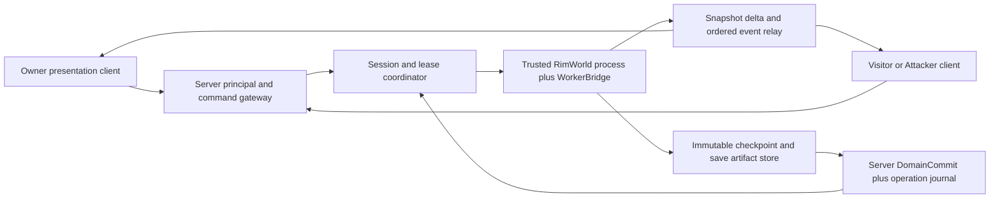

# ADR-002 — Tactical Session & Offline Combat Authority

- Work Package: **WP-ADR-TACTICAL-OFFLINE-01**
- Role: Architecture / QA Reviewer
- Decision Status: **PROVISIONALLY ACCEPTED** — Master Work Order WP-QA-TAC-ENGINE-01
- Decision owner: Master (GPT-5.6 Sol)
- Date: 2026-10-01 (Asia/Seoul)
- Prerequisite: **ADR-001 ACCEPTED**, Official Gap Baseline v1 ADOPTED
- Architecture Gate: **BLOCKED BY ARCHITECTURE 유지**
- Production code / game process / deployment: **변경·실행 없음**
- Existing defects: **QA-001~QA-014 OPEN**. 본 설계는 해결 완료 보고가 아니다.

**상태 갱신: 2026-10-02.** Master가 Candidate C를 PROVISIONALLY ACCEPTED로 지정했다. 기존 설계 본문의 코드 현황·미실행 표기는 2026-10-01 작성 시점의 baseline이다. 이후 ENGINE PoC의 실제 검증 범위와 남은 차단 사유는 [독립 QA 보고서](<C:/Users/user/Desktop/RimMulti/QA_POC_TAC_ENGINE_Review.md>)를 따른다. 이 상태 갱신은 완전 ACCEPTED 승격이나 구현 Gate 통과가 아니다.

**권장안:** Candidate C — 공유 Tactical Session은 Online/Offline 모두 **운영자 통제의 trusted RimWorld worker**가 단독 시뮬레이션한다. Owner/Visitor/Attacker client는 자신의 Pawn 명령과 presentation을 담당한다. 일반 독립 Settlement simulation 전체를 중앙화하는 결정은 아니다. 실제 worker load/remote UX/save/recovery 가능성은 필수 PoC로 검증하며, 실패하면 Master에게 재결정을 요청한다.

이 문서의 proposed schema/class/protocol 이름은 논리 계약이다. 현재 API/DTO/worker가 존재하거나 headless 실행이 검증됐다는 뜻이 아니다.

## 1. Context

Master의 이번 Work Order로 [ADR-001](<C:/Users/user/Desktop/RimMulti/ADR-001_Authenticated_Authority_and_Persistent_State.md>)의 identity, verified provider, SessionEpoch fencing, 중앙 Domain Authority, durable state/revisions/operation journal, 초기 신규 duplicate session 거절 및 SQLite-first PoC가 **ACCEPTED**됐다. 이 결정만 문서 상태에 반영했다. 구체 Steam verifier/DB provider는 PoC 대기이며 ADR-002의 설계를 막지 않는다.

[최상위 SRS](<C:/Users/user/Desktop/RimMulti/요구사항_명세서.md>)의 Section77 Map Owner Authority는 **현재 선호 후보**이고 Section78은 Offline Combat의 대체 authority를 검토하도록 한다. C안 권장은 이 선호 후보와 다른 선택이며 Master의 명시적 승인 대상이다. Offline 공격을 금지하거나 remote Pawn control을 생략하는 것으로 요구를 줄이지 않는다.

Authority를 둘로 분리한다.

- **Domain Authority:** Player/Faction/Title/ownership/War/Alliance/Betrayer/Tax/Market/WorldTime 및 최종 operation state는 서버가 확정한다.
- **Simulation Authority:** 한 Tactical Map의 AI/jobs/projectile/hit/damage/weather/cover/map mutation을 실제 엔진에서 계산한다. Candidate C에서는 trusted worker의 한 generation만 담당한다.

기존 Visit 승인은 message/TODO까지이며 Tactical headers는 enum-only다. 현재 local transfer helper는 durable save/domain commit을 포함하지 않는다. [공식 Gap Baseline v1](<C:/Users/user/Desktop/RimMulti/Official_Gap_Reconciliation_Candidate_v1.md>)의 결함을 설계 전제로 유지한다.

## 2. Requirements

각 번호는 **Canonical SRS**다. 아래는 개별 기능과 설계/PoC의 연결이며 구현 통과 판정이 아니다.

| Requirement | Design obligation | QA / PoC |
|---|---|---|
| SRS-FR-098 | 방문자 진입은 Owner의 **기존** Settlement Map 상태/identity를 보존; 새 유사 맵 생성으로 대체하지 않음 | POC-TAC-ENGINE/REMOTE |
| SRS-FR-099 | 각 Player는 자기 Pawn만 직접 명령 | AC-TAC-CMD |
| SRS-FR-100 | 정상 Map interaction/이동/물건/절도/공격 가능성을 과도하게 제한하지 않음; entry/정치 결과로 관리 | AC-TAC-INTERACT |
| SRS-FR-101 | 평화→전투가 같은 session/map/entity lineage에서 전환 | AC-TAC-TRANSITION |
| SRS-FR-102 | 평화 session 모든 참가 Player의 speed 입력 허용 | AC-TAC-SPEED |
| SRS-FR-103 | hostile 진입 tick 전에1x 강제 | AC-TAC-SPEED |
| SRS-FR-104 | hostile pause 비활성 | AC-TAC-SPEED |
| SRS-FR-105 | 전투 종료 후 과거 speed 자동 복원 필수 아님; 다시 선택 가능 | AC-TAC-SPEED |
| SRS-FR-106 | 다Faction 참가/관계 지원 | AC-TAC-MULTI |
| SRS-FR-107 | 다Faction에서도 own Pawn control | AC-TAC-CMD |
| SRS-FR-152 | 합법 공격 Caravan은 Owner approval 없이 진입 | AC-TAC-ENTRY |
| SRS-FR-153 | Owner offline도 실제 공격 허용 | POC-TAC-OFFLINE |
| SRS-FR-154 | offline defense Pawn은 실제 AI 제어 | POC-TAC-OFFLINE |
| SRS-FR-155 | 사망/부상/건물/아이템/약탈/동물/점령·파괴가 영구 실제 상태에 반영 | AC-TAC-COMMIT |
| SRS-FR-156 | offline attack Letter; 상세 battle report는 필수 아님 | AC-TAC-NOTICE |
| SRS-FR-157 | 전투 중 defender 로그인 시 가능하면 AI→Player | POC-TAC-HANDOFF |
| SRS-FR-158 | logout 시 가능하면 AI takeover | POC-TAC-HANDOFF |
| SRS-FR-159 | 가능한 한 vanilla retreat | AC-TAC-RETREAT |
| SRS-FR-160 | attacker map edge retreat 가능 | AC-TAC-RETREAT |
| SRS-FR-161 | 생존 attacker가 Caravan으로 재구성 | AC-TAC-RETREAT/COMMIT |
| SRS-FR-162 | 가능한 한 vanilla hostile entity 제거 승리 기준 | AC-TAC-RESULT |
| SRS-FR-163 | Occupy 전 SettlementLimit 조회 | AC-TAC-CONQUEST |
| SRS-FR-164 | limit 초과 Occupy 차단 | AC-TAC-CONQUEST |
| SRS-FR-165 | 점령 owner=승자 Player | AC-TAC-CONQUEST |
| SRS-FR-166 | Pawn/Animal/Building/Item/기타 소유 Entity complete transfer | AC-TAC-CONQUEST; QA-004 |
| SRS-FR-167 | Destroy 선택 시 attacker Caravan 먼저 구성 가능 | AC-TAC-DESTROY |
| SRS-FR-168 | Caravan 출발 후 Settlement 제거 | AC-TAC-DESTROY |
| SRS-FR-169 | Settlement와 Border 동시 제거 | AC-TAC-DESTROY |
| SRS-FR-170 | 임시 Ruins Site 생성 | AC-TAC-DESTROY |
| SRS-FR-171 | configured Ruins expiry | AC-TAC-DESTROY |
| SRS-CON-010 | Offline Combat authority 반드시 존재 | C안 + ENGINE/OFFLINE 게이트 |
| SRS-NFR-007 | 서로 다른 client가 중앙 결과를 확정할 수 없음 | AC-TAC-LEASE/COMMIT |
| SRS-NFR-008 | client crash는 서버 전체 중단이 아님 | POC-TAC-CRASH |
| SRS-NFR-011 | 실제 사용 가능한 remote command 반응성; 수치는 PoC 후 확정 | POC-TAC-LATENCY |

추가 연결: SRS-BR-009 동일 visit/combat, SRS-BR-010 Last Input Wins, SRS-CON-002 logout 무조작 fallback, SRS-FR-003 offline 일반 simulation 정지, SRS-NFR-002/004/005/006 원자성·일관성·영속성, SRS-FR-120~132 intent/정치 결과, SRS-CON-001 AoE fallback을 존중한다.

**직접 결함 연결**

| OPEN defect | Proposed boundary |
|---|---|
| QA-003 | engine save와 domain commit을 immutable artifact + durable operation 단계로 묶음; simple Success ACK 금지 |
| QA-004 | SettlementAssetOwner와 stable entity graph를 기준으로 complete scope 검증. 단순 old Faction/spawned 목록 금지 |
| QA-012 | outcome 불명/불완전 rollback은 durable REPAIR_REQUIRED + target quarantine. 정상 복구 문구/기존 owner 보존 로그로 종결 금지 |

## 3. Existing Constraints

| Evidence | Actual status / consequence |
|---|---|
| TAC-E01 | [PacketHeader](<C:/Users/user/Desktop/RimMulti/WarEconomyMod/Source/Common/Packets/PacketHeader.cs:48>) TacticalInstanceCreate/TacticalInstanceJoin/TacticalInstanceLeave/TacticalLockstepCommand는 enum-only. session/worker/replication handler 없음 |
| TAC-E02 | [Dialog_VisitWait](<C:/Users/user/Desktop/RimMulti/WarEconomyMod/Source/Client/UI/Dialog_VisitWait.cs:74>) Accept 뒤 메시지와 map-loading TODO만 |
| TAC-E03 | [ClientWorldTickManager](<C:/Users/user/Desktop/RimMulti/WarEconomyMod/Source/Client/Time/ClientWorldTickManager.cs:32>) combat mode를 real session으로 설정하는 생산 경로 없음. [TickPatches](<C:/Users/user/Desktop/RimMulti/WarEconomyMod/Source/Client/Patches/TickPatches.cs:50>) speed guard만 존재 |
| TAC-E04 | [Atomic executor](<C:/Users/user/Desktop/RimMulti/WarEconomyMod/Source/Client/Fief/AtomicFiefTransferExecutor.cs:34>) int tile map 선택, old-faction spawned pawn/CanHaveFaction thing scope, line135 save 없는 result |
| TAC-E05 | [FeudalManager](<C:/Users/user/Desktop/RimMulti/WarEconomyMod/Source/Server/Managers/FeudalManager.cs:198>) pending overwrite; line262 삭제 후 metadata 변경. [Program](<C:/Users/user/Desktop/RimMulti/WarEconomyMod/Source/Server/Program.cs:40>) target 없으면 execute broadcast |
| TAC-E06 | [Client csproj](<C:/Users/user/Desktop/RimMulti/WarEconomyMod/Source/Client/WarEconomy.Client.csproj:4>) net472 + actual Unity/RimWorld engine refs; [Server csproj](<C:/Users/user/Desktop/RimMulti/WarEconomyMod/Source/Server/WarEconomy.Server.csproj:5>) net8, 엔진 참조 없음 |
| TAC-E07 | 설치된 [RimWorldWin64.exe](<C:/Program Files (x86)/Steam/steamapps/common/RimWorld/RimWorldWin64.exe>) 및 [Assembly-CSharp.dll](<C:/Program Files (x86)/Steam/steamapps/common/RimWorld/RimWorldWin64_Data/Managed/Assembly-CSharp.dll>) 파일 존재만 확인. worker로 실행/load/save/여러 instance 가능 여부는 **미실험** |
| TAC-E08 | [NetworkClient](<C:/Users/user/Desktop/RimMulti/WarEconomyMod/Source/Client/Networking/NetworkClient.cs:167>) epoch 없는 queued apply; accepted ADR-001 계약은 아직 구현되지 않음 |

**실제 engine host 제안:** .NET8 서버에 Assembly-CSharp DLL만 로드하는 방식을 완성된 runtime으로 취급하지 않는다. 운영자 Windows host에서 설치된 **RimWorldWin64.exe의 실제 Unity runtime**을 supervised child process로 실행하고, 그 안의 **제안 WorkerBridge(mod, net472/engine ABI 일치)**가 main-thread Map/AI/commands/save adapter를 제공한다. Domain server/coordinator는 net8 별도 프로세스다. worker 연결은 player auth와 다른 운영자 service identity/allowlist로 검증한다.

WorkerBridge는 현재 존재하지 않는다. 실제 vanilla entry points, game/world context, Scribe/save cross references, tick/lord/job/AI adapters, renderless 동작은 모두 PoC 대상이다. standalone Map만 deserialize할 수 있다고 가정하지 않는다. 필요한 full Game/World/DLC/Mod context를 adapter가 보존해야 한다.

Unity 공식 문서에 player command-line/headless 옵션이 있으나, 현재 문서는 설치 RimWorld의 Unity version·게임 bootstrap 지원 증거가 아니다. **그 옵션을 붙이면 RimWorld worker가 된다**고 결론 내리지 않는다. [Unity player arguments](https://docs.unity3d.com/Manual/PlayerCommandLineArguments.html)

초기 PoC는 1 worker process : 1 active Tactical Map 격리를 권장한다. 별도 user-data/save/temp/profile, pinned engine/mod hashes, noninteractive bootstrap, stderr/log/health/stop supervision을 검증한다. graphics/display가 필요하면 운영자 host의 실제 요구 비용으로 측정한다. 엔진 로딩/멀티인스턴스/single-instance·Steam bootstrap/서비스 계정 조건을 충족하지 못하면 feasibility FAIL이지 user PC를 trusted worker로 이름만 바꿀 이유가 아니다.

이번 작업은 source read-only와 문서 작성만 수행했다. 엔진/server를 실행하거나 native 화면을 조작하지 않았다.

## 4. Architecture Invariants

| ID | Proposed invariant |
|---|---|
| INV-TAC-001 | (WorldId, SettlementId, Layer/MapIdentity)마다 current authoritative simulation lease 최대1 |
| INV-TAC-002 | session이 Peaceful→Hostile/recovery/join을 거쳐도 같은 map/entity/session lineage를 유지 |
| INV-TAC-003 | Player principal은 자기 Pawn capability만 사용; AI/system은 명시된 별도 controller scope |
| INV-TAC-004 | Domain Authority는 server, Map Simulation Authority는 지정 lease worker; 어느 player도 final battle/domain writer가 아님 |
| INV-TAC-005 | old SessionEpoch, LeaseGeneration, ControlRevision 또는 map context의 input/result/ACK는 current state에 적용0 |
| INV-TAC-006 | hostile 상태는 첫 hostile effect 이전1x/no-pause. Server World Time을1x로 바꾸는 규칙 아님 |
| INV-TAC-007 | offline battle은 기존 Settlement map/asset graph를 사용하고 결과는 durable actual state에 반영 |
| INV-TAC-008 | defender login은 새 sim 생성이 아니라 existing session bootstrap/control handoff |
| INV-TAC-009 | metadata/inventory/save/operation final commit은 coherent revision set 하나. Victory=true/통계 그럴듯함만으로 확정 금지 |
| INV-TAC-010 | 미확정 save/불완전 restore는 REPAIR_REQUIRED/quarantine; 정상 rollback/완료로 오판정 금지 |
| INV-TAC-011 | client rendering/proxy는 AI/jobs/hits/inventory/Caravan를 independently 확정하지 않음 |
| INV-TAC-012 | asset의 Pawn/Item identity와 location은 map↔Caravan↔save 사이에 중복 materialization되지 않음 |
| INV-TAC-013 | 일반 offline Settlement simulation은 정지. Tactical invasion/방어 AI는 별도 승인된 simulation exception |
| INV-TAC-014 | failed/missing trusted worker feasibility를 “offline 공격 금지” 또는 attacker-host 자동 fallback으로 처리하지 않음 |

“simulation 하나”는 서버가 인정하는 authoritative computation 하나라는 뜻이다. 악성 user PC가 자기 사본을 tick하는 것을 원격으로 물리적으로 막을 수 있다고 주장하지 않는다. 그 사본의 commands/results/save publication을 인정하지 않는다. trusted workers끼리는 supervisor의 stop acknowledgement/confirmed process termination을 통해 실제 중복 tick도 억제한다. partition 때 timeout만으로 새 host를 승격하지 않는다.

## 5. Candidate A — Owner Host / Attacker Host Hybrid

- Online: Owner client가 기존 map tick, visitors는 command/projection.
- Offline: server snapshot을 Attacker client가 임시 load, AI defense와 전투 결과 계산.
- 장점: 기존 owner map/local engine 활용; 운영자 engine 배포/CPU 비용 감소; online Owner latency 유리.
- 필요: same session identity, canonical save contract, worker와 동일 command/lease/epoch/journal, remote rendering.
- **핵심 결함:** Owner는 자신의 프로세스에서 Visitor job/health를 바꿀 수 있고 Attacker는 defense AI·damage·items·결과를 바꿀 수 있다. command gateway가 다른 Pawn 명령을 거절해도 host의 memory/engine patch를 막지 못한다.
- 인증·save hash/signature·server sanity check는 **누가 보냈는지/bytes가 바뀌었는지**만 증명한다. 결과가 실제 vanilla simulation에서 산출됐다는 proof가 아니다.
- Owner disconnect 시 authority migration, Attacker disconnect 시 AI continuation, asymmetric latency, malicious delay/drop/checkpoint rollback 모두 해결해야 한다.
- **판정:** normal-flow prototype/reference 가능. adversarial fairness 및 authoritative outcome 계약에는 **부적합 후보**. trusted replay/검증을 추가하지 않는 한 채택 권장하지 않는다.

## 6. Candidate B — Owner Host + Trusted Offline Worker

- Online: Owner client host.
- Offline: section3의 operator-controlled actual RimWorld worker가 map load/AI/tick.
- 장점: Offline Attack 결과 provenance가 A보다 강함; Owner의 local ordinary map 이행이 상대적으로 작음.
- 위험: Online Owner가 Visitor Pawn을 임의 조작하는 위험은 그대로다. Owner login 시 worker를 owner host로 바꾸면 handoff/checkpoint/latency/authority 동작이 presence에 따라 변한다.
- 개선 후보: Offline battle에서 defender login해도 worker를 유지하고 Player control만 넘긴다. 이는 B의 mid-battle 강제 host 변경을 줄이지만 새 Online battle의 owner trust 문제는 남는다.
- 필요: 두 실행환경에서 동일 serialized data/effect semantics, reliable host→worker crash migration, stop proof 및 full outcome validator.
- **판정:** offline worker feasibility의 부분 PoC 후보. online trust boundary를 면제하는 추가 Master 결정 없이는 C보다 미흡하다.

## 7. Candidate C — Trusted Tactical Worker Always

- Online/Offline 모두 공유 Tactical Map은 operator-controlled RimWorld worker가 AI/jobs/projectiles/damage/world-facing map effects를 계산한다.
- 모든 참가자(Owner 포함)는 remote client다. Player별 own Pawn capability만 부여한다. Host가 “Visitor를 조작할 UI가 없다”가 아니라 **user host 자체가 authority 경계 밖**이다.
- Online owner ordinary local simulation은 tactical admission tick에서 freeze/권한 handoff한다. 동일 map/entity Save lineage를 worker에서 load해 resume한다. guest/owner projection에는 독립 authoritative engine ticks가 없다.
- Offline owner의 accepted latest map/save를 실제 load한다. AI defense는 worker. Defender login/logout은 같은 worker에서 controller mode만 변경한다.
- worker와 server DB 사이에는 durable operation/checkpoint/publication 계약이 필요하다. worker가 trusted여도 bugs, stale snapshots, replay, write failures는 자동 해결되지 않는다.
- 엔진 bootstrap/remote display/CPU/RAM/deployment 비용이 가장 크다. 충분한 worker가 없을 때 resource admission/backpressure는 필요하지만 offline attack 자체를 제품 정책으로 금지하지 않는다.
- **판정:** 본 ADR의 **권장 architecture target**, 단 ENGINE/REMOTE/OFFLINE/CRASH/HANDOFF/LATENCY PoC 통과 전 feasibility는 INSUFFICIENT EVIDENCE.

## 8. Comparative Analysis

아래는 설계에 근거한 상대 비교다. 성능 수치/검증 완료를 의미하지 않는다.

| Criterion | A: Owner/Attacker | B: Owner/Offline worker | C: Worker always |
|---|---|---|---|
| 요구 충족 | 정상 online/offline 흐름 후보; 신뢰·재접속 미완성 | offline 요구 강점; online visitor protection 미해결 | 구조상 own Pawn/single sim/online·offline 동일 경계; 실제 구현 PoC 필요 |
| Anti-cheat | 양쪽 player hosts가 memory/result 조작 가능 | offline compute trust 개선; online Owner risk 유지 | player input만 authority로 인정; operator/worker compromise와 base-save provenance 별도 |
| 구현 가능성 | owner reuse 용이하지만 원격 simulation/불신 결과 검증 난도 큼 | runtime+client 두 host stacks와 migration | worker/remote/save 신규 foundation; feasibility 미확인 |
| Engine load | user runtime가 있음; offline temporary map load는 미검증 | 실제 trusted RimWorld runtime 별도 필요 | 실제 runtime 모든 active Tactical session에 필요 |
| Save/Load | untrusted owner/attacker provenance·crash write 문제 | origin 별 trust/save semantics 통일 필요 | immutable checkpoint/manifest 한 권한 경계로 통일 가능 |
| Latency | Owner local 유리; visitors host network 의존 | online/offline 경로 차이 | owner도 remote; reliable command ACK/replication QoS 측정 필수 |
| CPU/RAM | 비용 분산·player 품질 편차 | operator offline 수요 집중 | operator active-map 총량·process overhead 최대 |
| Reconnect | player host 교체와 control 교체가 얽힘 | offline worker 유지 가능; online host crash 어려움 | authority 유지, participant control만 새 epoch |
| Crash recovery | compromised/사라진 host evidence 복구 불확실 | client/worker 두 failure models | supervised worker + durable checkpoint/journal; engine replay feasibility 필요 |
| Migration complexity | 적어 보이나 reliable distrust/recovery를 포함하면 높음 | dual adapters/handoff 때문에 높음 | 처음 이행 크지만 Tactical trust/host lifecycle 한 모델 |
| Deployment | user game/mod; trusted verifier/replay 없으면 성립 안 함 | server+operator worker+owner client | server+worker pool+presentation client, internal bridge 배포 |
| 동시 battle | user CPU 분산, malicious load/host 품질 편차 | offline pool capacity + online clients | supervisor pool admission, per-target exclusion, measured capacity |

C의 resource budget은 `worker runtime baseline + active map/entity load + serialization buffers + server journal/outbox`의 합으로 측정한다. multiple-map-per-process optimization을 기본 성공 전제로 삼지 않는다. per-process1map baseline에서 두개 이상의 독립 sessions를 검증한 뒤 수평/공유 runtime 최적화 여부를 결정한다.

## 9. Recommended Architecture

**Candidate C를 조건부 권장한다.** SRS77의 owner-host 선호를 trusted shared Tactical worker로 변경할지 Master가 결정해야 한다. 아직 ACCEPTED가 아니다.

초기 trusted worker의 구체 형태:

1. 운영자 관리 Windows machine에 실제 RimWorld 설치와 pinned engine/mod environment.
2. .NET8 supervisor가 process/profile/identity/resource budget/health/stop을 관리.
3. 그 child RimWorld runtime의 trusted WorkerBridge가 IPC 입력을 typed bounded queue로 받고 engine main thread에서 명령/AI/map-save를 실행.
4. 초기 worker1개는 tactical map1개와 필요한 isolated Game/World context만 책임진다. 동작에 필요한 vanilla context를 유지하면서 다른 maps/world-domain mutation을 차단하는 tick adapter는 PoC로 증명.
5. public client는 worker service credential이나 canonical save-store 쓰기 권한이 없다. worker마다 별도 authenticated service principal/lease.
6. 필요시 graphics/display를 갖는 private noninteractive game runtime를 인정하고 그 비용을 계측한다. headless는 비용 최적화 후보이지 존재를 가정하는 runtime가 아니다.
7. user client의 proxy rendering이 실제 vanilla interaction을 제공하지 못한다면 NFR-011/FR-100/098 FAIL이다. 얇은 position viewer만 완성됐다고 부르지 않는다.

**승인 전 결정 한계**

- C도 일반 owner-local simulation에서 전달된 base save가 정직하다는 proof를 자동으로 만들지 않는다. accepted manifest의 identity/hash는 content의 gameplay provenance와 다르다. canonical inventory/save import와 ordinary simulation trust는 후속 ADR에서 반드시 결정한다.
- command Gateway, trusted worker, save contract는 A/B/C 모두 필요한 자산이다. ENGINE PoC 실패 시 safe attacker host라고 간주하지 않고 feasibility conflict/alternative PoC를 Master에게 제출한다.
- 일반 offline colony simulation은 정지한다. 이미 진행 중인 Tactical session은 AI defense/interaction을 포함한 명시적 예외다.
- active battle과 tax/trade/ownership이 같은 inventory를 변경할 때 조용히 snapshot을 덮어쓰거나 무기한 기능을 금지하지 않는다. section14의 serialization 계약을 후속 Inventory ADR과 함께 확정한다.

## 10. Tactical Session Model

**논리 aggregate:** `TacticalSessionId, WorldId, SettlementId, Layer/MapIdentity, Phase, SessionRevision, BaseSaveRevision, CurrentCheckpointId, DurableInputWatermark, CurrentLeaseGeneration, ParticipantRoster, HostilityPairs, ControllerCapabilities, OutcomeOperationId`. participant/controller 변경은 durable session transition이며 socket/display state와 분리한다.

`PlayerId`는 ADR-001 canonical identity, `SessionEpoch`는 그 authenticated connection의 fence, `SessionRevision`은 이 Tactical aggregate의 변경 순서다. 같은 이름의 session이라도 network login과 TacticalSession은 다른 lifetime이다. 지도 key의 active-session unique constraint로 같은 Settlement의 독립 battle 생성 경합을 차단한다. 이미 active한 map에 추가 attacker/visitor가 들어오면 entry legality를 검사하고 기존 session에 join시킨다.

| Phase | Authority | Allowed command | Speed policy | Join policy | Persistence behavior |
|---|---|---|---|---|---|
| CREATING | Server admission/coordinator; engine writer 없음 | entry/cancel admission, status 조회 | tick 없음 | 승인된 visit 또는 합법 invasion admission만; legal attacker에 Owner approval 요구 금지 | target revisions/asset reservation/base pointer/operation 생성 |
| LOADING | 지정 worker의 valid lease; load만 | status/cancel-before-effects; gameplay 금지 | load barrier, AI/jobs tick 없음 | participant 등록·대기, 아직 controller 권한 없음 | manifest/graph validation, load-ready checkpoint 기록 |
| PEACEFUL | 단일 worker + server domain gate | own Pawn 정상 interaction, speed/pause, exit; intent는 전환 gate로 | 참가자 speed 변경, server-admitted order의 Last Input Wins | 승인 visit/current entry policy 검사 | ordered command/event journal, checkpoints; exits는 durable asset handoff |
| HOSTILE | 같은 worker/session; server 정치 판정 | own Pawn 이동/draft/공격/interaction/retreat, outcome choice는 victory 검증 이후 | 1x, user pause/배속 거절 | legal reinforcements/defender reconnect; AI는 기존 session 유지 | damage/map mutation은 checkpoint/replay로 지속, domain-visible effects는 coherent commit |
| RECOVERING | Coordinator; old generation revoked, 새 worker는 replay/load barrier | status/query만; gameplay 입력은 명시 거절·재시도 안내 | 기술적 fail-safe 정지; user pause와 다름 | auth/bootstrap 대기 가능, control 발급 보류 | checkpoint/journal/lease reconcile; 결과 확정 금지 |
| CONCLUDING | Worker가 종료 tick에서 freeze, Server commit coordinator | 검증된 승자 Occupy/Destroy 선택, status/query; 신규 전투 입력 금지 | outcome/save barrier 정지 | observer/reconnect/status만, controller 신규 발급 없음 | final artifact prepare → domain validation/commit → publication |
| COMMITTED | Server canonical domain/save pointer | 결과 조회, 후속 world command | Tactical tick 종료 | 결과 bootstrap/exit만 | immutable result와 final revision set, outbox publication |
| ABORTED | Server | 사유/복구 결과 조회 | tick 종료 | 참가 종료 통지 | side effect가 없거나 검증된 restore만 허용; durable abort 원인/복구점 |
| QUARANTINED / REPAIR_REQUIRED | Server repair coordinator | read-only 진단·인가 repair operation만 | target simulation 금지 | controller 발급 금지, 영향 범위 격리 안내 | 미확정 범위·마지막 일관 checkpoint·repair 원인 보존; 정상 완료 금지 |

표의 barrier는 장애·권한 이행에 필요한 짧은 system barrier다. 평상시 Hostile의 pause를 Player에게 되돌려 주거나 전체 World Time을 멈추는 정책이 아니다. RECOVERING/CONCLUDING에서 이미 commit된 casualty/loot/ownership을 pre-battle save로 되돌리지 않는다.

**전환:** `CREATING → LOADING → PEACEFUL 또는 HOSTILE`; peaceful hostile intent는 `PEACEFUL → HOSTILE`; 장애는 active phase에서 `RECOVERING → 이전 검증 phase` 또는 `QUARANTINED`; 종료는 `CONCLUDING → COMMITTED`. ABORTED는 검증된 no-effect/restore 상태에만 허용한다. 전투 종료 후 peaceful하게 머무르는 흐름은 current session을 PEACEFUL로 바꿀 수 있고 speed 재선택을 허용한다. 자동으로 과거 배속을 복원할 의무는 없다.

**Peaceful → Hostile 처리 순서**

1. Worker가 아직 hostile effect를 실행하지 않은 tick boundary에서 typed attack intent를 제출한다. actor/own Pawn/capability/target/ControlRevision을 검증하고 durable intent sequence를 할당한다.
2. Server가 현재 관계/전쟁 상태를 확인한다. 합법 공격, betrayal 대상, 불법 공격·전쟁 대기 상태를 구분한다. 금지된 state의 공격은 거절한다. damage 유무가 intent를 대체하지 않는다.
3. 필요한 정치 transition과 `BetrayalIntent` operation을 durable journal/domain에 기록한다. 단순 방문자라는 이유로 모든 일반 interaction을 차단하지 않는다. AoE/friendly-fire intent의 정확한 분류는 SRS-FR-120~132/SRS-CON-001 후속 Intent ADR 대상이다.
4. Worker는 인가된 transition token/current revisions를 받은 뒤 **같은 TacticalSessionId/map/entity**에서 HOSTILE, speed1x, user pause disabled를 첫 effect보다 먼저 적용한다.
5. 해당 participant **쌍**의 hostility와 defender AI/controller·job 상태를 tick boundary에서 정합하게 갱신한다. 한 쌍의 교전이 모든 Faction을 적으로 만드는 것은 아니다.
6. 그 뒤 공격 job/effect를 실행하고 transition/event를 reliable ordered stream으로 전달한다. miss라도 이미 확인된 intentional action을 없던 일로 취급하지 않는다.

Server 정치 판정이 unavailable이면 effect 전 technical barrier에서 기다린다. Client damage packet으로 먼저 공격하고 나중에 betrayal을 추정하지 않는다. 3단계 뒤 worker crash는 durable transition/intent를 recovery에 포함하며 정치 commit을 임의 rollback하지 않는다. 정확한 vanilla hostility/lord/job adapter는 HANDOFF/REMOTE PoC에서 증명한다.

## 11. Authority Lease

**논리 lease:** `WorldId, MapIdentity, TacticalSessionId, WorkerServiceId, WorkerInstanceId, LeaseGeneration, LeaseState, Expiry/renewal policy, BaseCheckpointId`. Server durable coordinator가 current lease를 CAS로 발급하고 generation은 map/session lineage에서 단조 증가한다. worker process 재시작은 새 InstanceId다.

- **PlayerId / ConnectionId / SessionEpoch:** 명령 제출자의 현재 authenticated connection을 검증한다.
- **LeaseGeneration:** simulation 실행자와 save/result writer를 검증한다. Player reconnect로 자동 증가하지 않는다.
- **ControlRevision:** Pawn별 AI/Player capability의 소유자를 검증한다. 같은 lease에서 login/logout으로 증가한다.
- **WorldId / Layer / MapIdentity:** 다른 world/layer/tile의 결과를 같은 대상에 적용하지 못하게 한다.
- **SaveRevision:** checkpoint/outcome의 base와 current canonical asset state를 검증한다.

Worker IPC와 Client input은 별도 principal이다. player가 WorkerServiceId/Generation을 payload로 쓰는 것만으로 worker 권한을 얻지 못한다. input dispatch와 engine main-thread dequeue **모두** 현재 epoch/control/lease를 재검사한다. 이미 접수된 old-epoch command라도 아직 적용되지 않았다면 취소 상태를 기록하고 실행하지 않는다. 이미 실행된 job/effect는 새 connection callback이 아니라 authoritative state로 남는다.

**새 worker 승격 절차**

1. Durable coordinator가 old lease revoke/recovery를 기록한다. old generation의 input, checkpoint publication, result commit을 즉시 fence한다.
2. Supervisor가 old worker quiesce/stop ACK와 마지막 검증 checkpoint를 받거나 실제 process 종료를 확인한다. Coordinator 내부 동시 발급도 CAS/unique constraint로 차단한다.
3. Replay 가능한 current recovery point를 확정한다. old worker가 정지했는지 불명확하면 RECOVERING/QUARANTINED를 유지한다.
4. 새 generation/instance에 load/replay-only lease를 발급한다. load-ready semantic integrity 검증 후 active lease로 전환한다.
5. Client에 current generation/bootstrap을 보낸다. old snapshot/ACK/결과는 상태 조회 근거로만 보존하고 current simulation에 apply하지 않는다.

Lease renewal이 끊기면 worker는 local monotonic watchdog으로 command/tick을 fail-safe 정지한다. 이 자체의 clock/stop latency는 PoC 대상이다. **timeout이 지났다는 이유만으로 물리적으로 계속 tick할 수 있는 old worker와 새 worker를 동시에 active로 만들지 않는다.** remote supervisor partition에서 종료를 증명할 수 없으면 availability보다 single-authority 안전을 우선한다. 도메인 fencing은 stale 결과를 막지만 두 물리적 프로세스가 실제 정지했다는 증거를 대신하지 않는다.

Server 재시작은 persistence의 LIVE row를 그대로 재승인하지 않는다. server boot fencing 및 supervisor inventory를 reconcile하고 lease를 재검증한다. instance/lease generation counter를 reset하지 않는다. A/B의 user host가 보고한 “정지 완료”는 악성 host의 물리적 실행을 증명할 수 없다는 별도 한계가 있다.

## 12. Command Model

**최소 logical envelope** (world/actor는 connection/session context에서 resolve 가능):

| Field | Purpose |
|---|---|
| TacticalSessionId | active map/session resolution |
| Player principal | server-authenticated PlayerId + ConnectionId + SessionEpoch; user 제출 actor ID는 proof 아님 |
| Pawn/EntityId | persistent stable entity registry key; runtime Thing/load ID만 단독 사용 금지 |
| CommandSequence / CommandId | participant별 단조 sequence 및 논리 retry identity; payload hash와 중복 결과 기록 |
| CommandType + typed Target | Move/Draft/Attack/Interact/Speed/Pause/Retreat 등 allowlist schema |
| LeaseGeneration | 현재 execution generation fence |
| ControlRevision | 해당 Pawn controller capability fence |
| ExpectedEntityRevision (필요 command만) | inventory transfer/target mutation의 stale write 방지; 매 위치 입력에 전체 WorldRevision 요구 안 함 |

Server가 admit한 명령에는 session 전체 `AppliedOrder`/logical input order를 부여한다. client wall-clock timestamp로 Last Input Wins를 정하지 않는다. speed 입력은 Pawn이 없는 session-scope command이고 PEACEFUL participant permission을 적용한다.

**검증 pipeline:** authenticated WORLD_READY → current Tactical roster/entry legality → current phase → lease/epoch → own Pawn capability/ControlRevision → 대상 존재·alive·layer/visibility/거리 등 action precondition → sequence/replay/payload consistency → admit/journal → worker main-thread 재검사 → typed vanilla action. `Faction.IsPlayer`, 같은 Faction 소속, payload PlayerId만으로 다른 Player의 Pawn을 조종할 수 없다. AI service principal은 server가 지정한 defender Pawn scope만 갖는다.

Client는 arbitrary serialized JobDriver/CLR type/delegate를 전송하지 않는다. worker가 validated type을 vanilla job/interaction으로 생성한다. 유효했던 target이 큐 대기 중 죽거나 despawn되면 명시 거절한다. Conquest 등 ownership 변경은 ControlRevision도 바꾸므로 old owner의 queued order가 이후 실행되지 않는다.

**ACK/재전송 계약**

- `REJECTED`: reason/current relevant revision, client의 pending marker 제거.
- `ADMITTED`: durable input journal에 접수됨. 아직 실행·outcome commit 완료가 아니다.
- `APPLIED`: worker의 tick/order와 처리 결과. transient presentation과 durable checkpoint watermark를 구분한다.
- `DURABLE_EFFECT`: canonical asset/domain effect가 operation/revision set에 포함됐음.

같은 CommandId/sequence+동일 payload는 기존 상태/결과 조회로 끝난다. 다른 payload로 재사용하면 거절·audit한다. reconnect 후 sequence/status watermark를 bootstrap하고 이전 명령을 새 명령인 것처럼 blind replay하지 않는다. old epoch 미실행 명령은 CANCELED 결과를 조회하고 새 의도는 새 identity로 제출한다. 동작이 시작된 command의 network ACK 소실이 item transfer/business effect 두 번 발생의 근거가 되지 않는다.

Reorder는 bounded window와 missing-sequence timeout/resend로 처리한다. client가 큰 sequence를 보내 무한 대기/메모리 할당을 유발하지 못한다. gameplay queue capacity/rate limit과 system/critical reliable event 우선순위를 분리한다. battle result/asset commit은 별도 ADR-001 OperationId로 durable dedupe한다.

## 13. Replication Model

| Candidate | Strength | Risk / use |
|---|---|---|
| Full snapshot only | bootstrap/recovery가 단순, 전체 coherent state | 매 update 전송은 bandwidth/GC/load 비용 큼; loading/rejoin/checkpoint에 사용 |
| Delta snapshot only | 변경량만 전송 | base 누락/reorder/entity deletion gap이면 drift; snapshot identity/base revision 필요 |
| Event/state hybrid | reliable 중요한 events + batched state delta + full repair | stream ordering·baseline·event와 state 중복 적용 규칙 필요; 권장 |

**권장:** consistent tick의 full bootstrap → snapshot ACK/catch-up → versioned delta + reliable ordered critical events. delta는 `SessionId, Generation, SnapshotId/BaseSnapshotId, BaseTick, TargetTick, EntityId`를 갖는다. 잘못된 baseline은 추측 적용하지 않고 resync한다. full snapshot을 chunking/size 제한하고 ingress/serialization을 engine tick에서 분리하되 실제 engine 객체 read/export는 안전한 main-thread barrier에서 수행한다.

| Replicated domain | Authoritative computation / delivery |
|---|---|
| Pawn position | worker 이동; batched/interpolated state, 손실 후 최신 state로 repair |
| health / death / injury | worker damage/health, ordered critical event + snapshot; client damage 재계산 금지 |
| jobs / draft / target | worker job transition; command ACK와 revisioned state |
| projectile/combat | worker launch/hit/damage. client projectile visual은 표현이며 hit proof 아님 |
| map mutations | entity spawn/despawn/terrain/building/item 변화에 identity·quantity·mutation revision, reliable lifecycle + state repair |
| capability / owner / outcome | server/worker 인가된 reliable transition; stale controller·save 적용 fence |

Lossy position/animation update는 최신 baseline으로 repair 가능할 때만 허용한다. death/ownership/entity lifecycle/inventory/outcome를 묵시적으로 drop하지 않는다. reliable event 재전송은 EventId/order로 dedupe하고 bootstrap과 중복 apply되지 않아야 한다. Fog/visibility policy가 제한한 data는 remote observer에게 모두 공개하지 않는다.

**20~30Hz는 요구가 아니다.** update cadence/priority는 measured NFR-011, map complexity, network budget, snapshot cost를 기준으로 결정한다. 180 TPS World Time broadcast와 Tactical vanilla1x tick/replication rate는 별개다. 모든 상태를 매 World tick 보내는 설계를 기본으로 하지 않는다.

**Client prediction 비교와 초기 권장**

- 실제 Pawn jobs/pathing/combat를 client에서 미리 simulation하면 AI/path/random/inventory side effect가 divergence를 만든다. 취소한 local job으로 item을 먹거나 damage를 주었다면 단순 position correction으로 복구되지 않는다.
- 초기에는 **command acknowledgement + presentation interpolation**을 권장한다. 즉시 cursor/target/ghost path·“명령 전송/접수” 표시를 주고 실제 job/health는 authoritative state만 표시한다.
- invalid command는 pending visual을 지우고 이유/현재 state를 표시한다. authoritative Pawn을 순간 이동시키거나 client inventory를 역산 rollback하지 않는다.
- 이후 prediction은 irreversible effect 없는 UI/path preview 범위부터 별도 PoC로 확대한다. 진짜 speculative Pawn jobs는 coherent rollback/correction 증명 전 채택하지 않는다.

NFR-011은 packet RTT만으로 통과하지 않는다. user input → gateway admission → worker tick/apply → client corrected visual의 p50/p95/p99, reject feedback delay, jitter, traffic, worker tick budget/CPU/RAM을 함께 측정한다. Owner도 C에서는 같은 remote path다. 자동 계측으로 지연을 입증하고 실제 사용 가능한 vanilla interaction/조작감 최종 승인은 User가 맡는다.

## 14. Save / Revision Model

### 14.1 Actual map load contract

| Logical data | Required semantics |
|---|---|
| WorldId, SettlementId, Layer, MapIdentity | current world settlement와 실제 map 연결; int tile만으로 다른 layer/save 선택 금지 |
| SaveRevision + base revisions | accepted asset lineage, SettlementRevision/InventoryRevision 및 operation checkpoint 연결 |
| Manifest | schema/version, engine build, DLC/mod/Def dependencies/hashes, complete artifact lengths/checksums, World/Game context references |
| Map data | terrain/buildings/pawns/animals/items/containers/jobs/lords/health 등 실제 기존 state; 새 유사 map 생성 아님 |
| Entity registry | stable IDs, ownership/controller, nested container/stack lineage, world-Caravan-map location; crossrefs/load IDs 매핑 |
| Recovery context | TacticalTick, checkpoint watermark, replay에 필요한 RNG/AI/job/world-time projection/external input state |

파일 전체 포맷은 이번 ADR에서 구현/확정하지 않는다. RimWorld save의 full Game/World context가 필요할 수 있고 map subset portability는 ENGINE PoC가 증명해야 한다. manifest가 같다고 engine 내부 cross-reference graph의 round-trip까지 증명된 것은 아니다. corrupted/missing dependency/crossref는 default object/new map으로 조용히 대체하지 않는다.

Owner가 online이면 freeze한 current map을 accepted base로 export하고, offline이면 서버가 보유한 **마지막 accepted durable save**를 load한다. “서버가 받았다”와 “불신 user가 조작하지 않았다”는 다르다. ordinary map save import의 gameplay provenance/재접속 stale save 방지는 후속 Inventory/Ordinary Simulation Authority ADR blocker다.

### 14.2 Canonical save by lifecycle

| Moment | Canonical / recovery contract |
|---|---|
| Battle 시작 전 | 승인된 immutable BaseSaveRevision, asset graph와 entry reservation; owner local writer handoff |
| Battle 중 | 현재 generation의 최신 **durable validated checkpoint + durable input/event journal watermark**가 recovery authority; in-memory presentation은 아직 durable임을 가장하지 않음 |
| Host/worker crash | 해당 recovery point load + 검증 가능한 replay로 recover; 불가하면 QUARANTINED. pre-battle rewind로 이미 확정된 casualty/loot를 취소하지 않음 |
| Battle 종료 | worker final freeze/export, validated artifact와 operation/domain revisions가 commit된 final pointer |
| Conquest/Destroy/Retreat | final asset graph, inventories, owner/settlement/Caravan/border 등 같은 logical effect의 coherent revision set |

Worker tick의 모든 animation frame을 DB transaction으로 기록한다는 뜻이 아니다. 그러나 **영구 반영을 약속한 effect와 durable admitted input을 crash로 유실시키면 안 된다.** deterministic replay가 검증되면 checkpoint 이후 ordered inputs, RNG/AI state와 외부 events를 복구한다. RNG seed 하나만으로 vanilla/mod replay가 결정적이라고 가정하지 않는다. replay가 불가한 effect는 commit/effect barrier에서 recoverable export/state delta를 durable하게 남기는 대안과 비용을 PoC해야 한다. 어느 대안도 성립하지 않으면 CRASH PoC FAIL이며 무손실을 주장하지 않는다.

AI/environment가 command 없이 만드는 damage·death·fire도 이 계약에 포함한다. final checkpoint만 남기고 그 사이 autonomous effects는 항상 버려도 된다고 해석하지 않는다. checkpoint interval·durable tick/event watermark·admitted/applied ACK의 정확한 보장 범위를 PoC 산출물에서 명시하고 Master가 승인한다.

### 14.3 Engine artifact ↔ Domain DB commit

ADR-001 OperationJournal을 사용한 논리 protocol:

1. `OperationId`를 server가 current session/principal/payload hash/base revisions와 연결한다. PREPARING과 target reservations를 durable하게 기록한다.
2. worker를 특정 tick barrier에서 export한다. immutable artifact 임시 경로 → complete write/durability 확인 → manifest/hash/semantic graph validation → prepared artifact 등록. fsync/atomic rename 등의 구체 OS/store 보장은 provider PoC 대상이다.
3. server가 lease/phase/current revisions/operation identity, ownership scope, quantity/location conservation, conquest permission/SettlementLimit 및 required references를 검사한다.
4. 한 domain transaction에서 `Operation=COMMITTED`, canonical SaveRevision pointer/InventoryRevision/SettlementRevision, 관련 ownership/Caravan/Border/Ruins/정치 효과와 durable outbox를 함께 기록한다. artifact는 이미 완전 durable해야 한다.
5. committed result/current revisions를 재조회 가능하게 만들고 outbox로 worker/client에 publish한다. ACK 소실은 재적용이 아니라 결과 조회다. worker apply-ready barrier 이후 gameplay를 재개/종료한다.

SQLite transaction만으로 외부 RimWorld save file까지 atomic이 된다고 주장하지 않는다. **DB는 완성된 immutable artifact만 참조**한다. DB commit 전 orphan artifact는 gameplay effect가 없으며 operation reconciliation 후 정리한다. DB commit 후 ACK 실패는 pointer를 뒤로 돌리지 않는다. missing/corrupted committed artifact는 durable REPAIR_REQUIRED; 정상 complete 처리 금지. retain/GC는 모든 current/recovery/in-flight references를 확인해야 한다.

### 14.4 Complete asset scope and outcome

Conquest는 spawned entities 중 old Faction 일치 대상만 바꾸는 작업이 아니다. SettlementAssetOwner/registry 관계로 Pawn/Animal/Building/Item/기타 관련 entity, containers/held equipment/corpses/stack identity를 포함한 complete graph를 검증한다. visitors/allied Player 소유 Pawn/물건은 settlement 자산과 구분한다. vanilla Faction 변경 callback에 의한 graph 변형/예외도 staging validation 또는 verified rollback으로 처리하고 부분 snapshot을 성공으로 publish하지 않는다. server ownership과 engine Faction/Player control mapping의 정확한 범위는 complete-scope 테스트로 증명한다.

Victory는 trusted worker의 actual hostile-entity/vanilla 가능한 승리 기준에서 판정한다. Client `Victory=true`는 commit 권한이 아니다. battle result에는 session/generation/tick/checkpoint/base revisions, casualty/destruction/loot/entity mutation ledger, outcome operation/hash를 연결한다. trusted worker report도 stale lease/graph corruption/법적 점령 조건이면 거절한다.

- **Retreat:** actual map edge exit를 worker가 검증한다. 생존 Pawn/animals/items를 stable identity로 Caravan staging → coherent save/domain location commit → world Caravan publication. map과 Caravan에 같은 Pawn/stack을 동시에 생성하지 않는다.
- **Occupy:** UI 선택 전 limit을 보여주고 commit 시 Player/SettlementLimit/current state를 다시 검사한다. 동시 두 점령이 각자 이전 count만 보고 limit을 넘길 수 없다. 승자 Player 소유권/complete asset graph와 save lineage를 하나의 operation으로 확정한다.
- **Destroy:** attacker Caravan 구성·departure를 durable하게 검증한 뒤 settlement removal + border removal + temporary Ruins creation을 같은 domain transition으로 반영한다. departure 전에 settlement를 삭제하지 않는다. Ruins expiry는 configured policy와 server World Time의 durable idempotent system operation이다.
- outcome 선택 전에 winner가 disconnect한 경우 자동 Destroy/Occupy로 결정하지 않는다. timeout/대리 정책은 section22 Master 결정 대상이다.

### 14.5 Active Tactical inventory vs trade/tax

Active map의 inventory를 DB에서 바꾸고 worker가 stale full save를 덮어쓰는 경로는 금지한다. Server가 같은 asset intent를 current lease worker의 tick barrier로 route하고 `ExpectedInventoryRevision + SaveRevision + OperationId`로 serialize한다. worker export/asset mutation과 domain ledger는 section14.3 commit 순서를 공유한다.

Tax/trade는 current map inventory를 복제해 별도 보관한 뒤 양쪽에서 소비할 수 없다. 외부 inventory operation 중 battle outcome commit이 들어오면 동일 reservation/revision conflict를 resolve한다. 복구 barrier 중에는 pending/degraded 상태를 명시하되 offline 거래/세금을 영구 금지하는 기능 변경으로 해결하지 않는다. inventory semantics/ordinary local save re-entry의 최종 atomic protocol은 별도 ADR·PoC 의존성이며 아직 해결 완료가 아니다.

## 15. Online Flow

1. Owner/Visitor는 ADR-001 인증 WORLD_READY 상태다. visit 승인 또는 legal invasion 권한을 server가 확인한다. packet HostPlayerId로 authority를 정하지 않는다.
2. Server가 active-session/map lease를 조회한다. 이미 session이 있으면 current state로 join; 없다면 canonical revisions와 admission operation으로 생성한다.
3. Owner ordinary map의 tick/input/save writer를 main-thread barrier에서 정지하고 current accepted state를 export한다. worker load-ready 전에 방문자/owner 어느 쪽도 새 Tactical state를 independently 확정하지 않는다.
4. trusted worker가 동일 map/entity lineage를 actual engine로 load/validate한다. explicit stop/handoff와 new lease가 일치해야 active tick을 시작한다.
5. Owner·Visitor에 full bootstrap/ordered catch-up을 보내고 own Pawn capability를 발급한다. Viewer proxy가 vanilla AI/jobs/damage를 authoritative하게 tick하지 않는 것을 REMOTE PoC로 검사한다.
6. PEACEFUL interaction/speed, intent 기반 HOSTILE transition과 AI는 sections10~13을 따른다.
7. Owner disconnect는 worker crash가 아니다. control revoke/AI takeover 후 같은 map 계속; Visitor crash도 자신의 control만 변경한다. server World Time과 다른 Tactical sessions는 계속 진행한다.
8. 마지막 참가자 종료/전투 종결 시 coherent final commit 후 ordinary local simulation 재개를 허용한다. Owner는 old local save가 아니라 current accepted SaveRevision을 받아야 한다. private local copy의 mutation은 server에 publish되지 않는다.

**Visitor Pawn 존재:** Caravan entry operation에서 stable Pawn/Inventory identities를 기존 map 위치로 move한다. shadow clone을 새 Pawn으로 생성하는 방식은 금지한다. Participant의 asset ownership은 유지하면서 controller capability만 session에 바인딩한다.

Owner가 user PC에서 자기 Pawn memory를 바꾸어도 worker의 Pawn에는 적용되지 않는다. 이는 worker authoritative input 경계의 보장이지 owner-local ordinary simulation/save provenance까지 해결한 보장은 아니다.

## 16. Offline Flow

1. owner connection 부재와 legal attack/Caravan target을 server가 확인한다. owner consent를 기다리거나 offline attack을 거절하는 policy로 대체하지 않는다.
2. 기존 accepted map artifact/manifest와 canonical WorldId/SettlementId/Layer/SaveRevision을 reserve한다. worker resource 부족은 admission 대기/오류와 capacity 문제로 보고하며 offline attack 기능 삭제가 아니다.
3. trusted RimWorld process가 실제 기존 Map state를 load한다. default generated settlement/추정 병력 battle은 FR-098/155 대체가 아니다.
4. defender Pawn은 AI service principal과 capability로 actual jobs/lord/defense를 수행한다. attacker는 자기 Pawn만 remote control한다. 공격자 client는 save/result writer가 아니다.
5. HOSTILE1x/no-pause; casualties/injuries/destruction/items/loot는 recoverable checkpoint/ledger를 거쳐 durable map/domain에 반영한다.
6. retreat/victory/Occupy/Destroy는 section14의 actual engine outcome 및 journal/revision validation으로 확정한다.
7. defender에게 offline attack Letter를 durable outbox/notification 상태로 남긴다. reconnect 후 offline 중 실제 변경된 state를 load한다. 상세 battle report는 유용한 audit artifact이지만 SRS-FR-156 필수 기능으로 확대하지 않는다.

Offline 중 일반 colony local simulation freeze는 유지한다. Tactical defense AI는 별도 active session의 실행이다. 그 예외 때문에 전체 offline colony 일반 tick/tax/local production을 자의적으로 재해석하지 않는다.

## 17. Mid-Battle Login/Logout

### Defender mid-battle login

1. ADR-001 provider/auth/session fencing을 통과한다. duplicate-login 신규 거절 정책은 그대로다.
2. PlayerId의 Settlement에 active session이 있음을 resolve한다. owner 로컬 old save를 load/tick시키는 대신 current session을 bootstrap한다.
3. coherent full snapshot + journal/event catch-up을 보낸다. 준비가 끝날 때까지 existing AI가 defense를 계속한다.
4. current generation의 tick boundary에서 Pawn별 `ControlRevision`을 CAS로 증가시킨다. AI controller capability를 revoke하고 authenticated Player capability를 grant한다.
5. current job을 유지/취소/교체하는 vanilla adapter 규칙을 적용하고 결과 event를 보내 Player control을 enable한다. old AI/user queued commands는 ControlRevision mismatch로 적용되지 않는다.

새 Map, 새 TacticalSession, owner host 승격은 없다. worker failure가 아니라면 lease generation도 유지된다. client bootstrap 실패 시 AI를 즉시 꺼 무방비로 만들지 않는다. SRS-FR-157의 “가능하면”은 handoff feasibility 검토 여지이며 remote own Pawn control 전체를 영구 spectator로 대체하는 승인이 아니다.

### Defender logout / crash

1. current player SessionEpoch/connection input을 revoke하고 queued nonapplied command 취소를 기록한다.
2. 같은 worker tick boundary에서 ControlRevision 증가 → Player capability 제거 → AI capability 부여 순서를 적용한다.
3. 살아 있는 defender Pawn의 current state로 AI defense를 계속한다. 로그인 전 checkpoint나 pre-battle state로 돌리지 않는다.
4. 재접속은 위 bootstrap/handoff를 다시 수행한다. 다른 Player의 같은 Faction Pawn을 자동으로 인수하지 않는다.

**SRS-CON-002 fallback 분리:** SRS-FR-158 logout AI takeover가 지나치게 어렵다는 실제 PoC 근거와 Master 승인 때만 해당 Pawn의 무조작 상태를 허용할 수 있다. 이는 **처음부터 offline인 defender의 AI를 요구하는 FR-154 면제도 아니고 offline combat 중단도 아니다**. fallback 사용 이유/대상/control state를 audit하고 UI에 알린다. 기존 vanilla job을 계속할지 중단할지, autonomous job이 무조작의 범위인지 등 세부 의미는 Master가 명시해야 한다. 이번 권장안은 AI takeover이며 fallback 채택을 미리 확정하지 않는다.

## 18. Failure Recovery

Recovery policy는 outcome을 누가 주장했는지가 아니라 durable operation/checkpoint/lease evidence로 결정한다. 아래의 A/B 사례는 비교 후보의 한계를 명시하기 위한 것이며 권장 C의 자동 fallback이 아니다.

| Failure | Expected policy | Required safety evidence |
|---|---|---|
| Online Owner host crash (A/B) | REVOKE → RECOVER/REASSIGN to 검증 host 가능성 검토; 불신/불완전 save면 QUARANTINE | old host 결과 fence, recoverable actual checkpoint, 동일 entity graph. trusted 대체가 없으면 요구 미충족; battle reset로 악용 허용 금지 |
| Attacker host crash (A) | REVOKE → trusted recovery 후보, 불가하면 QUARANTINE | untrusted checkpoint를 실제 결과 proof로 취급하지 않음. attacker quit로 defender casualty/loot history reset 금지 |
| Owner/Attacker client crash (C) | worker 계속, participant input revoke/control transition | current player epoch/control fence; server/other sessions 장애 전파 없음 |
| Worker process crash (B offline/C) | RECOVER → confirmed termination → new generation REASSIGN → latest checkpoint + validated replay | process death, journal/watermark, final-state graph/revisions 일치; 없으면 QUARANTINE |
| Server process crash | workers fail-safe pause; durable coordinator/operation/outbox 복구 → supervisor reconcile → RECOVER | lease generation/instance 확인, duplicate commit0, no blindly restored LIVE lease, world clock 복구 정책 ADR-001 준수 |
| Player network partition | worker 유지; disconnect grace 후 capability/AI handoff | grace에서도 HOSTILE1x/no-pause, queued old input 재검사; participant만 격리 |
| Worker–server partition | worker watchdog stop, server RECOVERING; stop 확인 전 reassign 금지 | stale generation domain writes0; remote process 종료 불명 시 availability를 위해 두 active sim 허용 금지 |
| Crash before artifact complete | PREPARING reconcile, incomplete artifact publish 금지 | old coherent checkpoint 유지; admitted inputs의 복구 여부 증명 |
| Artifact durable, DB commit 전 crash | operation query/retry, prepared orphan validate 후 commit 또는 cleanup | same OperationId/payload/base revisions; external effect 미확정 |
| DB commit 후 ACK 전 crash | COMMITTED 결과 재조회/outbox replay, effect 재실행 금지 | canonical pointer와 ownership/inventory/results 논리 동일 |
| Corrupted checkpoint / broken crossrefs | QUARANTINED + durable REPAIR_REQUIRED | affected scope/last coherent point/복구 사유 보존; default-map 생성 금지 |
| Rollback/restore partial failure | QUARANTINED, 정상 rollback 통지 금지 | pawn/asset ownership와 snapshot/crossrefs 모두 검증; QA-012 연결 |

**ABORT + restore checkpoint 조건:** admitted input이 아직 effect를 만들지 않은 admission 실패이거나, 모든 영향 자산·외부 operations와 deterministic replay/restore로 마지막 일관 지점 복원이 입증된 경우에만 허용한다. 이미 durable casualty/loot/Caravan/정치 효과가 있는 battle을 pre-battle로 rewind하는 것은 정상 abort가 아니다. 기껏해야 committed checkpoint에서 interrupted session을 복구하거나 범위를 격리한다.

Repair는 privileged 별도 operation으로 원인/수정 evidence/관련 revision을 남긴다. 운영자가 save를 수동 교체한 뒤 기존 COMMITTED result와 어긋난 상태를 조용히 정상화하지 않는다. immutable evidence/backups는 retention 정책에 따라 보존한다. 한 Settlement quarantine은 전 서버 또는 다른 sessions를 불필요하게 정지시키지 않는다.

Server crash 중 World Time/ruins expiry/tax 외부 event 처리와 Tactical tick은 각각 ADR-001 domain recovery 및 현재 lease recovery를 따른다. World Time이 앞으로 이동했다고 Tactical map을 무제한 catch-up시키지 않는다. downtime 시간 적용 정책은 승인된 world-clock policy로만 결정한다.

## 19. Threat Model

### Player-host abuse analysis

| Attacker/Owner host can modify | Why server statistics cannot prove legitimacy | C mitigation / residual |
|---|---|---|
| Pawn health / damage | plausible injury amounts도 실제 hit/cover/weapon/RNG와 다를 수 있음 | trusted worker가 계산; Client health 입력 무권한 |
| item deletion/creation/loot quantity | 정당한 consumption/stack split과 forged changes를 aggregate만으로 구분 불가 | stable entity/quantity/location ledger + worker input whitelist; initial base-save provenance 미해결 |
| map/building destruction | plausibly destroyed building이라도 엔진 사건 증명 아님 | worker mutation export/journal, revision/graph consistency |
| defense AI/jobs/target selection | AI를 약화해도 최종 casualty 통계는 그럴듯할 수 있음 | worker 실제 AI, host인 공격자 없음; AI adapter bugs PoC |
| save result | checksum/signature는 forged original bytes도 인증할 수 있음 | player save publication 금지, trusted worker immutable artifact; ordinary owner-local base import는 별도 ADR |
| battle end / Victory | client truth flag는 hostile entity 제거/도주/remaining state를 증명 못함 | worker victory facts + server legal outcome commit |
| clock/host disconnect/checkpoint rewind | 불리한 outcome을 host reset으로 지울 수 있음 | durable journal/checkpoint, epoch/lease fencing, no quit rollback |

A안의 server sanity checks는 명백한 불가능 값을 탐지하는 방어층이며 **plausible forged simulation을 검증하는 oracle가 아니다**. 합의 투표·hash 교환도 모든 입력/엔진 계산의 정당성을 자동 증명하지 않는다. 신뢰 가능한 재실행/증명 기술을 실제 구현·검증하지 않고 A를 C와 동등한 trust로 분류하지 않는다.

**C trust assumptions**

- worker operator/supervisor/runtime/mod bundle과 worker service credentials를 신뢰한다. user가 worker machine 관리자이거나 bridge binary를 바꿀 수 있다면 C의 보장은 성립하지 않는다.
- pinned build/mod/schema, scoped service identity, private IPC, authenticated/encrypted transport, payload limits, rate budgets, hostile serialized types 금지 및 audit가 필요하다. 구체 transport/verifier 구현은 PoC 대상이다.
- worker가 trusted여도 algorithm bug, incomplete scope, stale load, save corruption이 가능하다. server legality/revision/graph checks와 QA failure injection은 계속 필요하다.
- SRS-NFR-007은 중앙 결과의 단일 확정 요구다. 완전한 모든 치팅 방지가 그 문장에 포함됐다고 과장하지 않는다. 이번 Work Order의 “host가 Visitor를 임의 조작하지 못하게”라는 경계를 C로 충족하려는 제안이다.
- **C가 해결하지 않는 Critical boundary:** tactical 시작 전 불신 owner-local save에 이미 생성된 items/health 변화의 legitimacy. server accepted hash만으로 이를 정직하다고 주장할 수 없다. canonical inventory 및 ordinary simulation save provenance ADR가 필요하다.
- resource DoS/huge saves/entry flood에 limits와 queues를 둔다. 부족한 resources를 unlimited worker spawn으로 처리하지 않는다. player-readable telemetry와 operator audit data를 분리하고 visibility policy를 적용한다.

## 20. PoC Plan

아래 PoC는 **정의만 했으며 실행하지 않았다**. 실제 APIs/DTO/worker는 미구현이다. mock 상태전이 성공과 actual RimWorld simulation 성공을 별도로 기록한다. engine 기반 PoC는 terminal/supervisor/engine test adapter로 계측하며 이번 QA 작업에서 게임 화면 조작을 사용하지 않는다.

### POC-TAC-ENGINE

**Goal:** 실제 RimWorld1.6 runtime를 trusted supervised worker로 bootstrap하여 기존 Settlement map을 load/tick/save할 수 있는지 증명한다.

**Setup:** 설치된 actual engine/build/DLC/mod hashes를 고정한다. proposed WorkerBridge/test adapter를 별도 PoC branch/asset로 구현하고 private profile/save paths를 사용한다. 실제 기존 colony save에 여러 Pawn/animals/buildings/containers/equipment/bed/area/master/graves와 world crossrefs를 포함한다. .NET8 DLL-only host 성공을 actual runtime 성공과 혼동하지 않는다.

**Pass Criteria:**

- operator-controlled actual game process의 비대화형 bootstrap/load-ready/tick/export/stop sequence가 반복 가능하다. 필요한 graphics/session 조건과 actual supported flags를 확인한다.
- existing terrain/entity identity/ownership/crossrefs가 load→engine tick→export→reload에서 유지된다. actual AI/jobs/health/map state가 실제로 진행된다.
- full Game/World context가 필요한 범위를 문서화하고 다른 independent maps/world-domain mutation이 의도치 않게 발생하지 않는다.
- startup/stop/load failure가 supervisor에 전달되고 per-process/profile isolation이 성립한다. 대표 save의 manifest mismatch는 안전 거절한다.

**Fail Criteria:** worker가 존재하는 것으로만 설명됨; generated lookalike map; IDs/crossrefs/held items 유실; headless flags 추정; load requires unhandled interactive approval; vanilla AI/save 동작을 mock만으로 대체.

**Artifacts:** engine/environment manifest, exact process launch parameters와 실제 logs, API adapter call evidence, semantic before/after entity graph, save bundles/hashes, startup/shutdown timings와 CPU/RAM. credentials/개인 token은 artifacts에 넣지 않는다.

### POC-TAC-REMOTE

**Goal:** 두 Player 이상이 같은 authoritative Map에서 자기 Pawn을 정상 RimWorld interaction 수준으로 조작하고 타 Pawn 조작이 거절되는지 검증한다.

**Setup:** ENGINE 성공 기반 trusted worker1, Owner/Visitor 및 여러 Faction/Player principals, real presentation clients 또는 동일 adapter의 automated client harness. move/draft/attack/interaction/speed/pause/entry/exit를 typed input으로 실행한다. client AI/jobs/damage local simulation을 차단한 상태에서 vanilla UI adapter의 기능 범위를 검사한다.

**Pass Criteria:**

- same session/map/entity lineage; visitor Caravan Pawn identity 이동, duplicate entities0.
- own Pawn command만 적용; spoofed PlayerId/same Faction/old ControlRevision/old epoch/old generation/reordered duplicate에 unauthorized effects0.
- 이동·정상 interaction/health/jobs/target/projectile/map mutation이 coherent render state로 이어진다. position viewer만으로 통과 금지.
- PEACEFUL Last Input Wins, HOSTILE 첫 effect 이전1x/no-pause, intentional miss와 accidental damage 분류 경계, 여러 Faction pair hostility를 검증한다.
- duplicate command/ACK retry는 business side effect1회; wrong payload reuse 거절.

**Fail Criteria:** Host가 visitor state를 직접 확정; client independent jobs가 items/damage 변화; own Pawn이 spectator-only; bootstrapping clone map; pre-effect speed/hostility order 깨짐.

**Artifacts:** ordered commands/events/ACKs, authoritative vs presentation state diff, capability rejects, entity graph/location conservation, UI adapter coverage 및 User 수동 확인에 필요한 최소 항목.

### POC-TAC-OFFLINE

**Goal:** Owner game process가 없어도 실제 기존 Settlement를 공격하고 AI defense 및 영구 결과를 복원할 수 있는지 검증한다.

**Setup:** owner process 종료, durable complex base save, attacker remote inputs, pinned trusted worker, coordinator/journal/artifact store. actual injuries/deaths/building destruction/items/loot/animals/retreat와 Occupy/Destroy 각 scenario를 분리한다. Inventory ADR 준비 후 active tax/trade 경합 case를 추가한다.

**Pass Criteria:**

- owner consent/host process 없이 legal attack admission, original map load, real AI defense.
- final canonical reload에서 casualties/loot/map changes가 동일하고 map↔Caravan/ownership duplicates0.
- limit 초과 Occupy 거절 및 동시 Occupy limit race 거절, complete entity ownership, Destroy departure→Settlement/Border removal→Ruins/expiry 순서.
- owner reconnect는 old local save를 publish하지 않고 current accepted state/Letter를 받는다.
- accepted checkpoint/journal/commit evidence가 실제 engine state와 일치한다. Inventory 경합은 stale save overwrites0을 증명해야 후속 통합 gate를 통과한다.

**Fail Criteria:** offline attack 금지/owner 접속 대기; 새 random map; AI 대신 damage formula; result flag로 commit; irreversible effects rollback; unsupported inventory integration을 통과로 기록.

**Artifacts:** owner-process absence evidence, original/final saves와 semantic diff, AI event log, casualties/loot/location ledger, domain revisions/operation records, conquest/destroy/notification outcomes.

### POC-TAC-CRASH

**Goal:** process crash/partition/save failure에서 single-authority 및 durable actual effect가 유지되는지 검증한다.

**Setup:** coordinator/worker/supervisor/clients/artifact store fault harness. admissions, attack transition, checkpoint write, artifact prepare, DB commit 전·후 ACK, Caravan departure, conquest graph transfer에 failure points를 둔다. Owner host/Attacker host는 A/B 위험 실험 또는 simulator로 구분하고 C actual worker/Server crash를 직접 검사한다.

**Pass Criteria:**

- all restart/reassign에서 generation monotonic, old callback/result commits0, 동일 map active lease 최대1.
- old worker partition에서 stop 증거가 없으면 new active worker 미승격. watchdog/confirmed termination/reconciliation 로그로 경계를 증명한다.
- checkpoint 이후 admitted commands 및 autonomous engine effects를 선언한 durable watermark까지 재현한다. RNG/AI/mod nondeterminism은 semantic diff로 검사한다.
- crash-after-commit retry는 canonical state/result1개; partial save/DB write failures/corrupted records는 safe recovery 또는 durable repair quarantine.
- save graph, inventories, casualties, owner, borders, Caravan가 coherent하며 rollback 실패를 성공 문구로 처리하지 않는다.
- client crash로 다른 sessions/server World Time 전체가 멈추지 않는다.

**Fail Criteria:** timeout-only 두 host 활성; old result 반영; pre-battle reset 악용; replay 불일치를 hash 재생성으로 숨김; committed artifact missing 무시; duplicate business effect.

**Artifacts:** fault point matrix, process/lease timeline, restart journal queries, semantic recovered-state diff, operation/repair records, residual nonreplayable boundaries와 measured recovery time.

### POC-TAC-HANDOFF

**Goal:** Offline defender login/logout/reconnect가 같은 session에서 own Pawn AI↔Player control을 정확하게 넘기는지 증명한다.

**Setup:** actual offline battle 중 defender login, delayed bootstrap, rapid disconnect/reconnect, old commands queued, 같은 Faction 다른 Player Pawn, AI가 attack job 수행 중인 boundary를 시험한다.

**Pass Criteria:**

- 새 Map/Session/parallel sim0; AI는 client ready까지 계속하고 tick boundary에서 capability/control revision이 한 번 전환.
- 이전 AI/old user inputs unauthorized effects0, already applied state 보존, own Player Pawn만 control.
- defender logout AI takeover가 actual vanilla jobs에서 동작; initial offline AI는 항상 유지.
- SRS-CON-002 fallback이 필요하면 실패 근거·정확한 무조작 의미·Master 승인 없이는 PASS로 기록하지 않는다.
- duplicate login policy, epoch fences, bootstrap event gap/dedupe 모두 확인한다.

**Fail Criteria:** owner login으로 second local authoritative sim 시작; bootstrap 전에 AI disable; Faction 전체 control 탈취; old-epoch queue apply; fallback로 FR-154까지 면제.

**Artifacts:** snapshot/catch-up and control timelines, Pawn job/control state diff, rejected stale input logs, fallback justification (해당 시), reconnect consistency report.

### POC-TAC-LATENCY

**Goal:** NFR-011에 따른 실제 command 반응성과 운영 비용을 계측하고 수치 acceptance target을 Master에게 확정받는다.

**Setup:** ENGINE/REMOTE 기반 실제 command/render pipeline. 다양한 representative map sizes/entity counts, Owner/Visitor 위치, RTT/jitter/loss/bandwidth shaping을 사용하고 scenario 범위를 기록한다. 최소 두 독립 concurrent battles에서 resource/load interference를 측정한다. hostile1x/peaceful speed와 snapshot/bootstrap spike를 분리한다.

**Pass Criteria:**

- end-to-end input/admit/apply/visual correction timestamps, p50/p95/p99, reject delay, RTT, bandwidth, worker tick lag, CPU/RAM과 startup/bootstrap/recovery spike를 제출한다.
- lost/reordered updates가 bounded resync로 복구되고 critical events drop0; load 시 다른 battle의 command/starvation이 규정된 budget 안에 든다.
- **PoC 실측 후 Master가 확정한 latency/resource/service envelope**와 User 조작감 검증을 만족해야 최종 PASS다. 수치가 아직 없으면 “계측 완료/판정 대기”이며 자동 PASS가 아니다.
- command ACK feedback와 correction UX가 사용 가능하고 invalid input에 client inventory/damage rollback artifacts가 없다.

**Fail Criteria:** RTT만 제출; 20~30Hz 도달을 Requirement PASS로 간주; 단일 empty map만 측정; p95/p99/GC/2battle costs 누락; remote own Pawn가 실사용 불가.

**Artifacts:** reproducible workload/network profiles, timestamp traces, percentile/traffic/resource tables, concurrency capacity estimate, renderer feedback/correction evidence, proposed targets·Master 승인 기록.

**의존 순서:** ADR-001 identity/epoch/operation/persistence PoCs → ENGINE → REMOTE → OFFLINE/HANDOFF → CRASH 및 inventory-integrated outcome → LATENCY representative capacity/UX gate. 일부 fail injection/성능 측정은 각 단계에 병행할 수 있지만 mock-only 결과로 later engine gates를 대체하지 않는다. 먼저 complex existing save와 actual runtime 성공을 얻고 그 뒤 production 구현 work orders를 확정한다.

## 21. QA Acceptance Criteria

본 문서 작성 완료와 architecture/구현 PASS는 구별한다.

| Acceptance ID | Evidence required | Canonical trace |
|---|---|---|
| AC-TAC-ENTRY | accepted visit actual existing map; legal attack owner approval 없이; entry concurrency same session | SRS-FR-098/152/153, SRS-CON-010 |
| AC-TAC-CMD | authenticated own Pawn capabilities, spoof/replay/reorder/stale scope negatives, multi-Player same Faction isolation | SRS-FR-099/107, SRS-NFR-007 |
| AC-TAC-INTERACT | vanilla 유사 interaction coverage, 단순 spectator가 아님 | SRS-FR-100, SRS-NFR-011 |
| AC-TAC-TRANSITION | same SessionId/map/entities, intentional intent→political authorization→1x/no-pause→effect order | SRS-FR-101, SRS-BR-009 |
| AC-TAC-SPEED | peaceful all participants Last Input Wins; hostile1x/user pause 금지; 종료 재선택 | SRS-FR-102~105, SRS-BR-010 |
| AC-TAC-MULTI | pairwise hostility와 own Pawn permissions; 제삼 Faction 자동 hostile 없음 | SRS-FR-106/107 |
| AC-TAC-LEASE | target당 lease1, confirmed stop before reassign, epoch/control/generation stale applies0 | SRS-NFR-007/008, SRS-CON-010 |
| AC-TAC-COMMIT | engine artifact/domain journal coherent; crash/retry/partial scope negatives; 영구 actual effects | SRS-FR-155/166, SRS-NFR-002/004/005/006; QA-003/004/012 |
| AC-TAC-NOTICE | offline attack Letter durable delivery; detailed report 필수화 안 함 | SRS-FR-156 |
| AC-TAC-HANDOFF | existing session bootstrap, AI→Player→AI, CON-002 exception evidence/승인 분리 | SRS-FR-154/157/158, SRS-CON-002 |
| AC-TAC-RETREAT | vanilla 가능한 actual edge exit, 생존 Caravan 구성과 identity/quantity 보존 | SRS-FR-159~161 |
| AC-TAC-RESULT | actual worker victory facts, no client Victory flag commit | SRS-FR-162, SRS-NFR-007 |
| AC-TAC-CONQUEST | before-choice 및 commit limit race, 승자 ownership complete atomic graph | SRS-FR-163~166, SRS-NFR-002 |
| AC-TAC-DESTROY | Caravan departure 후 settlement/border removal, temporary ruins/expiry durable | SRS-FR-167~171 |
| AC-TAC-PERF | accepted measured latency/capacity envelope + usable own Pawn remote feedback | SRS-NFR-011 |

**Negative test minimum:** duplicate entry; two Caravan same map; same OperationId altered payload; disconnect/reconnect during attack; lease expiry during save; late result after conquest; stale full save after tax; corrupted nested container graph; destroyed pawn/item during transfer; worker killed between asset prepare/domain commit; result ACK lost after commit; old AI command after Player handoff; two simultaneous Occupy limit checks; pre-departure Destroy; Ruins expiry replay/server restart.

**이 작업의 실제 검증 범위:** SRS/source read-only evidence review, ADR-001 status 반영, ADR-002 문서 traceability/structure/link checks, production input SHA256 unchanged 확인. production build/runtime/stress/engine PoC는 실행하지 않았다. 기존 Baseline/Reconciliation test 로그는 historical evidence일 뿐 현재 Tactical implementation의 PASS로 재사용하지 않는다. 검증 metadata는 [QA-Baseline/adr002-validation.json](<C:/Users/user/Desktop/RimMulti/QA-Baseline/adr002-validation.json>)에 별도 보존한다.

QA-003/004/012 및 QA-001~014는 OPEN이다. 본 ADR의 모델 이름이 생겼다는 이유로 existing defect를 CLOSE하지 않는다. acceptance criteria가 실제 tests/engine artifacts로 만족되고 Master architecture 승인 뒤 구현 gate를 판단한다.

## 22. Open Questions

다음은 요구 축소가 아니라 아직 결정/PoC 근거가 필요한 경계다. ADR-001의 ACCEPTED 계약을 재개방하는 항목은 아니다.

### DREQ-TAC-001 — SRS77 preferred Owner Authority vs C

- **Affected Requirement:** SRS-FR-098~107/152~158, SRS-CON-010, SRS-NFR-007/011; SRS Section77/78.
- **Observed Conflict:** Owner/Attacker-host는 user process mutation을 trusted computation으로 검증하지 못함. C는 선호 owner-host와 다르고 실제 runtime/remote UX 미검증.
- **Code Evidence:** TAC-E01/02/06/07, source에 실제 Tactical simulation/worker 없음.
- **Option A:** Candidate C와 six mandatory PoCs를 architecture target으로 승인.
- **Option B:** B/A trust boundary를 추가 검증하는 별도 replay/attestation PoC; user host의 결과를 그대로 확정하는 방식은 불충분.
- **Trade-offs:** C 운영 비용/이행 큼; A/B user host trust 위험 및 두 stack recovery 비용. 단순 서명/통계 검증으로 대체 불가.
- **Recommendation:** C conditional architecture target. ENGINE/REMOTE가 실패하면 실측 근거로 재결정하고 offline 공격 금지로 fallback하지 않음.

### DREQ-TAC-002 — Ordinary local save / inventory provenance

- **Affected Requirement:** SRS-FR-098/155/166, SRS-NFR-002/004/005/006/007.
- **Observed Conflict:** trusted tactical worker도 불신 owner가 제출한 pre-battle map/items를 정당한 gameplay 산출물로 증명하지 못함. independent local map와 offline server inventory mutation이 충돌할 수 있음.
- **Code Evidence:** TAC-E04/05/08; existing transfer lacks durable engine artifact+inventory journal.
- **Option A:** 별도 Inventory/Ordinary Simulation Authority ADR에서 canonical asset ledger/import/mutation reconciliation/anti-rollback를 설계·PoC.
- **Option B:** 더 넓은 trusted simulation 또는 verifiable replay boundary의 feasibility를 평가.
- **Trade-offs:** A hybrid 성능/자율성 유지하나 provenance 난도 높음; B 운영비와 ordinary-map architecture 변경 큼.
- **Recommendation:** A/B 경계를 별도 결정. C만으로 전체 save legitimacy와 Item Duplication risk 해소를 선언하지 않음.

### Other decisions / feasibility gates

| Question | Needed evidence / decision | Blocking scope |
|---|---|---|
| 실제 engine host는 noninteractive/headless 가능한가? | actual1.6 bootstrap/load/tick/save/stop, graphics/Steam/single-instance/profile requirements | ENGINE; trusted worker production deploy |
| full Game save vs portable map bundle | concrete crossrefs/entity round-trip 및 concurrent independent World context | Offline load/REMOTE/save |
| checkpoint 이후 vanilla/mod nondeterminism | deterministic replay 또는 durable state/effect export alternative 비용·검증 | crash consistency/영구 효과 |
| source owner freeze/handoff acknowledgement 실패 | canonical artifact/current writer fencing, operation repair flow | Online admission; ordinary resume |
| 마지막 occupant 종료 후 ordinary control 반환 | current SaveRevision bootstrap, owner-local stale writer 거절 | local simulation 재개 |
| victory 후 winner offline/choice timeout | Occupy/Destroy/retreat choice delegation/timeout product policy; automatic destructive choice 금지 | CONCLUDING completion |
| 여러 attacker/Faction victory attribution | actual battle participants/War rights와 승자 ownership policy | multi-party conquest/loot; 현재 ADR가 임의 승자를 정하지 않음 |
| defender defense AI/job handoff 범위 | pawn/job/lord adapter proof; CON-002 무조작 의미와 승인 | HANDOFF/logout fallback |
| inventory tax/trade vs live map | Inventory ADR의 two-resource atomic commit/barrier, stale save replay negatives | durable assets/outcome 통합 |
| resource admission/max concurrent sessions | representative CPU/RAM/startup/load budget·backpressure·capacity | scalability/deployment |
| NFR-011 numeric targets | measured p50/p95/p99 + User usable UX + Master approved service envelope | final performance PASS |
| map visibility/remote UI coverage | vanilla interactions allowed 범위와 fog policy, missing adapter list | REMOTE/anti-info leak |
| global politics/intent event coupling | Intent ADR: deliberate vs damage/AoE, authorized transition order | peaceful betrayal/illegal attack cases |

Requirements가 모호한 항목은 canonical SRS와 상위 문서 우선순위로 해결하고, 그래도 불명확하면 위 형식의 DECISION REQUEST를 Master에게 제출한다. Gemini의 미래 API/feasibility 설명을 actual evidence로 간주하지 않는다.

## 23. Decision Status

**PROVISIONALLY ACCEPTED** — Master Work Order WP-QA-TAC-ENGINE-01에 따른 상태 갱신.

- **ADR-001: ACCEPTED** — 이번 Master Work Order의 승인 상태와 확정 architecture 계약을 해당 문서에 반영했다. Steam verifier와 concrete DB provider PoC는 여전히 대기다.
- **ADR-002: PROVISIONALLY ACCEPTED** — Candidate C를 조건부 검증 대상으로 채택. 완전 ACCEPTED 승격은 독립 QA와 후속 PoC 결과를 Master가 검토한 뒤 결정한다.
- **Architecture Gate: BLOCKED BY ARCHITECTURE 유지.**
- **QA-001~QA-014: OPEN 유지.** 특히 QA-003/004/012가 설계 제안만으로 해결된 것은 아니다.
- Production code/commit/game process/deployment/GUI 변경 및 실행 **없음**.
- 실제 runtime/worker/remote UI/save/crash/latency PoC **미실행**. 본 문서의 후보 schema는 구현 존재 증거가 아니다.
- Master가 C의 trust/cost/feasibility plan과 open decisions를 검토하고 PoC work orders를 승인할 때까지 신규 production 구현을 시작하지 않는다.

**Master 제출 요지:** user-host result를 hash/통계로 진짜 simulation이라 단정할 수 없으므로, shared Tactical Map을 trusted actual RimWorld process에서 단일 lease로 계산하는 C를 권장한다. 다만 기존 map 실제 load/remote interaction/replayable persistence 및 owner-local base provenance가 확인돼야 다음 gate로 진행할 수 있다. 설계 산출물 제출 후 다음 지시를 기다린다.

