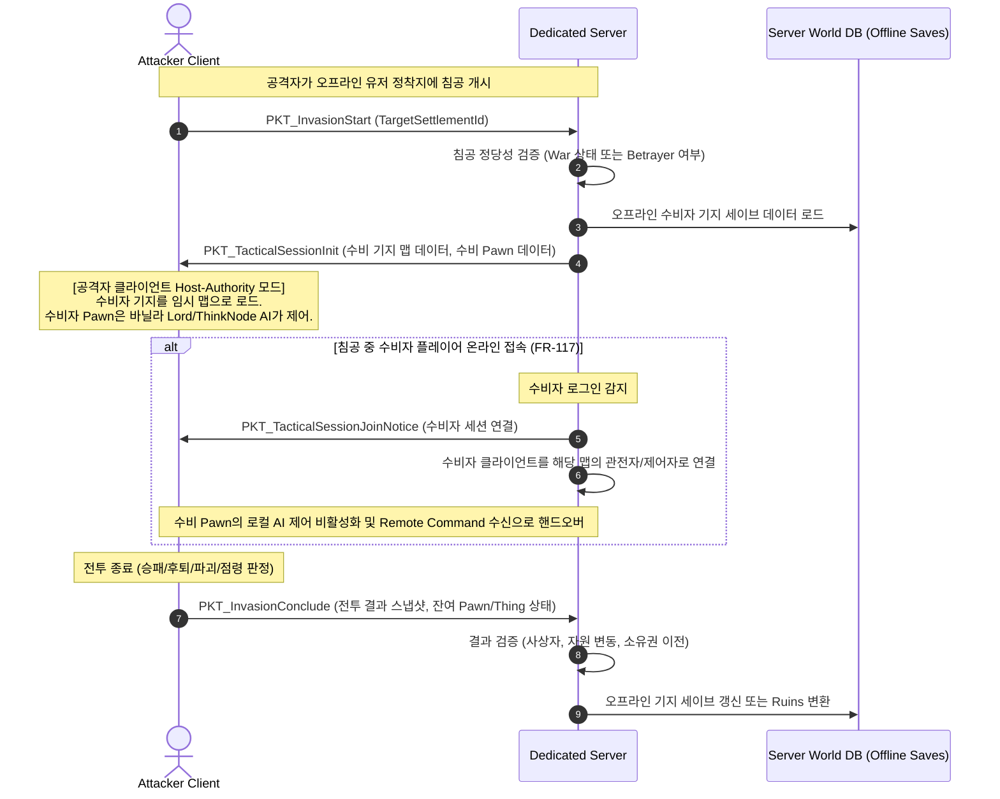
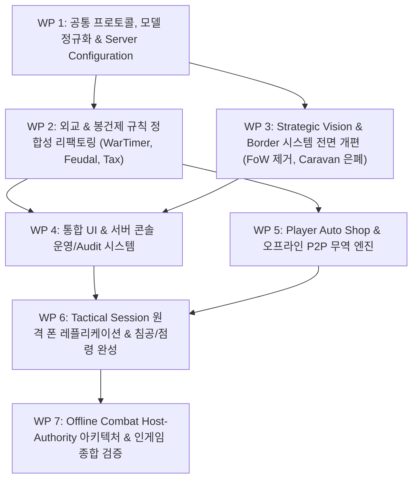

# Project RimMulti: WarEconomy
## Current Implementation Baseline & SRS Gap Matrix Report

**Document Version:** 1.0.0  
**Target:** RimWorld 1.6 Multiplayer Mod (Dedicated Server + Client Mod)  
**Author:** Primary Development Agent (Gemini 3.8 Flash)  
**Supervision:** Master (GPT-5.6 Sol) & User  
**Reviewer:** Architecture & QA Reviewer (GPT-6.1 Sol)  
**Date:** 2026-10-01  
**Source of Truth Baseline:**  
- `요구사항_명세서.md` (SRS v1.0)
- `요구사항_정규화.md` (FR-001~176, BR-001~025, NFR-001~012, CON-001~010, CFG-001~026)
- `유스케이스_명세.md`
- `시나리오_기반_분석.md`
- `도메인_분석.md`

---

## 1. Executive Summary & Baseline Statement

본 보고서는 **Project RimMulti: WarEconomy**의 새로운 공식 요구 명세서(SRS v1.0)를 유일한 Source of Truth로 확정하고, 기존 구현 코드베이스(`WarEconomyMod/Source`) 46개 파일 전수를 전수 대조 분석(Gap Analysis)한 결과물입니다.

### 1.1 핵심 진단 요약
1. **기반 인프라의 견고성 (High Reuse Potential)**:
   - 듀얼 클록(Dual-Clock: Server 3x Fixed Tick vs Client Independent Local Simulation) 인프라, 비동기 논블로킹 TCP 네트워크 파이프라인([ServerClientSession.cs](file:///c:/Users/user/Desktop/RimMulti/WarEconomyMod/Source/Server/Network/ServerClientSession.cs), [TcpNetworkServer.cs](file:///c:/Users/user/Desktop/RimMulti/WarEconomyMod/Source/Server/Network/TcpNetworkServer.cs)), 메인 스레드 안전 디스패치([MainThreadQueue.cs](file:///c:/Users/user/Desktop/RimMulti/WarEconomyMod/Source/Client/Threading/MainThreadQueue.cs)), 방문 프로토콜 핸드셰이크([PKT_VisitProtocol.cs](file:///c:/Users/user/Desktop/RimMulti/WarEconomyMod/Source/Common/Packets/Visit/PKT_VisitProtocol.cs)), 원자적 영지/소유권 전환기([AtomicFiefTransferExecutor.cs](file:///c:/Users/user/Desktop/RimMulti/WarEconomyMod/Source/Client/Fief/AtomicFiefTransferExecutor.cs)), NPC 동적 시장 탄력성 엔진([DynamicMarketManager.cs](file:///c:/Users/user/Desktop/RimMulti/WarEconomyMod/Source/Server/Managers/DynamicMarketManager.cs))은 매우 높은 완성도로 검증되어 있어 즉각 재사용 가능합니다.
2. **핵심 게임 규칙의 정면 충돌 (Direct Architectural Conflicts)**:
   - **War Timer 기준 충돌**: 현재 코드는 방어자 티어([FactionTierHelper.cs:64](file:///c:/Users/user/Desktop/RimMulti/WarEconomyMod/Source/Common/Models/Enums/FactionTier.cs#L64))로 계산하나, SRS(`FR-084`)는 **공격 Faction Tier** 기준입니다.
   - **봉건 작위 권한 충돌**: 현재 코드는 상위 작위가 하위 작위를 자유 박탈([NobilityTitle.cs:25](file:///c:/Users/user/Desktop/RimMulti/WarEconomyMod/Source/Common/Models/Enums/NobilityTitle.cs#L25)) 가능하나, SRS(`BR-005`, `FR-027`)는 **오직 King 이상만** 박탈/제명 가능합니다.
   - **세금 및 체납 메커니즘 충돌**: 현재 코드는 백작(Count) 이상만 징수하고 기한 만료 시 Settlement 단위로 자동 체납([FeudalManager.cs:290](file:///c:/Users/user/Desktop/RimMulti/WarEconomyMod/Source/Server/Managers/FeudalManager.cs#L290)) 처리하나, SRS(`BR-006`, `FR-136`, `FR-144`, `FR-146`)는 **직속 상위 귀족이 직속 봉신에게만** 부과하며, **실제 Tax Caravan 도착 후 미납 발생 시에만 Player 단위로 Delinquency가 생성**됩니다.
   - **시야 정책 충돌 (FoW vs Strategic Vision)**: 현재 코드는 월드 전체를 미탐색(Unexplored) 안개로 가리고 흑백 렌더링([FogOfWarPatches.cs](file:///c:/Users/user/Desktop/RimMulti/WarEconomyMod/Source/Client/Patches/FogOfWarPatches.cs))하나, SRS(`FR-047`, `BR-011`)는 모든 Settlement의 위치, 세력, 티어, 국경을 **100% 항상 공개**하며, 안개에 가려지는 주 대상은 **Caravan**뿐입니다.
3. **미구현 및 고위험 영역 (Critical Unbuilt Architectures)**:
   - Player Auto Shop 및 오프라인 P2P 무역(`FR-149~159`)
   - 전술 세션 내 원격 폰 동기화 및 오프라인 기지 AI 방어 침공(`FR-113~118`, `CON-009`)
   - 26개 항목의 서버 외부 설정 파일(`Server Configuration`, `CFG-001~026`)

> [!IMPORTANT]
> **원칙 준수 서약**: 본 분석이 완료되고 Master(GPT-5.6 Sol)의 검토 및 공식 승인(Work Package 승인)이 내려질 때까지 **단 한 줄의 Production Code도 수정하지 않습니다.**

---

## 2. Existing Architecture Summary

### 2.1 물리적 3-Tier 구성 현황

```mermaid
graph TB
    subgraph Common ["WarEconomy.Common (netstandard2.0)"]
        PacketDef["Packets (Header, Auth, Diplomacy, Economy, Feudal, Vision, Visit, World)"]
        Models["Models (SettlementData, WarDeclaration, TaxDelinquency, DynamicMarket, Visit)"]
        Enums["Enums (FactionTier, NobilityTitle)"]
        TimeConst["Time (WorldTimeConstants - 180 TPS)"]
    end

    subgraph Server ["WarEconomy.Server (.NET 8.0 Console / Dedicated)"]
        TcpServ["TcpNetworkServer (Concurrent Sessions, Routing, Broadcast)"]
        TickMgr["WorldTickManager (180 TPS Loop, Dual-Clock Authority)"]
        FeudalMgr["FeudalManager (Settlements, Basic Tax, Fief Transfer Coordinator)"]
        DiploMgr["DiplomacyManager (War State, Betrayer, Alliances, Cooldowns)"]
        MarketMgr["DynamicMarketManager (NPC Exponential Elasticity, Price Decay)"]
    end

    subgraph Client ["WarEconomyMod Client (RimWorld 1.6 / netstandard2.0 + Harmony)"]
        NetClient["NetworkClient (Async Receive, MainThreadQueue Safe Dispatch)"]
        ClientTick["ClientWorldTickManager (Tick Decoupling, Accumulator, Combat Lock)"]
        FiefExec["AtomicFiefTransferExecutor (Pawn/Thing/Map Ownership Transfer & Rollback)"]
        ClientMarket["ClientMarketManager (NPC Price Multiplier Cache)"]
        Patches["Harmony Patches (Tick, Trade, Visit, FoW, Letter, MainMenu)"]
        UI["Dialogs (ConnectServer, VisitRequest, VisitWait)"]
    end

    Client <-->|Raw TCP Packets (7777)| Server
    Common -.-> Client
    Common -.-> Server
```

### 2.2 네트워크 패킷 매핑 현황 (PacketHeader)

| PacketHeader | Packet Class | 발신 주체 | 수신 주체 | 현재 서버 처리 현황 |
|---|---|---|---|---|
| `Handshake (1)` | `PKT_PlayerHandshake` | Client | Server | 수신 시 PlayerId 등록 및 전체 Settlement 목록 전송 ([TcpNetworkServer.cs:122](file:///c:/Users/user/Desktop/RimMulti/WarEconomyMod/Source/Server/Network/TcpNetworkServer.cs#L122)) |
| `WorldTickSync (10)` | `PKT_WorldTickSync` | Server | Client | 서버에서 초당 1회 브로드캐스트, 클라이언트 월드 시계 보정 ([NetworkClient.cs:192](file:///c:/Users/user/Desktop/RimMulti/WarEconomyMod/Source/Client/Networking/NetworkClient.cs#L192)) |
| `SettlementListSync (11)` | `PKT_SettlementListSync` | Server | Client | 접속/영지 변경 시 브로드캐스트, 클라이언트 영지 국경 캐시 갱신 ([NetworkClient.cs:201](file:///c:/Users/user/Desktop/RimMulti/WarEconomyMod/Source/Client/Networking/NetworkClient.cs#L201)) |
| `SettlementRegister (12)` | `PKT_SettlementRegister` | Client | Server | 클라이언트 최초 정착지 생성 시 등록, 소유권 위조 차단 ([TcpNetworkServer.cs:134](file:///c:/Users/user/Desktop/RimMulti/WarEconomyMod/Source/Server/Network/TcpNetworkServer.cs#L134)) |
| `WarDeclarationRequest (20)` | `PKT_WarDeclarationRequest` | Client | Server | 서버 선전포고 카운트다운 시작 ([TcpNetworkServer.cs:289](file:///c:/Users/user/Desktop/RimMulti/WarEconomyMod/Source/Server/Network/TcpNetworkServer.cs#L289)) |
| `WarStateUpdate (21)` | `PKT_WarStateUpdate` | Server | Client | 전쟁 상태(Pending/Active/Concluded) 브로드캐스트 ([NetworkClient.cs:244](file:///c:/Users/user/Desktop/RimMulti/WarEconomyMod/Source/Client/Networking/NetworkClient.cs#L244)) |
| `AllianceRequest/Response/Break (22~24)` | `PKT_AllianceAndBetrayal` | Client/Server | Server/Client | 패킷 클래스는 정의되었으나 `TcpNetworkServer` 라우팅 미연결 |
| `BetrayalNotification (25)` | `PKT_AllianceAndBetrayal` | Server | Client | 패킷 클래스는 정의되었으나 브로드캐스트 트리거 제한적 |
| `VisitRequest (30)` | `PKT_VisitRequest` | Client | Server/Client | 타깃 영주 세션으로 정확히 단독 포워딩, 오프라인 거절 ([TcpNetworkServer.cs:163](file:///c:/Users/user/Desktop/RimMulti/WarEconomyMod/Source/Server/Network/TcpNetworkServer.cs#L163)) |
| `VisitCancel (31)` | `PKT_VisitCancel` | Client | Server/Client | 방문자 권한 검증 후 상대 세션으로 취소 통지 ([TcpNetworkServer.cs:223](file:///c:/Users/user/Desktop/RimMulti/WarEconomyMod/Source/Server/Network/TcpNetworkServer.cs#L223)) |
| `VisitResponse (32)` | `PKT_VisitResponse` | Client | Server/Client | 영주 권한 검증 후 수락/거절 결과 요청자 세션으로 회신 ([TcpNetworkServer.cs:254](file:///c:/Users/user/Desktop/RimMulti/WarEconomyMod/Source/Server/Network/TcpNetworkServer.cs#L254)) |
| `TaxCaravanDispatch (40)` | `PKT_TaxCaravan` | Client | Server | 패킷 클래스 정의됨 |
| `TaxPaymentSubmit (42)` | `PKT_TaxPaymentSubmit` | Client | Server | 납부 처리 및 완납 갱신 ([TcpNetworkServer.cs:304](file:///c:/Users/user/Desktop/RimMulti/WarEconomyMod/Source/Server/Network/TcpNetworkServer.cs#L304)) |
| `TaxDelinquencyBroadcast (43)` | `PKT_TaxDelinquencyBroadcast` | Server | Client | 체납 상태 브로드캐스트 ([NetworkClient.cs:255](file:///c:/Users/user/Desktop/RimMulti/WarEconomyMod/Source/Client/Networking/NetworkClient.cs#L255)) |
| `FiefTransferOffer (44)` | `PKT_FiefTransferOffer` | Client | Server | 영주 권한 검증 후 고유 TransferId 부여 및 실행 패킷 발송 ([TcpNetworkServer.cs:313](file:///c:/Users/user/Desktop/RimMulti/WarEconomyMod/Source/Server/Network/TcpNetworkServer.cs#L313)) |
| `FiefTransferExecute (45)` | `PKT_FiefTransferExecute` | Server | Client | 타깃 맵 보유 호스트 세션으로 전송 ([TcpNetworkServer.cs:40](file:///c:/Users/user/Desktop/RimMulti/WarEconomyMod/Source/Server/Program.cs#L40)) |
| `FiefTransferResult (46)` | `PKT_FiefTransferResult` | Client | Server | 원자적 양도/롤백 성공 여부 보고 수신 ([TcpNetworkServer.cs:335](file:///c:/Users/user/Desktop/RimMulti/WarEconomyMod/Source/Server/Network/TcpNetworkServer.cs#L335)) |
| `FogOfWarSync (50)` | `PKT_FogOfWarSync` | Server | Client | 정의되었으나 구형 타일 안개용 (Strategic Vision으로 개편 필요) |
| `DynamicMarketSync (60)` | `PKT_DynamicMarketSync` | Server | Client | NPC 품목별 가격 배율 동기화 ([NetworkClient.cs:263](file:///c:/Users/user/Desktop/RimMulti/WarEconomyMod/Source/Client/Networking/NetworkClient.cs#L263)) |
| `NPCTradeReport (61)` | `PKT_NPCTradeReport` | Client | Server | 거래량 보고 수신 후 지수적 가격 변동 연산 ([TcpNetworkServer.cs:296](file:///c:/Users/user/Desktop/RimMulti/WarEconomyMod/Source/Server/Network/TcpNetworkServer.cs#L296)) |

---

## 3. Comprehensive Requirements Gap Matrix (SRS vs Codebase)

범례:
- **SATISFIED**: 기존 코드가 SRS 요구를 충족하며 실기/테스트 검증 완료됨
- **PARTIAL**: 핵심 로직 일부가 존재하나 SRS 세부 규칙과 차이가 있거나 추가 구현 필요
- **CONFLICT**: 기존 구현이 새 SRS 규칙과 정면 충돌하여 재작성/수정 필수
- **MISSING**: 기존 코드베이스에 전혀 구현되어 있지 않음
- **OBSOLETE**: 새 SRS에서 폐기되어 코드베이스에서 제거해야 함

### 3.1 기능 요구사항 (FR-001 ~ FR-176) Gap 분석

| ID | 요구사항 요약 | 상태 | 증거 코드 | 기존 구현 내용 | SRS 공식 요구 내용 | 권장 조치 및 리스크 |
|---|---|:---:|---|---|---|---|
| **FR-001** | 접속자 0명 시 서버 World Time 진행 | **SATISFIED** | [WorldTickManager.cs:34-70](file:///c:/Users/user/Desktop/RimMulti/WarEconomyMod/Source/Server/Time/WorldTickManager.cs#L34-L70) | 데디케이트 서버 독립 스레드에서 180 TPS로 상시 틱 진행 | 접속자 없어도 진행 | 유지. (속도는 `CFG-001` 연동) |
| **FR-002** | Settlement Local Time 독립 관리 | **SATISFIED** | [ClientWorldTickManager.cs:71](file:///c:/Users/user/Desktop/RimMulti/WarEconomyMod/Source/Client/Time/ClientWorldTickManager.cs#L71), [TickPatches.cs:31](file:///c:/Users/user/Desktop/RimMulti/WarEconomyMod/Source/Client/Patches/TickPatches.cs#L31) | 로컬 시뮬레이션과 월드 오브젝트 틱 분리 | 타 정착지 및 월드와 독립 시뮬레이션 | 유지 |
| **FR-003** | 오프라인 정착지 시뮬 정지 | **SATISFIED** | 아키텍처 구조 | 클라이언트 미실행 시 로컬 맵 틱 정지 | 오프라인 시뮬레이션 정지 | 유지 |
| **FR-004** | 플레이어 영구 식별 | **PARTIAL** | [PKT_PlayerHandshake.cs:11](file:///c:/Users/user/Desktop/RimMulti/WarEconomyMod/Source/Common/Packets/Auth/PKT_PlayerHandshake.cs#L11), [NetworkClient.cs:85](file:///c:/Users/user/Desktop/RimMulti/WarEconomyMod/Source/Client/Networking/NetworkClient.cs#L85) | Steam PersonaName 또는 GUID 전송 | 영구적 고유 식별자 보장 | 영구 ID(SteamID64/고유 토큰) 저장 및 인증 보강 |
| **FR-005** | 프로토콜/모드 버전 검증 및 거부 | **PARTIAL** | [TcpNetworkServer.cs:122](file:///c:/Users/user/Desktop/RimMulti/WarEconomyMod/Source/Server/Network/TcpNetworkServer.cs#L122) | Handshake에 버전 수신은 하나 불일치 시 차단 로직 누락 | 비호환 버전 접속 즉시 거절 | 서버에서 버전 대조 후 불일치 시 거절 패킷 전송 및 소켓 종료 |
| **FR-006~007** | 신규 유저 개인 Faction 자동 생성 (Tribe) | **MISSING** | - | 클라이언트 로컬 바닐라 Faction 그대로 등록 | 신규 접속자에게 Tribe Faction 자동 생성 | 서버 FactionManager 신규 도입하여 세력 엔티티 영속 관리 |
| **FR-008~009** | Faction 고유 색상 배정 및 재사용 | **MISSING** | - | 미구현 | 구분되는 색상 팔레트 자동 배정 및 해체 시 재사용 | ColorPaletteManager 구현 |
| **FR-010** | Faction Tier (Tribe ~ Empire) 관리 | **SATISFIED** | [FactionTier.cs:6-14](file:///c:/Users/user/Desktop/RimMulti/WarEconomyMod/Source/Common/Models/Enums/FactionTier.cs#L6-L14) | 5개 Tier Enum 완벽 정의 | 5단계 계층 체계 | 유지 |
| **FR-011~014** | Tier 승격/강등 평가 및 유예 Timer | **CONFLICT** | [FactionTier.cs:41-62](file:///c:/Users/user/Desktop/RimMulti/WarEconomyMod/Source/Common/Models/Enums/FactionTier.cs#L41-L62) | 단일 수치 기반 즉시 강등/승격, 하드코딩 기준치, 영토 연결성/봉건 미반영 | 정착지, Wealth, 폰, 연결 영토, 봉건 조건 평가 및 유예 기간(Grace Period) 타이머 | `CFG-002~005` 기반 평가 엔진 및 Grace Period 타이머 구현 |
| **FR-015** | Tribe 승격 시 창립자 King 즉위 | **MISSING** | - | 미구현 | Minor Faction 승격과 최초 King 즉위 원자적 처리 | Tier 승격 트랜잭션에서 King 작위 부여 |
| **FR-016** | Tier 변경 시 Border Radius 재계산 | **CONFLICT** | [SettlementData.cs:20](file:///c:/Users/user/Desktop/RimMulti/WarEconomyMod/Source/Common/Models/SettlementData.cs#L20) | `BorderRadius = 2` 상수로 하드코딩 | Faction Tier별 국경 반경 재계산 (`CFG-006`) | SettlementData의 하드코딩 제거 및 Tier 기반 동적 연산 |
| **FR-017~018** | Faction 이름 변경 및 진행도 UI | **MISSING** | - | 미구현 | 승격 시 1회 개명 기회, 정확한 수치 진행도 UI | UI 창 구현 |
| **FR-019~023** | Faction 가입 (Tribe 불가, 승인, 해체, 편입) | **MISSING** | - | 미구현 | Ruler 승락, 기존 세력 해체, 정착지 대상 편입 | 가입 프로토콜 패킷 및 서버 Faction 병합 트랜잭션 구현 |
| **FR-024~026** | 최소 작위 Baron, 계통 지정, 단일 작위 | **PARTIAL** | [NobilityTitle.cs:7-14](file:///c:/Users/user/Desktop/RimMulti/WarEconomyMod/Source/Common/Models/Enums/NobilityTitle.cs#L7-L14) | 작위 Enum 정의됨 | 최소 Baron, Feudal Tree 트리 위치 지정, 1인 1작위 | Feudal Tree 계층 데이터 모델 구축 |
| **FR-027** | 작위 임명/승진/강등/박탈은 King 이상만 | **CONFLICT** | [NobilityTitle.cs:25](file:///c:/Users/user/Desktop/RimMulti/WarEconomyMod/Source/Common/Models/Enums/NobilityTitle.cs#L25) | `superior > subordinate`면 누구나 박탈 가능으로 구현 | **오직 King 이상(King/Emperor)만 수행 가능** | `CanRevokeOrExpel` 로직을 `King/Emperor` 전용으로 수정 |
| **FR-028~032** | 작위 박탈 = Faction 제명 = 신규 개인 세력 생성 | **MISSING** | - | 미구현 | 제명 시 개인 Faction 생성, 잔여 영지로 Tier 재계산 | 제명 트랜잭션 구현 |
| **FR-033~034** | Feudal Tree UI 및 King 관리창 | **MISSING** | - | 디버그 액션만 존재 | 계층형 봉건 트리 렌더링 및 관리 조작 UI | UI Dialog 구현 |
| **FR-036** | Tier별 Faction Border Radius | **CONFLICT** | [SettlementData.cs:20](file:///c:/Users/user/Desktop/RimMulti/WarEconomyMod/Source/Common/Models/SettlementData.cs#L20), [FogOfWarPatches.cs:64](file:///c:/Users/user/Desktop/RimMulti/WarEconomyMod/Source/Client/Patches/FogOfWarPatches.cs#L64) | 고정 2칸 하드코딩 | Tier별 Radius 적용 (`CFG-006`) | 국경 생성기 파라미터화 |
| **FR-037~040** | 영토 접촉 연결, 구멍 유지, 파괴 시 제거, 기존 영토 우선권 | **PARTIAL** | [FogOfWarPatches.cs:50-80](file:///c:/Users/user/Desktop/RimMulti/WarEconomyMod/Source/Client/Patches/FogOfWarPatches.cs#L50-L80) | 클라이언트 BFS로 영토 합침 | 빈 타일 채우지 않음, 생성 타임스탬프 우선권 | 영토 충돌 시 생성 틱 대조 우선권 부여 |
| **FR-041** | 연결 영토 규모로 Tier 평가 | **MISSING** | - | 영토 크기 미평가 | 영토 타일 수 평가 | 영토 크기 산출 로직 추가 |
| **FR-042~044** | 작위별 내부 Title Territory 및 아군 한정 표시 | **MISSING** | - | 미구현 | 작위령 반경, 아군만 표시, 외부는 전체 국경만 표시 | 렌더링 레이어 분리 |
| **FR-045~046** | Nation+ 영토 무인가 진입 차단, 중립/동맹 통행 | **MISSING** | - | 통행 제한 없음 | 적대 세력 무인가 통행 차단, 평화/동맹 자유 통행 | World Pathfinding 패치 구현 |
| **FR-047** | **모든 Settlement 위치/정보 100% 공개** | **CONFLICT** | [FogOfWarPatches.cs:17](file:///c:/Users/user/Desktop/RimMulti/WarEconomyMod/Source/Client/Patches/FogOfWarPatches.cs#L17), [LetterPatches.cs:36](file:///c:/Users/user/Desktop/RimMulti/WarEconomyMod/Source/Client/Patches/LetterPatches.cs#L36) | 타일 안개로 Settlement 감춤, 카메라 점프 차단 | **시야와 무관하게 모든 영지/국경 항상 공개** | **구형 FoW 타일 차폐 패치 전면 폐기** |
| **FR-048** | 시야 밖 Settlement 생성/소멸 실시간 동기화 | **SATISFIED** | [NetworkClient.cs:201](file:///c:/Users/user/Desktop/RimMulti/WarEconomyMod/Source/Client/Networking/NetworkClient.cs#L201), [TcpNetworkServer.cs:128](file:///c:/Users/user/Desktop/RimMulti/WarEconomyMod/Source/Server/Network/TcpNetworkServer.cs#L128) | SettlementListSync로 전 유저 실시간 수신 | 실시간 공개 | 유지 |
| **FR-049** | Vision의 핵심 은폐 대상 = **Caravan** | **MISSING** | - | Caravan 은폐 미구현 (타일 흑백 렌더만 존재) | Caravan 선택적 은폐 | Caravan 렌더 패치로 재설계 |
| **FR-050** | Settlement Vision = Border Radius | **PARTIAL** | [FogOfWarPatches.cs:64](file:///c:/Users/user/Desktop/RimMulti/WarEconomyMod/Source/Client/Patches/FogOfWarPatches.cs#L64) | 2칸 고정 | 국경 반경과 일치 | Border Radius 변수와 결합 |
| **FR-051** | Caravan Vision (최고 Shooting 기반) | **MISSING** | - | 미구현 | 최고 사격 능력치 기준 시야 계산 | Pawn 사격 스킬 쿼리 로직 구현 |
| **FR-052~053** | Vision 세력 및 동맹 간 공유 | **MISSING** | - | 로컬 클라이언트 캐시만 존재 | 세력/동맹 간 시야 집합 공유 | 서버 시야 브로드캐스트 구현 |
| **FR-054~059** | 정찰(Scout) 모드 (정지, 시야 보너스, 락) | **MISSING** | - | 미구현 | Scout 토글 기즈모, 이동 잠금, 피격 시 해제 | World Pawn Command 구현 |
| **FR-060~067** | 매복(Ambush) 모드 (상대 시야 밖 시작, 확률 은폐) | **MISSING** | - | 미구현 | Ambush 토글, 탐지 공식, Faction별 탐지, 전투 보너스 없음 | Ambush 로직 및 패킷 구현 |
| **FR-068~070** | 평화 방문 Entry Request / Accept / Deny / Cancel | **SATISFIED** | [VisitPatches.cs](file:///c:/Users/user/Desktop/RimMulti/WarEconomyMod/Source/Client/Patches/VisitPatches.cs), [TcpNetworkServer.cs:163](file:///c:/Users/user/Desktop/RimMulti/WarEconomyMod/Source/Server/Network/TcpNetworkServer.cs#L163), [Dialog_VisitWait.cs](file:///c:/Users/user/Desktop/RimMulti/WarEconomyMod/Source/Client/UI/Dialog_VisitWait.cs) | 방문 요청 기즈모, 대기창, 취소, 영주 수락/거절 완벽 동작 | 3자 방문 핸드셰이크 프로토콜 | 유지 (Phase 3 통과 완료) |
| **FR-071~072** | 오프라인 정착지 방문 불가 & UI 툴팁 | **PARTIAL** | [TcpNetworkServer.cs:196](file:///c:/Users/user/Desktop/RimMulti/WarEconomyMod/Source/Server/Network/TcpNetworkServer.cs#L196) | 서버에서 오프라인 영주 확인 후 자동 거절 회신 | 클라이언트 UI 비활성화 및 툴팁 제공 | 클라이언트 기즈모 비활성화 처리 추가 |
| **FR-073~076** | 방문자 기지 진입, 본인 Pawn만 조작 | **PARTIAL** | [AtomicFiefTransferExecutor.cs](file:///c:/Users/user/Desktop/RimMulti/WarEconomyMod/Source/Client/Fief/AtomicFiefTransferExecutor.cs) | 프로토콜은 연결되었으나 원격 맵 로드/동기화 미구현 | 호스트 기존 맵 진입, 상호 본인 폰만 조작 | Tactical Session 맵 복제/동기화 구현 (High Risk) |
| **FR-077** | 평화/전투 동일 Tactical Session 구조 | **MISSING** | [PacketHeader.cs:48](file:///c:/Users/user/Desktop/RimMulti/WarEconomyMod/Source/Common/Packets/PacketHeader.cs#L48) | 패킷 헤더만 존재, 엔진 미구현 | 동일 세션 내에서 평화->전투 전환 | 단일 Tactical Session 관리자 구현 |
| **FR-078** | 평화 세션 배속 (Last Input Wins) | **MISSING** | - | 미구현 | 마지막 입력자가 배속 결정 | 시간 제어 패킷 동기화 |
| **FR-079** | 적대 세션 배속 (1x 고정 & Pause 금지) | **SATISFIED** | [TickPatches.cs:50-85](file:///c:/Users/user/Desktop/RimMulti/WarEconomyMod/Source/Client/Patches/TickPatches.cs#L50-L85) | 전투 시 강제 1배속 및 일시정지 키 무력화 | 1배속 고정 및 Pause 차단 | 유지 |
| **FR-080** | 다세력(3개 이상) Tactical Session 지원 | **MISSING** | - | 1:1 패킷 구조 중심 | 3개 이상 세력 동일 맵 참여 | 멀티 세션 참가자 풀 확장 |
| **FR-081~083** | 선전포고 (최고 작위자만 발령, 사유) | **PARTIAL** | [DiplomacyManager.cs:33](file:///c:/Users/user/Desktop/RimMulti/WarEconomyMod/Source/Server/Managers/DiplomacyManager.cs#L33) | 선전포고 처리하나 발신자의 최고 작위자 검증 누락 | 최고 작위자만 발령 (`BR-008`), 사유 기재 | 발신자 작위 권한 검증 추가 |
| **FR-084** | **WarPending 시간 = 공격 Faction Tier 기준** | **CONFLICT** | [DiplomacyManager.cs:43](file:///c:/Users/user/Desktop/RimMulti/WarEconomyMod/Source/Server/Managers/DiplomacyManager.cs#L43), [WarDeclarationData.cs:39](file:///c:/Users/user/Desktop/RimMulti/WarEconomyMod/Source/Common/Models/WarDeclarationData.cs#L39) | **방어자 Tier(`defenderTier`) 기준 대기시간 계산** | **공격 Faction Tier 기준 대기시간 연산** | 공격자 Faction Tier를 조회하여 대기시간을 계산하도록 수정 |
| **FR-085** | Tribe 공격자는 대기시간 0 (즉시 전쟁) | **SATISFIED** | [WarDeclarationData.cs:43](file:///c:/Users/user/Desktop/RimMulti/WarEconomyMod/Source/Common/Models/WarDeclarationData.cs#L43) | `prepTicks <= 0 ? WarState.Active : WarState.Pending` | Tribe는 즉시 Active | 공격자 기준 수정 시 자연 충족 |
| **FR-086~089** | WarPending 카운트다운 & 전면전 전환 Letter | **PARTIAL** | [DiplomacyManager.cs:64](file:///c:/Users/user/Desktop/RimMulti/WarEconomyMod/Source/Server/Managers/DiplomacyManager.cs#L64), [NetworkClient.cs:250](file:///c:/Users/user/Desktop/RimMulti/WarEconomyMod/Source/Client/Networking/NetworkClient.cs#L250) | 카운트다운 및 Message 출력은 동작하나 정식 Letter 누락 | 공격 세력, 남은 시간, 예정 시점 Letter 통지 | Vanilla Letter 패킷 발송 |
| **FR-090~093** | 전쟁 종료 후 Cooldown 및 재선전 차단 | **PARTIAL** | [DiplomacyManager.cs:30, 89](file:///c:/Users/user/Desktop/RimMulti/WarEconomyMod/Source/Server/Managers/DiplomacyManager.cs#L30) | Cooldown 기록 및 선전 차단 동작하나 수치 하드코딩 | 재선전 차단 및 툴팁 (`CFG-011`) | 설정 파일 연동 및 클라이언트 툴팁 추가 |
| **FR-094~098** | 비인가 공격 시 Betrayer 지정 및 자유 피격 | **SATISFIED** | [DiplomacyManager.cs:134-165](file:///c:/Users/user/Desktop/RimMulti/WarEconomyMod/Source/Server/Managers/DiplomacyManager.cs#L134-L165) | Betrayal 등록, 타이머, 선전포고 없이 공격 허용 판정 | Faction 단위 Betrayer 지정, 동맹 공격 권한 부여 | 인게임 타격 감지 훅 연결 |
| **FR-099~101** | Betrayer 타이머 만료, 조기 해제, 반복 시 연장 | **PARTIAL** | [DiplomacyManager.cs:175](file:///c:/Users/user/Desktop/RimMulti/WarEconomyMod/Source/Server/Managers/DiplomacyManager.cs#L175) | 만료 자동 해제는 있으나 피해 세력의 조기 해제/누적 연장 누락 | 피해자 조기 해제, 반복 시 누적 연장 (`CFG-014`) | 조기 해제 패킷 및 연장 수식 추가 |
| **FR-102~104** | 전투 중 적 대상 오사(Friendly Fire) 제외 | **MISSING** | - | 미구현 | 오사 시 Betrayal 면책, AoE 부수 피해 제외 | DamageWorker 패치에서 타깃 의도성 판정 (High Risk) |
| **FR-105~109** | 상호 평화협정, 조건부 배상 퀘스트, 불이행 즉시 재개 | **PARTIAL** | [DiplomacyManager.cs:81](file:///c:/Users/user/Desktop/RimMulti/WarEconomyMod/Source/Server/Managers/DiplomacyManager.cs#L81) | 단순 ConcludeWar만 존재 | 배상 요구 품목/수량 퀘스트 생성, 미이행 시 즉시 전쟁 복구 | 조건부 평화협정 시스템 구현 |
| **FR-110~111** | 동맹 대리 평화, 영지 전멸 시 자동 종전 | **PARTIAL** | [DiplomacyManager.cs:100](file:///c:/Users/user/Desktop/RimMulti/WarEconomyMod/Source/Server/Managers/DiplomacyManager.cs#L100) | 동맹 등록만 존재 | 동맹 대리 체결, 전멸 시 자동 종전 | 종전 트리거 로직 추가 |
| **FR-112** | 합법 공격권 보유 시 무승인 정착지 침공 | **MISSING** | - | 방문 승인 플로우만 존재 | 승인 없이 즉시 전투 인스턴스 침공 | 침공 진입 진입점 생성 |
| **FR-113~118** | **Offline Settlement 침공 (AI 방어 조종 & 영구 반영)** | **MISSING** | - | 미구현 | **오프라인 영지 공격 가능, 수비 폰 AI 자율 방어, 결과 영구 저장** | **Critical Architectural Risk (별도 섹션 7.1 상술)** |
| **FR-119~120** | Vanilla 후퇴/승패 규칙 및 Caravan 재구성 | **MISSING** | - | 미구현 | 후퇴 시 Caravan 재생성 | 맵 탈출 패치 구현 |
| **FR-121~122** | 승리 후 점령(Occupy) 또는 파괴(Destroy) 선택 | **MISSING** | - | 미구현 | 점령/파괴 다이얼로그, SettlementLimit 초과 시 점령 차단 | 점령/파괴 흐름 구현 |
| **FR-123** | **Occupy 시 원자적 소유권 이전 (Rollback 보장)** | **SATISFIED** | [AtomicFiefTransferExecutor.cs:34-150](file:///c:/Users/user/Desktop/RimMulti/WarEconomyMod/Source/Client/Fief/AtomicFiefTransferExecutor.cs#L34-L150) | 폰, 아이템, 건물, 맵 부모 세력 원자적 전환 및 실패 시 100% 복구 | 부분 실패 없는 소유권 원자적 이전 | 점령 완료 후 트리거 연동 |
| **FR-124~126** | Destroy 시 정착지 제거 및 Ruins Site 생성/소멸 | **MISSING** | - | 미구현 | 정착지 제거 후 잔해 사이트 생성, 타이머 후 소멸 (`CFG-025`) | WorldObject_RuinsSite 구현 |
| **FR-127~128** | Settlement 0개여도 Caravan 있으면 세력 생존 | **MISSING** | - | 미구현 | Caravan 잔존 시 생존, 영지 변동 시 Tier 재계산 | 세력 전멸 판정 수정 |
| **FR-129~132** | 최고 통치자 Branch 붕괴 시 하위 독립 Faction 분리 | **MISSING** | - | 미구현 | 봉건 가지별 분리 독립, Tier 재계산, 생존자 King 승격 | Faction 분할 알고리즘 구현 |
| **FR-133~135** | 직속 Superior → Direct Vassal Tax Policy 설정 | **CONFLICT** | [FeudalManager.cs:211](file:///c:/Users/user/Desktop/RimMulti/WarEconomyMod/Source/Server/Managers/FeudalManager.cs#L211), [NobilityTitle.cs:34](file:///c:/Users/user/Desktop/RimMulti/WarEconomyMod/Source/Common/Models/Enums/NobilityTitle.cs#L34) | Count 이상만 징수, Settlement 단위로 부과 | **Feudal 직속 상위자만 직속 봉신에게 부과 (`BR-006`), Vassal 단위** | 봉건 트리 기반 부과로 전면 수정 |
| **FR-136~138** | **Tax Caravan 도착 시에만 징수, 오프라인 징수 허용** | **CONFLICT** | [FeudalManager.cs:290](file:///c:/Users/user/Desktop/RimMulti/WarEconomyMod/Source/Server/Managers/FeudalManager.cs#L290) | 월드 틱 타이머 경과 시 즉시 자동 처리 | **물리적 상단이 도달해야만 징수 발생** | 타이머 자동 징수 제거, 상단 도착 트리거로 개편 |
| **FR-139~142** | 지정품 부족 시 바닐라 시장가치 환산 및 대체 자산 징수 | **PARTIAL** | [FeudalManager.cs:258](file:///c:/Users/user/Desktop/RimMulti/WarEconomyMod/Source/Server/Managers/FeudalManager.cs#L258) | 지정 수량 차감만 존재 | 부족분 가치 계산, 타 물자/가축/노예 강제 징수 | 대체 가치 산정 및 강제 징수 UI 구현 |
| **FR-143~144** | 징수 성공 시 주기 재시작, **상단 미도착 시 체납 불가** | **CONFLICT** | [FeudalManager.cs:295](file:///c:/Users/user/Desktop/RimMulti/WarEconomyMod/Source/Server/Managers/FeudalManager.cs#L295) | **기한 경과만으로 자동 체납(`MarkDelinquent`) 전환** | **상단 미도달 시 절대 체납 불가 (`BR-023`)** | **`FeudalManager.OnWorldTick`의 자동 체납 루프 완전 삭제** |
| **FR-145~148** | **Tax Delinquency는 Player 단위 & 누적 가치 산정** | **CONFLICT** | [TaxDelinquencyState.cs:21](file:///c:/Users/user/Desktop/RimMulti/WarEconomyMod/Source/Common/Models/TaxDelinquencyState.cs#L21) | `SettlementId` 단위로 체납 상태 관리 | **Settlement가 아닌 Player 단위 (`FR-146`), 미납 가치 누적** | `PlayerTaxDelinquency` 모델로 재작성 |
| **FR-149~159** | **Player Auto Shop & 오프라인 P2P 거래** | **MISSING** | - | NPC 거래만 존재 | 정착지별 Buy/Sell 설정, 오프라인 자동 체결, 인벤토리 즉시 반영, Letter 통지 | **Critical Architectural Risk (별도 섹션 7.3 상술)** |
| **FR-160~164** | **NPC Dynamic Market (지수 탄력성, 회귀)** | **SATISFIED** | [DynamicMarketManager.cs](file:///c:/Users/user/Desktop/RimMulti/WarEconomyMod/Source/Server/Managers/DynamicMarketManager.cs), [TradePatches.cs](file:///c:/Users/user/Desktop/RimMulti/WarEconomyMod/Source/Client/Patches/TradePatches.cs) | 대량 구매 시 지수 급등, 대량 판매 시 덤핑 급락, 월드 틱 점진적 회귀 완벽 구현 | 품목별 독립 시세, 충격 배율, 회귀 | 유지 (`CFG-021~024` 연동만 수행) |
| **FR-165** | NPC 재고 보충(Restock) 바닐라 유지 | **SATISFIED** | [TradePatches.cs](file:///c:/Users/user/Desktop/RimMulti/WarEconomyMod/Source/Client/Patches/TradePatches.cs) | 바닐라 상인 인벤토리 그대로 유지 | 바닐라 Restock 규칙 준수 | 유지 |
| **FR-166~172** | UI 통합 관리창 (탭 구분, 봉건 조작, Letter) | **MISSING** | - | 개별 다이얼로그 및 디버그 액션으로 파편화 | 단일 통합 창(내부 탭), 봉건 관리 조작 일체화, Letter 통지 | MainTabWindow_WarEconomy 구현 |
| **FR-173~176** | 서버 콘솔 운영 (Kick, Ban, Audit Log) | **MISSING** | [Program.cs:60](file:///c:/Users/user/Desktop/RimMulti/WarEconomyMod/Source/Server/Program.cs#L60) | quit, exit, status 명령만 존재 | 영구 식별자 기반 Kick/Ban, Audit Log 파일 저장 | 서버 명령어 파서 및 AuditLogger 구현 |

---

### 3.2 비즈니스 규칙 (BR-001 ~ BR-025) 정합성 대조

| Rule ID | 비즈니스 규칙 핵심 내용 | 기존 코드 일치 여부 | 상세 충돌 및 조치 사항 |
|---|---|:---:|---|
| **BR-001** | 1인 1 Faction 소속 원칙 | **일치** | FactionId 단일 바인딩 유지 |
| **BR-002** | 1인 1 Feudal Title 원칙 | **일치** | 단일 작위 유지 |
| **BR-003** | Tribe는 1인 Faction | **수정 필요** | 신규 접속자 세력 생성 시 인원 제한 적용 필요 |
| **BR-004** | Tribe 승격 + 최초 King 탄생 = 원자적 사건 | **미구현** | 승격 트랜잭션에서 동시 처리 보장 |
| **BR-005** | 작위 임명/승진/강등/박탈은 King 이상만 | **정면 충돌** | [NobilityTitle.cs:25](file:///c:/Users/user/Desktop/RimMulti/WarEconomyMod/Source/Common/Models/Enums/NobilityTitle.cs#L25)의 `superior > subordinate`를 `King/Emperor`로 제한 |
| **BR-006** | 세금은 직속 Superior → Direct Vassal만 | **정면 충돌** | [FeudalManager.cs:211](file:///c:/Users/user/Desktop/RimMulti/WarEconomyMod/Source/Server/Managers/FeudalManager.cs#L211)의 Count 이상/영지 부과를 봉건 트리 직속 관계로 개편 |
| **BR-007** | Title Revocation = Faction Expulsion | **미구현** | 작위 박탈 패킷 수신 시 제명 처리 동시 수행 |
| **BR-008** | 최고 작위자만 정식 War Declaration | **수정 필요** | [DiplomacyManager.DeclareWar](file:///c:/Users/user/Desktop/RimMulti/WarEconomyMod/Source/Server/Managers/DiplomacyManager.cs#L33) 호출 시 발신자 작위 검증 추가 |
| **BR-009** | 비인가 적대행동 = Faction 전체 외교 영향 | **일치** | `RecordBetrayal`이 세력 단위로 적용됨 |
| **BR-010** | 행동 차단보다 정치/경제적 결과 부과 | **일치** | 철학 일치 |
| **BR-011** | Settlement 정적 World 정보 100% 공개 | **정면 충돌** | [FogOfWarPatches.cs](file:///c:/Users/user/Desktop/RimMulti/WarEconomyMod/Source/Client/Patches/FogOfWarPatches.cs)의 영지 차폐 로직 전면 삭제 |
| **BR-012** | Caravan 위치는 Vision 규칙 준수 | **미구현** | Caravan 선택적 은폐 로직 구현 |
| **BR-013** | Vision은 Faction 및 Alliance 단위 공유 | **미구현** | 시야 마스크 네트워크 동기화 구현 |
| **BR-014** | 영토 충돌 시 선점 영토 우선 | **수정 필요** | 타임스탬프 기반 영토 충돌 해결 로직 추가 |
| **BR-015** | 오프라인 정착지는 일반 방문 불가 | **일치** | [TcpNetworkServer.cs:196](file:///c:/Users/user/Desktop/RimMulti/WarEconomyMod/Source/Server/Network/TcpNetworkServer.cs#L196) 오프라인 거절 일치 |
| **BR-016** | 오프라인 정착지도 침공, 징수, 자동상점 가능 | **미구현** | 오프라인 대상 비동기 트랜잭션 파이프라인 구축 필요 |
| **BR-017** | 평화 세션 배속: Last Input Wins | **미구현** | 시간 조절 패킷 핸들러 구현 |
| **BR-018** | 적대 세션 배속: 1x / Pause Disabled | **일치** | [TickPatches.cs:50-85](file:///c:/Users/user/Desktop/RimMulti/WarEconomyMod/Source/Client/Patches/TickPatches.cs#L50-L85) 완벽 구현 |
| **BR-019** | 동맹 자동 참전은 직접 동맹 1-Hop만 | **미구현** | 연쇄 참전 방지 가드 구현 |
| **BR-020** | Betrayer Faction은 선전포고 없이 공격 가능 | **일치** | [DiplomacyManager.CanDeclareWar](file:///c:/Users/user/Desktop/RimMulti/WarEconomyMod/Source/Server/Managers/DiplomacyManager.cs#L37) 및 Betrayer 상태 일치 |
| **BR-021** | Settlement 전멸 ≠ Faction 멸망 | **수정 필요** | 세력 소멸 조건에 Caravan 잔존 여부 결합 |
| **BR-022** | Caravan 존재 시 Faction 유지 | **수정 필요** | 상동 |
| **BR-023** | 세금 예정일 경과 자체는 Delinquency 안 만듦 | **정면 충돌** | [FeudalManager.cs:290](file:///c:/Users/user/Desktop/RimMulti/WarEconomyMod/Source/Server/Managers/FeudalManager.cs#L290)의 자동 체납 루프 제거 필수 |
| **BR-024** | 부족분 대체징수 한도는 부족 품목의 바닐라 시장가치 | **미구현** | 시장가치 환산 및 한도 체크 로직 구현 |
| **BR-025** | P2P 거래 가격 자유 책정 (시스템 비제한) | **일치** | 상점 주문 모델에 자유 가격 필드 배치 |

---

### 3.3 비기능 요구사항, 제약사항, 서버 설정 매핑

| ID | 구분 | 요구 내용 | 코드베이스 현황 | 필수 조치 |
|---|---|---|---|---|
| **NFR-001** | 비기능 | 서버 상태 상호 일관성 | 매니저별 락은 있으나 다중 엔티티 복합 트랜잭션 단위 부족 | 트랜잭션 컨텍스트 도입 |
| **NFR-002** | 비기능 | 원자적 소유권 이전 및 롤백 | [AtomicFiefTransferExecutor.cs](file:///c:/Users/user/Desktop/RimMulti/WarEconomyMod/Source/Client/Fief/AtomicFiefTransferExecutor.cs) 완벽 구현 | 유지 및 점복 시 재사용 |
| **NFR-003** | 비기능 | 서버 재시작 후 영속성 | **미구현** (메모리 상주) | JSON/SQLite 기반 세이브/로드 엔진 구현 |
| **NFR-004** | 비기능 | 멀티플레이 상태 권한 명확성 | 서버 중심 권한 구조 확립됨 | Tactical Session 권한 모델 상세화 |
| **NFR-007** | 비기능 | 클라이언트 크래시 시 서버 무중단 | 예외 격리 처리됨 ([ServerClientSession.cs](file:///c:/Users/user/Desktop/RimMulti/WarEconomyMod/Source/Server/Network/ServerClientSession.cs)) | 유지 |
| **CON-001~007** | 제약 | RimWorld 1.6, Dedicated Server, Dual-Clock | 완벽 준수 중 | 유지 |
| **CON-008~009** | 제약 | Tactical Session 및 Offline Combat Authority | 미해결 리스크 | 전용 아키텍처 수립 필수 |
| **CFG-001~026** | 설정 | 26개 밸런스 파라미터 외부 설정 파일화 | **전체 하드코딩 상태** | `ServerConfiguration.json` 및 로더 구축 |

---

## 4. Reusable Components (즉시 재사용 가능 모듈)

다음 모듈들은 높은 완성도로 구현되어 있으며, SRS 요구사항을 이미 충족하거나 최소한의 어댑터 연결만으로 재사용할 수 있습니다.

### 4.1 클라이언트 핵심 엔진
1. **[AtomicFiefTransferExecutor.cs](file:///c:/Users/user/Desktop/RimMulti/WarEconomyMod/Source/Client/Fief/AtomicFiefTransferExecutor.cs)**:
   - **적합성**: `FR-123`, `NFR-002` (Occupy 원자적 소유권 이전 및 완전 롤백)
   - **강점**: 폰 상태 스냅샷(구역, 마스터, 침대, 명상지), 폰/가축/건물/물자/맵부모 세력 일괄 전환, 실패 시 사전 스냅샷을 기반으로 한 100% 완전 롤백 무결성 검증, TransferId 기반 결과 보고 완료.
2. **[ClientWorldTickManager.cs](file:///c:/Users/user/Desktop/RimMulti/WarEconomyMod/Source/Client/Time/ClientWorldTickManager.cs) & [TickPatches.cs](file:///c:/Users/user/Desktop/RimMulti/WarEconomyMod/Source/Client/Patches/TickPatches.cs)**:
   - **적합성**: `FR-001~002`, `FR-079`, `BR-018`
   - **강점**: 로컬 기지 자율 배속(0~3x)과 서버 3배속 월드 틱의 완벽한 디커플링, 프레임 독립 소수점 틱 누적기(Accumulator), 적대 전투 시 강제 1배속 및 일시정지 차단 패치.
3. **[MainThreadQueue.cs](file:///c:/Users/user/Desktop/RimMulti/WarEconomyMod/Source/Client/Threading/MainThreadQueue.cs) & [NetworkClient.cs](file:///c:/Users/user/Desktop/RimMulti/WarEconomyMod/Source/Client/Networking/NetworkClient.cs)**:
   - **적합성**: Unity 멀티스레드 안정성
   - **강점**: 백그라운드 수신 루프에서 들어온 모든 패킷을 Unity 메인 스레드 큐로 안전하게 전달하여 NRE 원천 방지, SessionId 기반 세션 격리 및 안전 재접속.
4. **[TradePatches.cs](file:///c:/Users/user/Desktop/RimMulti/WarEconomyMod/Source/Client/Patches/TradePatches.cs)**:
   - **적합성**: `FR-161~165`
   - **강점**: 바닐라 거래 창의 `Tradeable.GetPriceFor` 후킹으로 서버 동적 배율 즉각 반영, 거래 체결 시 `TradeDeal.TryExecute`에서 거래 품목/수량 패킷 발송.
5. **[Dialog_VisitWait.cs](file:///c:/Users/user/Desktop/RimMulti/WarEconomyMod/Source/Client/UI/Dialog_VisitWait.cs) & [Dialog_VisitRequest.cs](file:///c:/Users/user/Desktop/RimMulti/WarEconomyMod/Source/Client/UI/Dialog_VisitRequest.cs)**:
   - **적합성**: `FR-068~070`
   - **강점**: 방문 요청 발송 후 대기 창, 실시간 자율 취소(Cancel), 영주 측 승인/거절 모달.

### 4.2 서버 핵심 엔진
1. **[DynamicMarketManager.cs](file:///c:/Users/user/Desktop/RimMulti/WarEconomyMod/Source/Server/Managers/DynamicMarketManager.cs)**:
   - **적합성**: `FR-160~164`
   - **강점**: 지수적 가격 충격 수식(`Math.Exp`), 품목별/정착지별 독립 시세 딕셔너리, 월드 틱 단위 점진적 기본가 회귀(Price Decay), 스레드 안전 락.
2. **[TcpNetworkServer.cs](file:///c:/Users/user/Desktop/RimMulti/WarEconomyMod/Source/Server/Network/TcpNetworkServer.cs) & [ServerClientSession.cs](file:///c:/Users/user/Desktop/RimMulti/WarEconomyMod/Source/Server/Network/ServerClientSession.cs)**:
   - **적합성**: 네트워크 전송 신뢰성
   - **강점**: Unbounded 채널 + 원자적 카운터(`_pendingReliableCount`)를 통한 100% Reliable 무손실 송신, 특정 세션 타깃 전송(`SendToPlayer`), 접속 종료 시 대기 요청 안전 정리(`CleanupVisitRequestsForSession`).
3. **[WorldTickManager.cs](file:///c:/Users/user/Desktop/RimMulti/WarEconomyMod/Source/Server/Time/WorldTickManager.cs)**:
   - **적합성**: `FR-001`, `CON-007`
   - **강점**: 초당 180회 정밀 고정 틱 구동, 등록된 시스템 일괄 틱 호출, 주기적 틱 패킷 브로드캐스트.

---

## 5. Components Requiring Modification (수정 대상 모듈)

다음 모듈들은 SRS의 비즈니스 규칙 및 설정 분리 요구에 맞추어 코드 수정이 반드시 필요합니다.

| 모듈 경로 | 수정 필요 사유 | 수정 상세 내용 |
|---|---|---|
| [DiplomacyManager.cs](file:///c:/Users/user/Desktop/RimMulti/WarEconomyMod/Source/Server/Managers/DiplomacyManager.cs) | WarPending 계산 기준 오류, 발령자 작위 검증 부재, 설정치 하드코딩 | 1. `DeclareWar()`에서 대기시간을 방어자 티어가 아닌 **공격자 세력 티어(`attackerTier`)**로 계산하도록 변경 (`FR-084`).<br>2. 선전포고 요청 발신자의 작위가 세력 최고 작위자(Ruler)인지 검증 (`BR-008`).<br>3. Cooldown 기간을 `CFG-011` 설정값으로 대체.<br>4. 조기 해제 및 반복 배반 시 기간 연장(`CFG-014`) 구현. |
| [WarDeclarationData.cs](file:///c:/Users/user/Desktop/RimMulti/WarEconomyMod/Source/Common/Models/WarDeclarationData.cs) | 속성 및 생성자 기준 오류 | 1. `DefenderTierAtDeclaration` -> `AttackerTierAtDeclaration`으로 변경.<br>2. 생성자에서 공격자 티어로 `CountdownEndWorldTick` 계산. |
| [FactionTier.cs](file:///c:/Users/user/Desktop/RimMulti/WarEconomyMod/Source/Common/Models/Enums/FactionTier.cs) | 계산식 및 하드코딩 충돌 | 1. `GetWarPreparationTicks(FactionTier tier)`를 공격자 관점으로 재정의.<br>2. 하드코딩된 가중치와 Threshold를 제거하고 `CFG-002~005` 주입 구조로 변경.<br>3. 강등 유예 타이머(Grace Period Timer) 상태 추가. |
| [NobilityTitle.cs](file:///c:/Users/user/Desktop/RimMulti/WarEconomyMod/Source/Common/Models/Enums/NobilityTitle.cs) | 권한 규칙 충돌 | 1. `CanRevokeOrExpel()`의 `superior > subordinate` 규칙을 폐기하고 `title >= NobilityTitle.King`으로 수정 (`BR-005`, `FR-027`).<br>2. `CanLevyTaxes()`의 백작(Count) 제한을 제거하고 직속 봉신 관계 기반으로 전환 (`BR-006`). |
| [SettlementData.cs](file:///c:/Users/user/Desktop/RimMulti/WarEconomyMod/Source/Common/Models/SettlementData.cs) | 국경 반경 하드코딩 | 1. `public const int BorderRadius = 2;` 삭제.<br>2. 세력의 FactionTier에 따라 `CFG-006` 설정 반경을 동적으로 반환하는 메서드로 변경. |
| [FeudalManager.cs](file:///c:/Users/user/Desktop/RimMulti/WarEconomyMod/Source/Server/Managers/FeudalManager.cs) | 세금 체납 자동화 오류 및 부과 단위 오류 | 1. **`OnWorldTick` 내의 기한 경과 자동 체납 로직 전면 삭제** (`BR-023`, `FR-144`).<br>2. 세금 부과를 Settlement 단위가 아닌 Direct Vassal(Player) 단위로 개편 (`BR-006`).<br>3. 미납 발생 시 시장가치 환산 및 Player 단위 누적 체납 기록 (`FR-145~146`). |
| [TaxDelinquencyState.cs](file:///c:/Users/user/Desktop/RimMulti/WarEconomyMod/Source/Common/Models/TaxDelinquencyState.cs) | 모델 키 오류 | 1. 영지(`SettlementId`) 단위에서 플레이어(`PlayerId`) 단위 모델로 전환 (`FR-146`).<br>2. 미납된 누적 화폐 가치(`DelinquentMarketValue`) 필드 추가 (`FR-147`). |
| [WorldTimeConstants.cs](file:///c:/Users/user/Desktop/RimMulti/WarEconomyMod/Source/Common/Time/WorldTimeConstants.cs) | 배속 상수 고정 | `WorldFixedSpeedMultiplier = 3`을 서버 설정 `CFG-001`을 참조하도록 변경. |
| [Program.cs](file:///c:/Users/user/Desktop/RimMulti/WarEconomyMod/Source/Server/Program.cs) | 콘솔 관리 및 설정 로딩 부재 | 1. 시작 시 `ServerConfiguration.json` 로딩.<br>2. `kick <playerId>`, `ban <playerId>`, `config reload` 콘솔 명령어 구현 (`FR-173~175`).<br>3. AuditLogger 파일 출력 연결 (`FR-176`). |

---

## 6. Obsolete / Conflicting Components (폐기 및 제거 대상)

새로운 SRS v1.0 원칙에 정면으로 위배되어 코드베이스에서 정리하거나 제거해야 하는 구성요소입니다.

1. **[FogOfWarTileCache.cs](file:///c:/Users/user/Desktop/RimMulti/WarEconomyMod/Source/Common/Models/FogOfWarTileCache.cs)**:
   - **사유**: 월드맵 전체 행성 타일을 Unexplored(0), Explored(1), Visible(2)로 분할하여 타일 데이터를 캐싱하고 타일 단위 안개를 씌우는 구형 모델. SRS는 **정착지, 국경, 세력명 100% 실시간 공개**(`FR-047`, `BR-011`)를 선언하였으므로 구형 타일 안개 캐시는 불필요하며 제거 대상입니다.
2. **[FogOfWarPatches.cs](file:///c:/Users/user/Desktop/RimMulti/WarEconomyMod/Source/Client/Patches/FogOfWarPatches.cs)**의 타일 차폐 로직:
   - `Patch_WorldRenderer_RenderWorld`: 미탐색 타일에 흑백 셰이더를 씌우는 렌더 패치 폐기.
   - `Patch_WorldObjectsHolder_WorldObjectsHolderTick`: 타일 미탐색 시 정착지를 시각적으로 가리는 로직 폐기.
   - **대체 방향**: SRS `FR-049`에 맞추어 **오직 Caravan의 렌더링/선택만 가리는 `Strategic Vision & Caravan Detection` 패치**로 전면 재작성.
3. **[LetterPatches.cs](file:///c:/Users/user/Desktop/RimMulti/WarEconomyMod/Source/Client/Patches/LetterPatches.cs)**:
   - **사유**: `CameraJumper.TryJump`를 가로채어 미탐색 타일로의 카메라 이동을 강제 차단하고 "미정찰 구역에서 포착된 신호" 에러를 띄움. SRS는 모든 정착지 공개 및 무역 완료 시 해당 정착지로의 카메라 점프를 명시(`FR-158`)하므로 카메라 차단 패치는 폐기 대상입니다.
4. **[PacketHeader.cs:51](file:///c:/Users/user/Desktop/RimMulti/WarEconomyMod/Source/Common/Packets/PacketHeader.cs#L51)**의 `TacticalLockstepCommand = 73`:
   - **사유**: SRS Section 2 및 Section 77은 Lockstep 방식을 명시적으로 배제하고 Hybrid / Map-Owner Replication 방식을 채택했으므로 과거 락스텝 패킷 잔재는 정리 대상입니다.

---

## 7. Deep-Dive on 5 Critical Architectural Risks

SRS 및 품질 분석(`요구사항_정규화.md`)에서 **RISK** 등급으로 지정된 5가지 핵심 기술 난제에 대한 심층 아키텍처 분석 및 권장 해결 방안입니다.

### 7.1 Risk 1: Offline Combat Authority Architecture (`FR-113~118`, `CON-009`)



- **핵심 문제**: 수비자 플레이어가 오프라인일 때, 독립 프로세스인 Dedicated Server는 림월드 맵 그래픽/시뮬레이션 엔진을 직접 돌릴 수 없습니다.
- **아키텍처 해법**:
  1. **Attacker-Hosted Temporary Tactical Session**: 공격자의 RimWorld 클라이언트가 서버로부터 수비 기지 데이터를 스트리밍받아 임시 로컬 맵을 생성하고, 수비측 폰을 바닐라의 습격 방어 AI(`LordJob_DefendBase`)로 구동합니다.
  2. **서버 측 무결성 검증 가드 (Anti-Cheat / Sanity Guard)**: 공격자가 비정상적인 자원 조작이나 무손실 승리를 조작하지 못하도록, 서버는 전투 시작 전 공격 상단 전력과 수비 기지 Wealth를 기반으로 결과 스냅샷(생존 폰 수, 소모 탄약, 파괴된 건물 가치)의 통계적 타당성을 검증합니다.
  3. **Seamless Transition (FR-117)**: 수비자가 접속할 경우, 공격자 클라이언트가 Host가 되어 수비자에게 맵 스냅샷을 전송하고 수비자 폰의 AI 제어를 수비자의 명령 패킷으로 전환합니다.

---

### 7.2 Risk 2: Remote Tactical Session & Replication Latency (`FR-073~076`, `NFR-011`, `CON-008`)

```mermaid
graph LR
    subgraph Host ["Host Client (Settlement Owner)"]
        HostSim["RimWorld Engine (Authoritative Simulation)"]
        HostPawn["Owner Pawns (Local Input)"]
        VisitorPawnLocal["Visitor Pawns (AI/Proxy)"]
    end

    subgraph Guest ["Guest Client (Visitor)"]
        GuestUI["Visitor UI & Selection"]
        GuestPawn["Visitor Pawns (Predicted/Rendered)"]
        HostPawnRemote["Host Pawns (Snapshot Proxy)"]
    end

    GuestUI -->|Pawn Commands (Move/Draft/Attack)| HostSim
    HostSim -->|Snapshot Replication (Positions, Health, Jobs)| GuestPawn
    HostSim -->|Snapshot Replication| HostPawnRemote
```

- **핵심 문제**: 두 플레이어가 동일 맵에 있을 때 락스텝(Lockstep)을 사용할 경우 네트워크 지연으로 인해 게임 전체가 버벅이며, 완전 클라이언트 분리 시 디싱크(Desync)가 발생합니다.
- **아키텍처 해법**:
  - **Map-Owner Authoritative + Remote Command + Snapshot Replication (`CON-008`)**:
    - 기지의 원 소유자(Host)가 맵 시뮬레이션의 최종 권한을 가집니다.
    - 방문객(Guest)은 자신의 폰에 대한 명령(이동, 소집, 공격 타깃)을 패킷으로 호스트에게 전송합니다.
    - 호스트는 매 10틱(또는 위치 변화 시)마다 게스트에게 상태 스냅샷을 레플리케이션합니다.
    - 게스트는 로컬 예측(Client-side Prediction)을 통해 조작 즉시 폰이 반응하도록 하여 `NFR-011`의 반응성을 충족합니다.

---

### 7.3 Risk 3: Offline Settlement Inventory & Auto-Trade Mutex (`FR-154~156`, `FR-153`)

- **핵심 문제**: 오프라인 영지의 자동 상점(Auto Shop)에서 거래가 체결될 때, 오프라인 기지의 실제 인벤토리(Silver, 아이템)를 어떻게 원자적으로 증감시키고 저장할 것인가?
- **아키텍처 해법**:
  1. **Server Inventory Ledger (원장 분리)**:
     - 유저가 로그아웃할 때 해당 정착지의 판매 가능 재고 스냅샷을 서버에 커밋합니다.
     - 오프라인 거래 발생 시, 서버의 원장에서 즉시 결제(재고 차감 및 실버 누적)를 원자적으로 차감합니다.
     - 동시 구매자가 발생하더라도 서버의 원자적 락(`ConcurrentDictionary` / DB 트랜잭션)을 통해 초과 판매(Overselling)를 100% 방지합니다.
  2. **Login Delta Settlement (접속 시 차분 정산)**:
     - 오프라인 영주가 접속하면 서버는 `PKT_OfflineTradeDelta` 패킷을 전송합니다.
     - 클라이언트는 메인 스레드에서 실제 맵 보관소에 구매된 물자를 스폰하고 판매된 물자를 삭제한 후, 거래 내역 Letter를 띄우고 해당 위치로 카메라를 점프(`FR-158`)시킵니다.

---

### 7.4 Risk 4: Atomic Ownership Transfer & Post-Conquest State (`FR-123`, `NFR-002`)

- **현재 코드 기반의 강점**: 이미 완성된 [AtomicFiefTransferExecutor.cs](file:///c:/Users/user/Desktop/RimMulti/WarEconomyMod/Source/Client/Fief/AtomicFiefTransferExecutor.cs)가 소유권 이전과 롤백을 완벽하게 담당하고 있습니다.
- **점령(Conquest) 확장 전략**:
  - 단순 평화적 양도(Offer) 외에 전투 승리 후 점령(Occupy) 선택 시, 서버가 공격자 클라이언트에게 `PKT_FiefTransferExecute`를 발송하도록 파이프라인을 그대로 연결합니다.
  - 점령 시 패배 세력의 소유권 해제, 승리 세력으로의 귀속, 국경 타일 갱신 및 `BorderRadius` 재계산이 한 트랜잭션 안에서 연동되도록 합니다.

---

### 7.5 Risk 5: Betrayal Intent vs Friendly Fire / AoE Damage Filter (`FR-102~103`)

- **핵심 문제**: 평화 방문이나 공동 전투 중, 플레이어가 적군(메카노이드, 곤충, 적대 세력)을 사격하다가 우호 폰이 탄도선에 끼어들어 피격당했을 때(Friendly Fire) 배반(Betrayer)으로 오인 판정되어 동맹이 깨지는 치명적 문제.
- **아키텍처 해법**:
  - **DamageWorker Intent Tracker 패치**:
    ```csharp
    // DamageInfo 및 폰의 현재 JobDriver/Stance 분석
    bool isIntentionalHostileAction = false;
    if (dinfo.Instigator is Pawn attackerPawn && target is Pawn victimPawn)
    {
        // 공격자가 현재 명시적으로 victimPawn을 목표(TargetA/B)로 조준하고 있었는가?
        if (attackerPawn.CurJob?.targetA.Thing == victimPawn || attackerPawn.CurJob?.targetB.Thing == victimPawn)
        {
            isIntentionalHostileAction = true;
        }
        // 적 대상을 조준 사격 중 발생한 탄도 궤적상의 유탄/오사는 Intentional = false로 처리
    }
    ```
  - 명시적 타깃팅 공격인 경우에만 서버로 `PKT_BetrayalReport`를 전송하여 오사로 인한 억울한 배반자 지정을 원천 차단합니다.

---

## 8. Recommended Implementation Dependency Order

SRS의 모든 요구사항을 완벽히 수용하기 위해, Master(GPT-5.6 Sol)께 권장하는 단계별 구현 로드맵 및 종속성 체계입니다.



### 단계별 상세 작업 범위
1. **Work Package 1: 공통 프로토콜, 모델 정규화 & Server Configuration**
   - 26개 항목의 `ServerConfiguration.json` 구축 및 로더/유효성 검증(`CFG-001~026`, `NFR-010`).
   - `SettlementData`, `TaxDelinquencyState` 등 모델의 하드코딩 제거 및 정규화(Player 단위 체납 모델 전환).
   - 신규 패킷(동맹, 자동상점, 세력 관리) 추가 및 `PacketHeader` 정비.
2. **Work Package 2: 외교 & 봉건제 규칙 정합성 리팩토링**
   - `DiplomacyManager`: WarPending 공격자 티어 기준 전환(`FR-084`), Ruler 발령 권한 검증(`BR-008`).
   - `NobilityTitle`: King 이상만 박탈/제명(`BR-005`), 직속 상위-직속 봉신 관계 세금 부과(`BR-006`).
   - `FeudalManager`: 틱 자동 체납 루프 완전 삭제(`BR-023`), 세금 상단 도착 기반 징수 및 부족분 시장가치 산정.
3. **Work Package 3: Strategic Vision & Border 시스템 전면 개편**
   - 구형 타일 기반 안개(`FogOfWarTileCache`, 흑백 렌더러, 카메라 점프 차단) 완전 폐기.
   - 모든 영지/국경 100% 공개 및 Tier별 Border Radius 반영(`FR-036`, `FR-047`).
   - Caravan 선택적 시야 차폐 및 Scout/Ambush 시스템 구현(`FR-049~067`).
4. **Work Package 4: 통합 UI & 서버 콘솔 운영/Audit 시스템**
   - `MainTabWindow_WarEconomy`: 계층형 봉건 트리, 세력 관리, 조작 통합 탭 UI(`FR-166~168`).
   - 서버 콘솔 Kick/Ban, AuditLog 파일 저장 시스템(`FR-173~176`, `NFR-009`).
5. **Work Package 5: Player Auto Shop & 오프라인 P2P 무역 엔진**
   - 정착지별 Buy/Sell 설정 UI 및 서버 원장(Server Inventory Ledger) 관리(`FR-149~156`).
   - 오프라인 구매 즉시 반영 및 접속 시 차분 정산/Letter 통지(`FR-157~158`).
6. **Work Package 6: Tactical Session 원격 폰 레플리케이션 & 침공/점령 완성**
   - 평화 방문 시 기존 맵에 원격 폰 스폰 및 명령 전송/상태 동기화(`FR-073~076`).
   - 정식 침공 진입점 및 전투 종료 후 점령(Occupy) / 파괴(Destroy) 분기(`FR-121~126`).
   - `AtomicFiefTransferExecutor`를 점령 흐름에 연동.
7. **Work Package 7: Offline Combat Host-Authority 아키텍처 & 통합 검증**
   - 오프라인 기지 임시 침공 세션 및 수비 AI 방어 구동(`FR-113~118`).
   - 수비자 접속/종료 시 Seamless 핸드오버 및 최종 인게임 엔드투엔드 검증.

---

## 9. Decision Requests for Master & User

구현 착수 전 Master(GPT-5.6 Sol)와 User의 명확한 방향 확정이 필요한 의사결정 사항입니다.

1. **[DECISION 1] Faction 가입 시 SettlementLimit 초과 처리 절차 (`FR-035`)**:
   - 신규 유저가 기존에 여러 정착지를 가진 상태에서 타 Faction에 가입하여 Baron(정착지 한도 1개)을 부여받을 경우:
     - *옵션 A (자동 양도)*: 초과 정착지를 영주(King)에게 자동으로 원자적 소유권 이전.
     - *옵션 B (선택 매각/양도 창)*: 가입 수락 전 다이얼로그를 띄워 유지할 1개 영지를 선택하고 나머지는 King에게 헌납하도록 강제. (권장)
2. **[DECISION 2] 평화 방문 중 절도(Theft)의 외교적 처리 시점 (`FR-104`)**:
   - 방문자가 호스트 기지 물건을 들고(Caravan 또는 인벤토리) 떠나려 할 때:
     - *옵션 A (포장 즉시)*: 호스트 소유 물건을 집어 드는 순간 즉시 Betrayal 발동 및 전투 전환. (권장: 방어 용이)
     - *옵션 B (맵 이탈 시)*: 물건을 가지고 맵 경계를 탈출하는 순간 Betrayal 발동.
3. **[DECISION 3] Offline Settlement Combat 승인 수준**:
   - 섹션 7.1에서 제안한 **Attacker-Hosted Temporary Tactical Session + Server Sanity Check** 방식을 본 프로젝트의 공식 침공 아키텍처로 채택할 것인지 여부.

---
**Report Prepared By:** Gemini 3.8 Flash (Primary Development Agent)  
**Status:** Waiting for Master (GPT-5.6 Sol) & User Approval. **(No production code modified.)**
